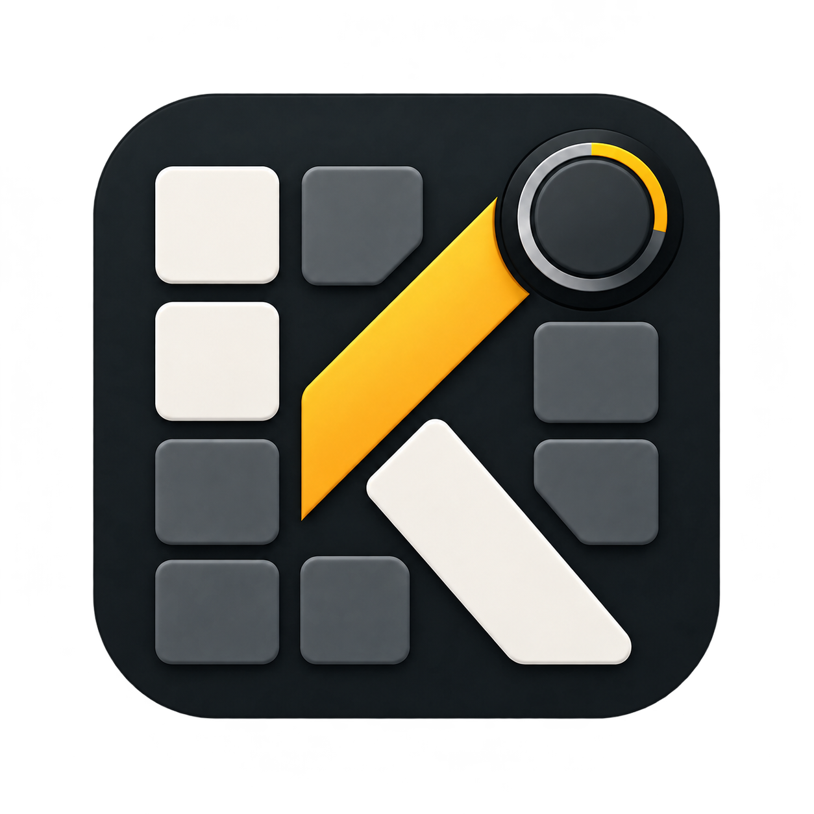

Русский перевод: [AK Configurator](docs/ru/README.md).

# AK Configurator

AK Configurator adapts [Entropy](https://github.com/ergohaven/entropy) for the wired AK820. The native desktop application is being prepared for its first public alpha, `0.1.0-alpha.1`. It targets the published AK820 firmware `v0.6.0-beta.3`, with ten exact profiles: Main, Game, Mmo, Typing, Code, Pointer, Onehand, Creative, Shortcuts and Multios. Browser support is a later stage.

The editor provides profile-aware key and encoder mappings, six layers, macros, Combo, typed settings and Russian/English help. It retains Entropy's menus and key picker. Offline projects let users explore and edit all ten profile examples without connecting a keyboard.

Lighting controls include built-in effects, individual-key palettes, local scenes, music visualization through bundled CAVA 1.0.0 and optional local OpenRGB SDK 0/1 input. Main, Game, Mmo and Creative support Direct. Beta.3 adds palette readback, atomic full-frame RAM commit and explicit restoration of the prior Direct palette. A separate `direct-ram.json` file saves and restores volatile colors; it is not a backup of persistent keyboard settings.

Native workflows also cover complete settings backups, guarded restore/reset, firmware installation, local OEM recovery and an optional OS layout helper. Public firmware inputs are bundled for offline preparation. OEM ROM and recovery data stay local. Editing and installation depend on the exact verified image and settings contract, not a profile name alone.

## Documentation

- [Installation and updating](docs/INSTALL.md): download, checksums, launch, per-user installation and replacement of earlier development builds.
- [Desktop guide](docs/DESKTOP.md): controls, backups, restoration, installation and platform limits.
- [MCP diagnostic preview](docs/MCP.md): optional agent diagnostics, synthetic checks and native offline GUI testing.
- [Current status](docs/STATUS.md) and [verification report](docs/REVIEW.md): completed checks and remaining qualification.
- [Requirements](docs/REQUIREMENTS.md) and [implementation plan](docs/PLAN.md): supported scope and delivery gates.
- [RGB plan](docs/RGB-PLAN.md) and [audio components](docs/THIRD-PARTY-AUDIO.md): protocol, source lifecycle, platform capture and redistribution details.
- [Changelog](CHANGELOG.md): current candidate and retained project history.

This is an unpublished alpha candidate. Source/host checks, native platform execution and physical keyboard behavior are recorded separately; an offline pass does not establish flashing, retention or LED output. The six unsigned CI candidates passed packaged runtime and installation checks; signing, publication and hardware qualification remain open. Exact beta.2 images and backups retain separate compatibility rules. Offline project format v2 pins the release, catalog and Intel HEX; beta.1 v1 projects need deliberate manual migration.

Firmware source and releases remain in [dvino/ak820](https://github.com/dvino/ak820). This repository contains the configurator. Entropy history, copyright notices and the imported GPL-3.0-or-later license are preserved; see [LICENSE](LICENSE). Third-party notices continue to apply to their respective files.
