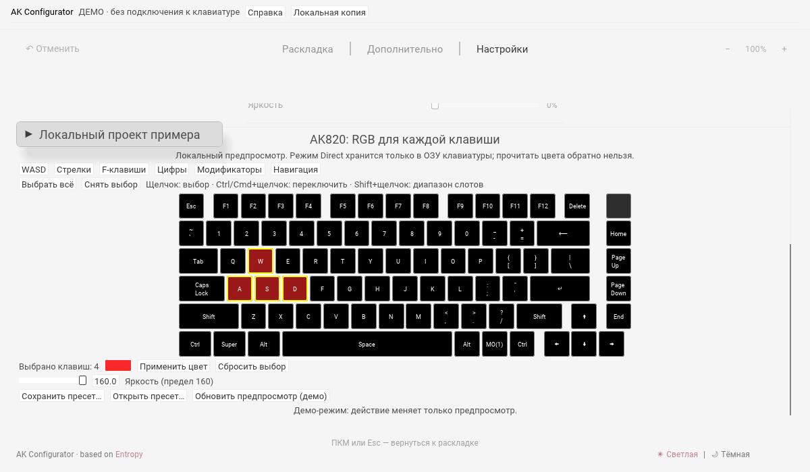

Русский перевод: [AK Configurator](docs/ru/README.md).

# AK Configurator

AK Configurator adapts [Entropy](https://github.com/ergohaven/entropy) for the wired AK820. The current beta2 source contract supports ten exact v0.6.0-beta.2 profile images: Main, Game, Mmo, Typing, Code, Pointer, Onehand, Creative, Shortcuts and Multios. Browser support remains a later stage.

The desktop application supports per-image key and encoder mappings, macros, Combo, typed settings and RGB controls. Beta2 settings writes are enabled only after the complete packed-image identity and every required setting have been checked. The RGB palette editor is available only for Main, Game, Mmo and Creative. Music visualization reuses bundled CAVA, with optional local OpenRGB SDK input and explicit previous built-in effect restoration. See [desktop scope and limits](docs/DESKTOP.md), [installation and development](docs/INSTALL.md), [requirements](docs/REQUIREMENTS.md), [implementation plan](docs/PLAN.md), [RGB plan](docs/RGB-PLAN.md) and [current status](docs/STATUS.md).

Native workflows also cover complete backups, guarded restoration and reset, firmware installation, provenance-bound OEM recovery, and an optional OS layout helper. The ten public linked firmware inputs are bundled for local preparation; private OEM data stays on the computer. Implementation and physical qualification are reported separately.

The offline project format is version 2 and pins its target release, profile catalog and Intel HEX image. Version 1 beta1 projects require explicit manual migration. A release catalog entry or linked CODE hash alone does not establish a supported device image.

Firmware source and releases remain in [dvino/ak820](https://github.com/dvino/ak820). This repository contains the configurator, not a copy of the firmware tree. Entropy source history and copyright notices are preserved. The imported project declares GPL-3.0-or-later; see [LICENSE](LICENSE). Third-party notices continue to apply to their respective files.

This is beta2 release preparation, not a fully qualified first release. Physical behavior, complete backup/history/restoration, installer execution, target-platform runtime and signing remain qualification work. Current verification and limits are recorded in [status](docs/STATUS.md) and [review](docs/REVIEW.md).

