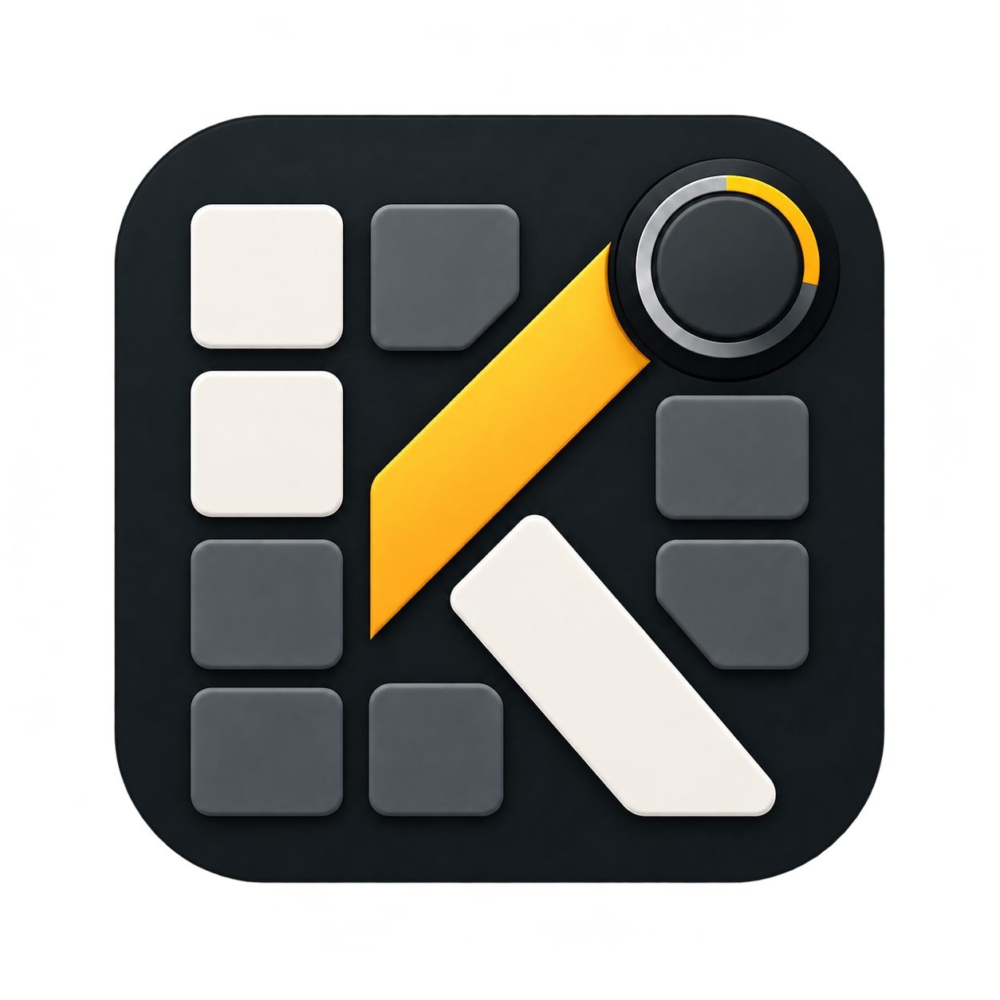

Русский перевод: [AK Configurator](docs/ru/README.md).

# AK Configurator

AK Configurator adapts [Entropy](https://github.com/ergohaven/entropy) for the wired AK820. The current work prepares the first Windows alpha, `0.1.0-alpha.1`, with x86_64 and ARM64 package/CI paths. Runtime checks cover the x86_64 executable; actual ARM64 execution remains unverified. This is a local candidate: no application release or download has been published. Linux and macOS builds are outside this milestone; the broader six-target release requirement remains open.

The candidate pins the published AK820 firmware `v0.6.0-beta.5` and its ten exact profiles: Main, Game, Mmo, Typing, Code, Pointer, Onehand, Creative, Shortcuts and Multios. The installer keeps Beta3 compatibility checks, but Beta3 is not an installation target. Beta5 is the default and requires explicit prerelease opt-in. Hardware validation and saved-settings writes remain disabled.

The native application includes an optional read-only MCP diagnostic interface. It can inspect bounded metadata and prepare a local installation preview; it does not expose a settings writer, restore executor or firmware flash operation. MCP use is separately enabled by the user. The x86_64 release executable passed isolated GUI and metadata-only MCP checks. The integrated Windows suite, strict lint and formatting passed. An unsigned native GUI setup passed isolated install, same-version reinstall and uninstall checks; the final signed setup and release package remain pending.

The application can display and edit offline profile examples without connecting a keyboard. This does not establish complete keyboard configuration or physical support. The current alpha has not passed the full integrated regression and independent review gates. No physical keyboard operation was performed.

## Documentation

- [Installation](docs/INSTALL.md): current Windows candidate status, local build and package checks.
- [Desktop guide](docs/DESKTOP.md): application controls and current platform/device limits.
- [MCP guide](docs/MCP.md): optional diagnostics, synthetic checks and access boundaries.
- [Current status](docs/STATUS.md) and [review record](docs/REVIEW.md): evidence and remaining gates.
- [Requirements](docs/REQUIREMENTS.md) and [plan](docs/PLAN.md): project scope and delivery gates.
- [Changelog](CHANGELOG.md): user-visible changes and limits.

Firmware sources and releases remain in [dvino/ak820](https://github.com/dvino/ak820). OEM ROM and recovery material stay local. This repository preserves Entropy history, copyright notices and the GPL-3.0-or-later license; see [LICENSE](LICENSE).
