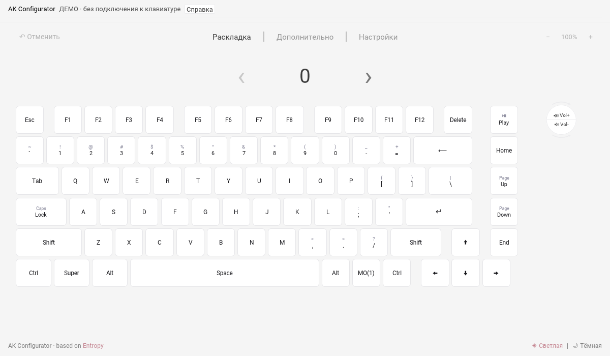

Русский перевод: [AK Configurator](docs/ru/README.md).

# AK Configurator

AK Configurator adapts [Entropy](https://github.com/ergohaven/entropy) for
the wired AK820. The first milestone is a native desktop configurator for the
verified full permanent firmware v0.6.0-alpha.3. Browser support is a later
stage and is not part of this alpha.

The desktop editor covers supported key and encoder mappings, macros, Combo,
and lighting. See [desktop scope and limits](docs/DESKTOP.md),
[installation and development](docs/INSTALL.md), [requirements](docs/REQUIREMENTS.md),
[implementation plan](docs/PLAN.md), and [current status](docs/STATUS.md).

Firmware source and releases remain in [dvino/ak820](https://github.com/dvino/ak820).
This repository contains the configurator, not a copy of the firmware tree.
Entropy source history and copyright notices are preserved. The imported
project declares GPL-3.0-or-later; see [LICENSE](LICENSE). Third-party notices
continue to apply to their respective files.

