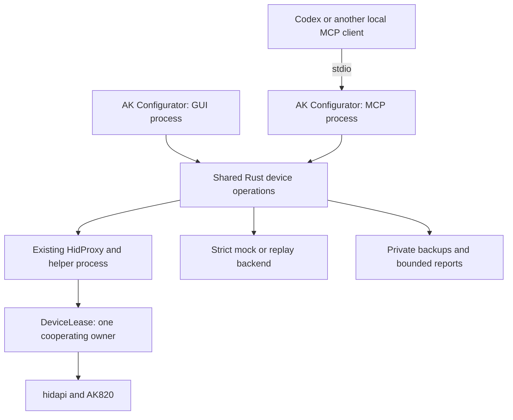
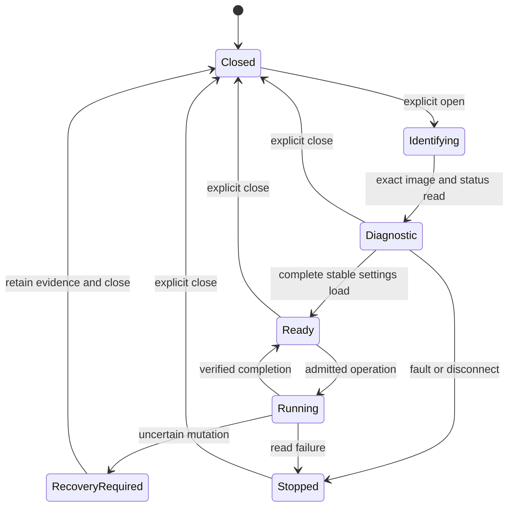

Русский перевод: [План интеграции MCP](ru/MCP_IMPLEMENTATION_PLAN.md).

# MCP integration plan

> Implementation update: the original audit below is retained as the plan baseline. A partial, optional read-only P0 preview now exists; see [MCP.md](MCP.md) for implemented commands and limits and [REVIEW.md](REVIEW.md) for actual verification. The remaining planned API is not available yet.

## 1. Decision, scope and audited versions

**Status: proposed implementation plan, not an implemented MCP interface.**
Prepared on 2026-10-27. This change adds documentation only. No application or
firmware source, dependency, build configuration or release profile is changed.
No keyboard commands, builds or hardware tests were run for this audit.

The recommended first implementation is a **separate headless process launched
from the existing executable**, `ak-configurator --mcp-stdio`, using the official
Rust MCP SDK. It calls the existing Rust device services and the existing HID
helper. It does not start the GUI, background indicator, audio capture or OpenRGB
bridge. A second executable and a general-purpose core library are not P0
prerequisites. There is no MCP network listener.

| Input | Immutable audit baseline |
| --- | --- |
| Configurator | `desktop-dev`, commit [`f8a31854bae916d1b07f24bdcf5dde1d00fdbdce`](https://github.com/dvino/ak-configurator/tree/f8a31854bae916d1b07f24bdcf5dde1d00fdbdce), application version `0.1.0-alpha.1` |
| Firmware | [`v0.6.0-beta.3`](https://github.com/dvino/ak820/tree/v0.6.0-beta.3), annotated tag object `4cabae9af9bb68492a8cf079c59f8b388c5cf788`, commit `88d190abb156960915a0f1f8ac7f602bb401eab3` |
| Scope and delivery rules | [REQUIREMENTS.md](REQUIREMENTS.md), [PLAN.md](PLAN.md), [STATUS.md](STATUS.md), [AGENTS.md](../AGENTS.md), [agent routing](AGENT-ROUTING.md) |
| MCP SDK candidate | Official `rmcp` release `3.8.0`; release and tagged manifests checked on 2026-10-27. Lock the selected version before implementation; do not follow its moving Git branch. [S01], [S02] |

The working branch was checked against GitHub before the audit. Findings below
refer to these commits even if `desktop-dev` subsequently changes. References
at the end link to immutable source files and important functions.

**Useful MVP:** an agent can launch the server without a display, enumerate an
AK820, open a read-only diagnostic session, distinguish an exact known image
from an unknown one, read storage/USB status, run a bounded diagnostic suite,
and obtain a structured report and sanitized exchange trace. The same workflow
runs against a strict mock in CI. It cannot change settings, unlock, reset,
enter the loader or flash. This already shortens diagnosis of recognition,
transport, malformed-response and storage problems.

MCP controls the same domain operations as the application. It does not inspect
widgets, click the GUI, synthesize keyboard presses or become a general shell,
file server or arbitrary HID command endpoint.

## 2. Audit of the existing code

### 2.1 Reusable components and their actual boundaries

| Area | Existing implementation | Consequence for MCP |
| --- | --- | --- |
| Startup | `main()` dispatches self-check and private HID helper modes before normal GUI startup. Headless export and an opted-in background helper already exist. The crate currently has one binary and no library target. [C01], [C02] | Add an early MCP mode; retain private helper dispatch. No eframe event loop is necessary for MCP. Existing GUI dependencies remain build/link dependencies in P0. |
| Enumeration | `DeviceManager::scan_usb_devices`, device instance tokens, `Device::permits_hid_target` and physical-device matching. [C03] | Reuse USB-only discovery. Return opaque candidate IDs tied to the current enumeration, not arbitrary client-supplied HID paths. |
| Transport | `HidDevice::open_fresh_for` opens a `HidProxy`; the proxy launches the same executable in a private mode and serializes requests to the actual HID handle. [C04], [C05] | Use this path, including its timeout/reaping behavior. Do not open a second raw HID connection from MCP. |
| Ownership | `DeviceLease::acquire` is held by the actual helper. Unix uses a fixed-directory protected lock file and `flock`; Windows uses a named kernel object. [C06] | GUI and MCP can run simultaneously, but only one may own a given keyboard. A busy owner is reported; MCP never forces a handoff. Third-party programs do not necessarily honor this cooperative guard. |
| Read-only policy | `enforce_read_only_hid` sets a process-global irreversible `OnceLock`; `ReadOnlyHidSession::send` checks `is_read_request` before transport. [C04], [C07] | Suitable for the default read-only process. Never try to upgrade that process to write access. The allowlist is a host setter guard, not proof that firmware cannot flush existing dirty storage. |
| Image recognition | `parse_manifest`, `identify_image`, `ImageContract`, `contract_for_hash`, and `verify_ak820_firmware` bind the manifest to the complete packed CODE hash and catalog. [C08], [C09] | Reuse exact identity checks. UID, schema, release title and profile name are insufficient. Readiness to edit is a separate state. |
| Connection loading | `load_ak820` / `load_verified_ak820` validate the definition, matrix, counts, keymap, encoders, macros, dynamic tables and typed extensions, compare getters with NVM, reread NVM, then call `ak820_enable_settings`. [C10] | P1 must extract this sequence into a GUI-neutral service, retaining every check. Calling `verify_ak820_firmware` alone must never enable writes. |
| Settings | Typed methods in `hid_keymap`, `hid_macros`, `hid_dynamic` and `hid_settings`; `ak820_send_or_passthrough`, `typed_candidate`, `ak820_verify_write` enforce AK820 restrictions and readback. [C11], [C12], [C13], [C14], [C09] | MCP supplies typed arguments and calls these methods. Preserve source-specific keycode validation, unsupported-feature rejection and latched failure. |
| Catalog and codecs | `ak820_beta1_profiles.rs` now contains beta.3 contracts despite its historical filename. `ak820_typed_storage` validates settings/CRC/table records; `ak820_settings_model` interprets NVM. [C15], [C16], [C17] | Share these exact contracts. Do not create a second capability matrix or infer capabilities from storage capacity. |
| Direct and RGB | `ak820_rgb/direct.rs` provides negotiated snapshots, generation checks, atomic upload and readback. `HidDevice` wraps them with image/session/owner checks; `FrameScheduler` limits dispatch. [C18], [C09], [C19] | A Direct write is RAM-only. It is distinct from mode selection and RGB save. Reuse the scheduler for scenes, not one MCP call per animation frame. |
| Backups | `ak820_capture_backup`, `CapturedBackup`, strict archive parsing, validation, private publication and rereading already exist. [C09], [C20], [C21], [C22] | Reuse the backup format and filesystem protections. A partial `.entlayout` export is not a complete safety backup. |
| Restore/reset | `plan_restore`, `plan_factory_reset`, `RestorePlan`, `PreparedRestore::run`, `ak820_restore_backup`. Plans bind exact source/target identities and expected NVM; execution requires fresh physical confirmation and final reconciliation. [C23], [C24], [C25] | Expose preview before execution. Do not add a raw reset command. Generic full restore is not the cleanup primitive for unattended tests. |
| Installation | `PreparedInstallation::prepare/execute`, `InstallIo`, `HidDevice::ak820_prepare_install/ak820_execute_install`, `InstallUsb`, loader state ordering and release admission. [C26], [C27], [C28], [C29] | P2 wraps the current one-attempt transaction. No independent MCP flasher, Python runtime dependency or looser image admission. |
| Diagnostics | `DiagnosticsLogger` writes stderr and optional local logs; existing HID tracing mainly describes inherited display commands. Log rotation happens when opening a log, not continuously. [C30], [C04] | Stderr is usable, but existing logs are neither a complete AK820 exchange recorder nor a bounded sanitized report. Add a small structured recorder. |
| Offline tests | `TestHidRecorder`, scripted responders/faults, AK820 fake constructors, Direct `Fake`, ownership and GUI worker cancellation tests. [C04], [C09], [C18], [C06], [C31] | Reuse fixtures and production parsers. The current fake backend is `cfg(test)` and sometimes falls back to canned replies; it is not yet a strict runtime mock server. |
| CI | `desktop-dev.yml` already builds six native targets, runs Linux tests, platform ownership/filesystem tests, package self-checks and install smoke tests. [C32] | Add focused MCP checks to those jobs. Do not reproduce the firmware build matrix in configurator CI. |

### 2.2 Firmware identity and protocol limits

The application uses VID/PID `320F:505B` and Raw HID usage page/usage
`FF60:0061`. Factory firmware can share VID/PID; matching them alone does not
authorize a project protocol. Raw reports are 32 bytes excluding the HID report
ID. The Vial UID on the wire is `04 70 FF 90 01 B9 15 D3`; its little-endian
Rust integer is `0xD315B90190FF7004`. VIA protocol is 9 and Vial protocol is 6.
Interfaces must be found from descriptors/usages, not a hard-coded OS interface
number. [C08], [F01], [F02]

The current shape is six layers, a 16×8 sparse matrix with 83 physical
positions, one encoder with two directions, 16 macros with an 8192-byte logical
buffer, eight Combos, and 82 LEDs. There are 498 physical key assignments and
12 encoder-direction assignments. The encoder press belongs to the physical
matrix and has no LED. Stored encoder order and wire direction order differ;
reuse existing mapping code. The 8192-byte macro view is not permission to
overwrite 8192 arbitrary NVM bytes. [C10], [C11], [F02]

The source supports ten release profiles: `main`, `game`, `mmo`, `typing`,
`code`, `pointer`, `onehand`, `creative`, `shortcuts`, `multios`. Direct v1 is
present in `main`, `game`, `mmo`, `creative`. Optional QMK Settings, Tap Dance,
Key Overrides and other actions follow the exact image contract. For example,
beta.3 Main and Typing have Auto Shift QSID 4; beta.2 Main must not acquire that
capability through MCP. Beta.3 permits Caps Word as a Combo result and the
supported `LT(layer0..5, MC0..15)` action only in its allowed source context.
[C15], [C08], [F03]

### 2.3 Read-only does not mean that all getters are side-effect-free

This is the main safety finding of the audit. In beta.3,
`ak820_usb_raw_send()` unconditionally calls `ak820_nvm_flush()`. Normal
VIA/Vial requests run inside `ak820_nvm_begin()` / `ak820_nvm_end()`.
`raw_request_is_nonpersistent()` controls reply admission after storage faults;
it does not eliminate that flush. An ordinary getter can therefore flush an
already dirty cache. [F04]

`FD00` CODE reads and `FD01` status bypass NVM batching and flushing in the
audited firmware. `FD01` must follow exact recognition because historical
firmware did not all implement the same safe dispatch. The current Rust
`verify_ak820_firmware()` starts with ordinary protocol/UID getters before CODE
recognition; an MCP adapter must not claim strict diagnostic bootstrap by
calling it unchanged. [F04], [F05], [C09]

The P0 service must factor its identity logic into one shared implementation
with this order:

1. Enumerate a project Raw HID candidate and acquire its existing helper lease.
2. Read the 64-byte manifest at `0xEF80` and hash packed CODE
   `[0x2800,0xC700)` through bounded `FD00` requests; check both against
   `ImageContract`. No generic arbitrary-address MCP tool is exposed.
3. For a recognized beta.3 image, decode `FD01` and require clean/nonfaulted
   storage, zero batch depth and no unlock operation before normal getters.
4. Only then check VIA/Vial identity and any requested ordinary read groups.
   Guard those groups with status checks; stop on dirty/busy/faulted status.
5. Keep diagnostic-only and fully loaded settings sessions distinct. Unknown
   images receive an identity failure and no guessed `FD01`, setters or unlock.

Recognition reads about 40 KiB in at most 27-byte chunks, so it is an explicit
operation with progress and a deadline, not work performed during MCP startup.
Do not invent a fast version getter: the release/profile is derived from the
verified catalog match and reported with that provenance. A manifest by itself
is only an unverified claim.

No host policy can stop unrelated physical key actions or another uncooperative
program from changing firmware state. Reports distinguish `setters_sent: 0`
from an observed unchanged NVM snapshot. They do not claim that no firmware
instruction could have programmed flash during the observation interval.

### 2.4 Diagnostics already available

| Facility | What it establishes | Limits and integration work |
| --- | --- | --- |
| `FD00` | Exact CODE/NVM bytes, direct readback independent of the NVM cache | Max 27 bytes per request; keep full ROM/OEM bytes private. Existing Rust reader is reusable. [C09], [F04] |
| `FD01 v1` | Failure latch, cache validity/dirty flag, batch depth, cached page, first failure stage, last IAP attempt, unlock state, USB enumeration/sleep/raw state | Snapshot of RAM and last attempt; no history, stack measurement or durable-write proof. Add a typed diagnostic decoder using the existing documented byte map, not a copy of UI error strings. [F05] |
| `AKBT v1` EP0 feature report | Boot stage and advancing main-loop heartbeat even when the Raw main-loop path is stuck | Already in firmware/Python runner, absent as a typed normal Rust operation. Add a fixed GET_FEATURE operation to the existing helper in P1; do not expose the install feature-report API. Correct hidapi buffer length is nine bytes including report ID 0. [F06], [F02], [C27] |
| Vial matrix getter | A sampled state of matrix rows | Require validated unlocked status before sampling and stop if unlock is lost. The locked firmware may leave the reply untouched; a zero-looking reply is not an all-keys-released observation. Absence of pressed keys is not a switch test, and polling can miss edges. Do not auto-unlock. [C14], [F07] |
| Direct v1 | Coherent 82-color RAM snapshot and generation, accepted full-frame commit, conversion/publication status | GET may expire an unfinished RAM upload; successful commit does not prove LED output, enable lighting or persist colors. [C18], [F08] |
| Existing host logs | Application failures and timing at selected call sites | May include private paths; not automatically safe for an agent transcript or an issue attachment. [C30] |

### 2.5 Existing guarantees must not be weakened

`ak820_editing_ready()` requires a complete load and no latched error. The
session gate serializes a setter with its ACK, getter and storage checks;
typed extension setters also compare the complete expected NVM, including
adjacent bytes. Unchanged effective typed defaults avoid materializing blank
storage. AK820 transport uses one attempt; do not add MCP retries around it.
The existing Direct snapshot algorithm allows at most three complete read
attempts (two restarts) on generation races; it stops on transport errors or malformed
replies. This bounded consistency algorithm is distinct from retrying failed
packet exchanges or uncertain mutations. [C09], [C04], [C18]

Backup restore/reset creates and rereads a safety backup and uses a fresh
three-second Esc + left Control hold. A pre-existing unlock does not satisfy
that confirmation. The generic restore executor therefore cannot be silently
used in `finally` after every unattended test. Existing live tests instead
use narrow, preplanned inverse setters and stop before restoration if state
is uncertain. [C25], [F09]

Some source comments retain historical names such as “beta1” or “beta2”. The
audit follows `ImageContract`, exact hashes and current branches in the code,
not those labels. Firmware qualification reports and published catalog entries
do not establish behavior of an attached keyboard. [C08], [C15], [F03]

## 3. Architecture choice

### 3.1 Alternatives

| Variant | Reuse and cost | Headless operation / stability | Decision |
| --- | --- | --- | --- |
| MCP inside the running GUI event loop | Direct access to GUI state, but couples requests to eframe lifecycle, background tasks and UI queues | Requires GUI; cancellation and blocking HID can affect it | Reject for the first integration |
| Same executable, separate `--mcp-stdio` process | Same Rust functions and existing self-spawned HID helper; small startup/service adapter | Works without GUI; faults are process-local. GUI dependencies still compile and ship | **Recommended for P0–P2** |
| Separate `ak-configurator-mcp` executable with a shared Rust library | Good long-term separation; requires moving the current binary module graph, app-owned DTOs and helper startup contracts | Can eventually reduce headless package dependencies; introduces packaging and refactor work now | Revisit after P1 if there is a measured need |
| Python/TypeScript MCP sidecar | Official SDKs exist, but Rust calls need new IPC/FFI or duplicated device logic | Additional runtime/distribution and synchronization burden | Use only as external test clients, not the production server |
| Resident broker / HTTP MCP service | Could arbitrate simultaneous GUI and agent operations | Adds lifecycle, authentication and network/service maintenance | No demonstrated requirement; out of scope |

The recommendation is an embedded server **entry point**, not a server sharing
the GUI process. The client launches a new OS process. Two process instances
have separate Rust state; the existing helper-held device lease arbitrates
their access. This deliberately returns `DEVICE_BUSY` when the GUI owns the
keyboard. Controlling an already running GUI session would require a later
broker design and is not promised by this plan.

### 3.2 Component relationship



“Shared” means the same implementation compiled into both entry points, not
shared mutable memory. The mock is selected before device discovery and has no
path to the real backend.

### 3.3 SDK and dependency policy

Use official `rmcp`, serde DTOs and schemars-generated input/output schemas.
The audited `rmcp-v3.8.0` manifests provide `server`, `macros`, `transport-io`
and `transport-async-rw` features. Its MSRV is 1.88; existing desktop CI selects
Rust 1.97.0. [S08], [C32] A candidate configuration, to be compiled and locked in P0, is:

```toml
# Proposed only; not a change to Cargo.toml in this work package.
rmcp = { version = "=3.8.0", optional = true, default-features = false, features = ["server", "macros", "transport-io"] }
tokio = { version = "1", optional = true, features = ["rt", "io-std", "time", "sync", "macros"] }
schemars = { version = "1", optional = true }
```

Use a project `mcp` feature, initially disabled in the normal alpha build.
`serde`, `serde_json`, `sha2`, error handling and native HID dependencies are
already present. Tokio and schemars are absent from the audited lockfile and would be new dependencies. SDK transitive
dependencies are real costs: record lockfile changes and cold/warm build times.
Do not enable HTTP, OAuth, sampling, elicitation or client features in the
shipped server without a concrete use. `transport-io` may enable Tokio networking
internally; that does not require opening a socket. Check dependency licenses
and preserve existing notices. [C01], [S01], [S02]

The current SDK supports MCP 2026-07-28 and earlier clients. Let it handle
version negotiation, legacy initialization, modern request metadata, framing,
tool discovery and standard cancellation. Test both protocol eras; do not
implement JSON-RPC or MCP version negotiation locally. `structuredContent`
has a matching output schema and a serialized JSON text fallback. Tool
annotations help clients present risk; they do not enforce authorization.
[S01], [S03], [S04], [S09]

MCP Tasks now have a separate extension and client support must be established.
P0 does not depend on it. A small domain operation record is needed anyway to
retain hardware ownership after cancellation. `ak820_operation` exposes this
record; it is not a general durable job scheduler. A future Tasks adapter may
wrap that same record without changing device execution. [S05]

### 3.4 Startup and shared service boundaries

Preserve `--self-check` and the private `--entropy-hid-proxy` /
`--ak820-install-proxy` dispatch. Detect `--mcp-stdio` after private helper
dispatch and before reading GUI preferences, taking the GUI single-instance
lock, initializing a renderer or starting optional integrations. Parse the MCP
startup arguments strictly; unknown arguments fail without opening USB.
Reject mutually exclusive entry-point flags rather than silently choosing one.
[C02], [C05]

Proposed files, introduced incrementally:

| File / module | Responsibility | First stage |
| --- | --- | --- |
| `src/mcp/mod.rs`, `server.rs` | Startup, rmcp handlers, fixed tool/resource registration, stdout discipline | P0 |
| `src/mcp/dto.rs`, `policy.rs` | Typed schemas, limits, startup access scopes, safe error mapping | P0 |
| `src/ak820_service.rs` | One session owner, diagnostic identification, serialized operations, generation and cancellation | P0; full settings load in P1 |
| `src/ak820_diagnostics.rs` | FD01 parsing, evidence DTOs; fixed AKBT operation later | P0/P1 |
| `src/ak820_trace.rs` | Bounded exchange recorder and redaction | P0 |
| `src/ak820_test_runner.rs` | Named scenarios, assertions, reports; conditional compensation later | P0/P1 |
| `src/mcp/test_backend.rs` | Strict scripted/replay adapter behind explicit development feature | P0 |
| `src/ak820_settings_service.rs` | Extracted complete loader and shared typed changes used by GUI and MCP | P1 |
| `src/ak820_operation_policy.rs` | Immutable mutation plans, safety snapshots and one-shot approval records | P1/P2 |

These are responsibilities, not a demand for one large file per row. Keep tiny
modules together until a separation is useful. No public crate API or general
plugin framework is needed.

P0 may reference the existing `app::ak820_beta1_profiles` namespace without
instantiating `EntropyApp`. In P1, promote the pure catalog module to the crate
root and keep a temporary re-export if that simplifies the extracted loader.
Move only the needed data DTOs out of `app_state` / UI modules. Do not move
unrelated Entropy code or rewrite offline project formats. [C15], [C10], [C33]

Run synchronous device operations in one bounded worker, not on the async MCP
dispatcher. Use the existing helper/proxy; pass cancellation/progress through
the existing atomic patterns. Do not hold a service mutex over an `.await` or
launch unbounded `spawn_blocking` tasks. P0 supports one active device session
per server process and one active device operation; independent read-only
metadata and operation-status requests remain responsive. Concurrent device
requests return `OPERATION_BUSY` instead of accumulating a queue.

## 4. Device state, authority and failure handling

### 4.1 Session and operation state

A `device_session_id` is an application handle, independent of MCP transport
sessions or protocol revision. It binds a process nonce, selected candidate,
OS instance token, resolved USB port, exact image observation and a monotonically
increasing generation. No session or plan survives reconnect by implication.
Serial-less devices cannot be identified durably from VID/PID alone.



Identity may be known while storage is faulted; report that as stopped
diagnostics, not a successful ready session. `session.status` and
`operation.status` read cached host state and never send recovery traffic.
Fresh device diagnosis requires an explicit new action. A stopped state cannot
be cleared by a setter, retry counter or fake successful read.

Operations retain the owner until their worker and helper have finished.
Cancellation means “stop at the next safe boundary”, not “release the handle
now”. EOF requests cancellation and bounded cleanup. A killed process or power
loss can leave changes; a persistent recovery record must describe that
possibility, not mark it restored. A device-session generation change invalidates
all plans and prevents stale worker results from updating current state.
[C05], [C31]

### 4.2 Access levels

| Level | Permission | Default |
| --- | --- | --- |
| R | Enumeration, known diagnostic reads, typed reads, offline validation/tests | Enabled |
| L | Write bounded reports/backups to an application-owned local directory | Enabled for requested capture/report actions; never arbitrary paths |
| S | Ordinary supported settings changes and bounded RAM RGB changes | Disabled; explicit startup policy required |
| T | Named modifying test plus its exact inverse changes | Disabled; separate scope and write budget; not implied by S |
| D | Full settings restore/reset and firmware update | Disabled; exact one-shot local approval, additional existing physical confirmation where applicable |

The default `--mcp-access=read-only` calls the existing irreversible host
read-only guard before opening a handle. A write-enabled process is a separate
explicit launch, with narrower immutable scopes in its startup policy; no MCP
tool changes that policy. Neither `confirm: true`, a natural-language claim,
tool annotations nor a successful plan grant write authority.

For S/T, a user-configured scope specifies allowed operation kinds, optional
profile/device restrictions and maximum test changes. The agent can prepare
and execute operations within that delegation. It cannot change an image,
unlock, reset or restore a full backup merely because S/T is enabled.

For D, P1/P2 adds a small local confirmation entry point
`ak-configurator --mcp-approve-plan <plan-file>`. It displays the exact summary
on an interactive terminal or the existing confirmation UI and requires a
fresh human action. It writes a private, expiring, single-use grant bound to
the running server nonce, operation kind, plan digest, device generation,
source/target identity and artifact hashes. There is no approval MCP tool.
The server consumes the grant before the first mutating command and rechecks
all pins. An expired/changed plan needs a new approval. Reuse
`PreparedInstallation::confirmation_pin` and existing restore checks instead
of designing a second image-confirmation algorithm. [C24], [C25], [C26]

This confirmation channel prevents accidental MCP-only authorization. It is
**not a security boundary against an agent or program with unrestricted code
execution as the same OS user**. File permissions, stdio and tokens cannot
provide that guarantee. Such deployments require MCP-client/sandbox policy as
well. A fresh firmware-observed physical hold remains necessary for current
project-firmware restore/update paths; MCP never simulates it.

Initial P2 supports project beta.3 update transitions only. OEM first install
and OEM rollback remain in the existing application workflow until their
distinct identity and confirmation paths are separately qualified. They are
not automatically admitted by a generic `flash` plan.

### 4.3 Restoration rules for changing tests

Before the first setter: capture and privately publish the complete validated
baseline, reread it, save an operation journal, and validate every forward and
inverse change against the exact image. A backup publication failure sends
zero setters. For a run with several small tests, one stable full baseline is
retained, and each step also records its expected NVM and acknowledged progress.

Compensation is allowed only after successful ACK/readback, clean storage,
unchanged identity/owner and an exact match to the expected intermediate state.
It is part of the originally authorized T plan. Each inverse setter is checked
in the same way as a forward setter. Final success requires the original NVM
bytes and relevant runtime values to match; expected generation/counter changes
are reported separately.

On a timeout, malformed reply, mismatch, storage fault or disconnect: stop,
retain `restore_pending`, baseline and trace, mark `recovery_required`, and
send no automatic restore, abort, unlock, reset or retry. After a controlled
cancel between verified steps, compensation may finish only while these same
health conditions still hold. If the worker cannot establish a clean boundary,
the result is recovery-required. A later recovery is a new observed plan and
explicit authorization. This matches the current live-test rule. [F09], [C25]

Not every logically reversible setting is byte-reversible: blank/default typed
records may become materialized, and saved RGB state is different from live
mode. A test is admitted only if the shared storage model proves its inverse
returns the original bytes. Otherwise it is skipped before mutation. Do not
weaken a complete-backup restore's physical confirmation to make tests pass.

## 5. Proposed MCP API

### 5.1 Common contract

Nine tools cover the complete planned surface. P0 registers six:
`ak820_devices`, `ak820_session`, `ak820_read`, `ak820_tests`, `ak820_trace`,
`ak820_operation`. P1 adds backup, prepare and execute. Unimplemented actions
are absent from the compiled schema. Device feature absence is reported in
capabilities and as `UNSUPPORTED_FEATURE`; the tools list does not change when
a keyboard connects or a session changes. Policy is fixed at process startup.

Every input rejects unknown fields and out-of-range integers. Mutation targets
come from typed enums and catalog IDs. No tool accepts raw HID bytes, memory
addresses, shell commands, arbitrary executable names, unrestricted URLs or
unrestricted filesystem paths. A tool does not automatically run a compiler,
CI job or firmware installer script.

Every `structuredContent` object follows `ak820-mcp-result-1`:

| Field | Contract |
| --- | --- |
| `format`, `request_id` | Schema version and server-generated correlation ID |
| `status` | `ok`, `accepted`, `blocked`, `failed`, `cancelled`, `recovery_required` |
| `backend`, `evidence` | `hid` / `mock` / `replay`; `device_protocol` / `host_model` / `replay_model` / `offline_validation`. These are never inferred from a successful test name. |
| `device_session_id`, `session_generation` | Present for a selected session; immutable binding for this result |
| `image` | Verified identity and catalog provenance, or null/unverified status; separate IHX, linked CODE, packed CODE and full-ROM identities |
| `data` | Tool-specific typed result described below |
| `verification` | Checks actually performed, `setters_sent`, `nvm_readback`, `physical_behavior_validated`, exclusions and skipped checks |
| `artifacts` | Opaque IDs, kind, size, digest and privacy-safe resource URI when readable; no automatic OEM/backup contents |
| `error` | Null or `{code, message, stage, retryable:false, recovery_required, details}`; messages exclude raw private paths and payloads |

All operation failures set MCP `isError=true`; accepted asynchronous work is
not success. Standard malformed MCP requests use the SDK's JSON-RPC errors;
device, policy, validation and test failures return structured tool errors.
For compatibility, return the same bounded JSON as a text content block.
Full test reports are artifacts, not truncated success summaries. [S04]

`physical_behavior_validated` defaults to false, including real readback tests.
If a future instrument-backed suite supplies evidence, its physical claims
must enumerate exactly what was measured.

Common errors are shared by all applicable tools:

| Codes | Meaning / action |
| --- | --- |
| `INVALID_ARGUMENT`, `LIMIT_EXCEEDED` | Schema/range/size violation; no USB work |
| `DEVICE_NOT_FOUND`, `DEVICE_AMBIGUOUS`, `DEVICE_BUSY`, `ACCESS_DENIED` | Selection/ownership/OS permission failure; no auto-elevation, driver install or forced close |
| `SESSION_STALE`, `SESSION_STOPPED`, `OPERATION_BUSY` | Re-enumerate or explicitly open a fresh session; no implicit reconnect |
| `UNKNOWN_IMAGE`, `IMAGE_MISMATCH`, `UNSUPPORTED_FEATURE`, `NOT_READY`, `UNLOCK_REQUIRED` | Exact contract/readiness precondition missing; no speculative fallback |
| `TIMEOUT`, `DISCONNECTED`, `MALFORMED_REPLY`, `READBACK_MISMATCH`, `STORAGE_FAULT`, `STORAGE_BUSY` | Stop current device work; after a possible mutation retain recovery evidence |
| `READ_ONLY`, `AUTHORIZATION_REQUIRED`, `PLAN_STALE`, `PLAN_EXPIRED`, `PLAN_CONSUMED` | Policy/plan failure; prepare or authorize explicitly |
| `BACKUP_INVALID`, `BACKUP_INCOMPATIBLE`, `BACKUP_SAVE_FAILED`, `INPUT_CHANGED`, `IMAGE_REVOKED` | Invalid or changed inputs; never proceed with a weaker check |
| `CANCELLED`, `RECOVERY_REQUIRED`, `TRACE_LIMIT`, `REPLAY_MISMATCH` | Explicit terminal or diagnostic state; never disguise it as PASS |

### 5.2 Tool specifications

#### `ak820_devices` — USB candidates

- **Arguments:** `{refresh?: bool=false}`. Startup backend is immutable. Mock
  mode returns only configured fixture devices.
- **Result `data`:** `{devices:[{device_id, label, vid, pid, usage_page, usage,
  connection_state, identity_status}], enumeration_generation}`. Labels and
  IDs omit raw serials/OS paths by default. Enumeration does not recognize
  firmware and does not open all candidates.
- **Errors:** common selection/OS/limit errors. Empty inventory is an ordinary
  result, not an unknown-device assertion.
- **Limits/access:** R; max 32 reported candidates, with an explicit overflow
  indication. No automatic choice among multiple devices. Reuse [C03].

#### `ak820_session` — open, inspect or release an owner

- **Arguments:** tagged union: `{"action":"open","device_id":ID,
  "load":"diagnostics"|"settings"}`; `{"action":"status",
  "device_session_id":ID}`; `{"action":"close","device_session_id":ID}`.
  P0 only accepts diagnostic load. Opening performs the safe sequence in §2.3.
- **Result `data`:** open returns an operation ID immediately, then its terminal
  result contains session ID, image status, allowed operations and capabilities;
  status returns cached state/progress; close returns `closed` or
  `closing_pending_operation`.
- **Errors:** `DEVICE_BUSY`, `UNKNOWN_IMAGE`, storage/transport errors and stale
  IDs. A faulted session can report already acquired diagnostic information
  while remaining stopped; it cannot be labeled ready.
- **Limits/access:** R, one active session. Close never kills an active mutation
  to free the keyboard. No implicit GUI handoff or global instance-lock bypass.

#### `ak820_read` — typed observations

- **Arguments:** `{device_session_id, section, selector?, include_values?:false}`.
  `section` is `identity|capabilities|storage|connection` in P0; P1 adds
  `keymap|encoders|macros|combos|qmk_settings|tap_dance|key_overrides|rgb|direct|matrix|boot_liveness`.
  `selector` is a section-specific schema: e.g. one layer or bounded slots,
  advertised QSID IDs, or `samples`/`interval_ms` for matrix/liveness. Never a
  generic JSON path into application state.
- **Result `data`:** exact typed values, dimensions/ranges, source, `state_revision`
  and observation timestamp. All action-bearing values (keymap, encoders,
  macros, Combos, Tap Dance and Key Overrides) require both
  `include_values:true` and the startup sensitive-settings exposure scope.
  Otherwise return dimensions, occupied-slot/length metadata and a revision
  digest. The same policy covers diffs and report expected/observed values.
  `capabilities` includes advertised vs verified support, active
  QSIDs, counts, supported RGB modes and planned-operation availability.
  Macro output defaults to slot lengths and hashes; content requires both
  `include_values:true` and the startup sensitive-settings exposure scope.
  Matrix returns timestamped samples plus `edges_may_be_missed:true`.
- **Errors:** `UNSUPPORTED_FEATURE`, `UNLOCK_REQUIRED`, readiness, storage and
  transport errors. Do not substitute defaults for a failed live read.
- **Limits/access:** R; settings reads require the P1 validated load. Keymap
  max one 83-position layer per page; macros max one selected slot per content
  read. Matrix max 100 samples, interval at least 20 ms, total at most 5 s;
  polling frequency is a host limit, not a measured keyboard scan rate.
  Boot liveness follows the existing bounded five-second reference check.
  Matrix sampling requires validated unlocked status before and throughout
  sampling; stop if validated unlocked status is lost or replies are invalid, without treating zero bytes
  as proof of released keys. No automatic unlock. Reuse [C10]–[C18], [F02], [F06], [F07].

#### `ak820_trace` — bounded host exchange capture

- **Arguments:** start `{action:"start",device_session_id,
  mode:"metadata"|"payload",max_bytes?:8388608,max_seconds?:60}`;
  stop/status `{action:"stop"|"status",trace_id}`.
- **Result `data`:** `{trace_id, state, records, bytes, dropped,
  replayable, artifact_id?}`. Metadata includes opcode/subcommand, direction,
  length, elapsed monotonic time, operation ID and sanitized result code.
- **Errors:** invalid limits, stopped session, local I/O failure;
  reaching a trace cap closes capture and records truncation. If a test requires
  complete tracing, it stops at the next safe boundary, not midway through
  an uncancellable flash step.
- **Limits/access:** R+L; payload capture needs an explicit startup sensitive
  trace scope and a separate request. One trace/session, max 8 MiB or 60 s by
  default, configurable hard ceiling 32 MiB/300 s outside MCP. OEM/recovery
  ranges are never exported through MCP. Default traces are not replayable.
  Timing is host-observed request latency, not USB bus timing. See §7.

#### `ak820_tests` — list and run registered scenarios

- **Arguments:** `{action:"list"}` or `{action:"run",device_session_id?,
  suite_id, parameters?, seed?:0}`. The schema for `parameters` belongs to the
  registered suite. Hardware suites require a session; mock/replay selection
  is fixed at startup. P0 supports `protocol.smoke` and failure fixtures.
- **Result `data`:** list returns versioned suite definitions with evidence
  level, capabilities, write budget and physical requirements; run returns
  `operation_id`, then a result with PASS/FAIL/SKIP/BLOCKED per check, report ID
  and restoration status. A report with skipped required checks cannot be
  reported as full acceptance.
- **Errors:** unsupported suite/parameters, missing capabilities and common
  device errors; failed assertions are structured failures with observations.
- **Limits/access:** R+L for direct execution. A modifying suite returns
  `AUTHORIZATION_REQUIRED` with guidance to use `ak820_prepare(kind:"test")`;
  no `allow_write:true` argument. No user-supplied code, arbitrary packets,
  automatic flashing, external process or unbounded fuzzing. Scenario limits
  and initially one iteration are enforced by the runner.

#### `ak820_backup` — capture, import and validate

- **Arguments:** `{"action":"create","device_session_id":ID,
  "include_direct_ram":false|true}` or `{"action":"validate",
  "source_ref":ID,"target_profile"?:ID}`. `source_ref` is a registered input
  under a launch-configured directory or a prior artifact, not a path/URL.
- **Result `data`:** backup ID, manifest hash, format/schema, source image,
  per-file integrity results, Direct-sidecar availability and compatibility
  reasons. Validation distinguishes integrity, recognized provenance and
  source-to-target compatibility; a hash alone is not trusted provenance.
  It never restores anything.
- **Errors:** backup invalid/incompatible/save failed, unstable source,
  missing private inputs and common transport errors.
- **Limits/access:** R+L; P1. Reuse the existing strict archive size/count and
  filesystem limits, keep private full-ROM/OEM data local, and return metadata
  only. `direct-ram.json` is a separately observed volatile snapshot, not proof
  of simultaneous RAM/NVM capture. Reuse [C20]–[C23].

#### `ak820_prepare` — validate an immutable change

- **Arguments:** `{device_session_id, kind, request, expected_revision}`.
  `kind` is `settings|rgb|test|restore|reset` in P1; P2 adds `flash`.
  `request` is a discriminated typed union described in §5.3.
  `expected_revision` is a previously observed opaque NVM/runtime fingerprint,
  not the server's current value guessed by the caller.
- **Result `data`:** `{plan_id, plan_sha256, expires_at, change_summary,
  required_scopes, requires_local_approval, physical_confirmation,
  predicted_nvm_effect, write_budget, reversible, blocked_reasons}` plus a
  readable plan resource. No setter, unlock, reset or loader transition occurs.
  Preparation can read state and stage validated local files; flash preparation
  must stage every required byte before approval.
- **Errors:** validation/capability/identity/compatibility failures and local
  staging failures. An incompatible plan has no executable plan ID.
- **Limits/access:** R+L; no write authority is implied. Max 32 distinct typed
  changes per ordinary settings plan, one Direct frame, one registered test or
  one restore/reset/flash operation. Plans expire after five minutes and are
  invalidated by session/state changes. Expiry is rechecked before mutation.

#### `ak820_execute` — execute one admitted plan

- **Arguments:** `{plan_id, plan_sha256}` only. No replacement payload,
  destination, force flag, inline consent or bypass field.
- **Result `data`:** accepted operation ID, then final result containing exact
  applied/verified counts, before/after fingerprints, safety backup ID,
  restoration status and any `restore_pending`. Success is reported only after
  the plan's required readbacks. Firmware result and settings result remain
  separate fields.
- **Errors:** read-only/scope/approval failure, stale/expired/consumed plan,
  changed source and all relevant device errors. After a possible mutation,
  uncertainty returns recovery-required instead of an ordinary retryable error.
- **Limits/access:** S, T or D as determined by the immutable plan. Revalidate
  source bytes, target, storage and expected state immediately before execution.
  One execution claim is journaled before a setter; a repeated call returns the
  existing operation record or `PLAN_CONSUMED`, never a second attempt. For all
  clients this tool is conservatively marked non-read-only/destructive.

#### `ak820_operation` — status and cooperative cancellation

- **Arguments:** `{action:"status"|"cancel",operation_id}`.
- **Result `data`:** operation kind, state, stage, progress counts,
  `cancellable_now`, `cancel_requested`, `loader_transition_attempted`,
  observed device mode, terminal result/report reference and
  whether the device lease is still held. `cancel` acknowledges the request,
  not rollback or immediate completion.
- **Errors:** unknown operation or invalid action; status never retries HID.
- **Limits/access:** R for status; cancellation is allowed for that process's
  own operation but may result in authorized compensation. Mark the combined
  tool conservatively non-read-only for client presentation. Retain at most
  32 recent operation summaries in memory; persist required recovery records.
  Before the loader transition, cancellation retains the application. After
  transition but before erase, cancellation or loader-Identity failure may
  leave the keyboard in its loader: report that state separately from firmware
  outcome `NotAttempted` and require a new authorized recovery decision. Do not
  automatically send Restart. Once erase starts, retain ownership and honor
  the existing executor's bounded one-attempt policy instead of killing it on
  RPC timeout. [C26], [C27]

### 5.3 Typed changes and limits

All values below are proposed public DTOs; validation remains in the shared
domain code. Each union branch has `additionalProperties:false`.

| Change kind | Fields and checks | Existing execution / oracle |
| --- | --- | --- |
| `key` | `layer:0..5,row:0..15,col:0..7,keycode:0..65535`; coordinate must be in `MATRIX_MASK`, action assignable for Matrix | `set_keycode`, getter, expected NVM mapping |
| `encoder` | `layer:0..5,index:0,direction:"cw"` or `"ccw",keycode`; source restriction applies | `set_encoder`, mapping codec, getter/NVM |
| `macro` | `slot:0..15,actions:[...]`; tagged action schema below, existing byte encoding and logical buffer limits | Existing macro codec and `write_macros`; full affected storage oracle and unlock preconditions required. No raw macro byte upload in public API. |
| `combo` | `slot:0..7,triggers:[u16,u16],output:u16` or explicit empty entry; two distinct ordinary keys and profile-supported output | `valid_combo`, `set_combo`, compact storage codec |
| `qmk_setting` | `id` must be queried and allowed by exact contract; typed `value` | `QmkSettings`, `set_qmk_setting_u8/u16`; IDs 1,2,4,7,18,19 exist in storage but only active IDs are exposed |
| `tap_dance` | `slot:0..7,on_tap:u16,on_hold:u16,on_double_tap:u16,on_tap_hold:u16,tapping_term_ms:0..32767` | `TapDance::encode`, `set_tap_dance`; outputs follow the existing source-aware validator, all-zero record is empty; absent module is unavailable |
| `key_override` | `slot:0..7,trigger:u16,replacement:u16,layers:u16,mods:u8,negative_mods:u8,suppressed_mods:u8,options:u8` | `KeyOverride::encode`, `set_key_override`; nonempty entry requires trigger `0x04..0xA4`, valid replacement, layer mask `1..63`, option bit 6 clear and at least one of bits 0–2 set; all-zero record is empty |
| `rgb_mode` | Catalog mode, speed/hue/saturation byte, value `0..160`, explicit boolean `persist` | `set_vialrgb_mode`; separate `save_rgb` only when requested and verified |
| `direct_frame` | Exactly 82 HSV8 triples, V `0..160`, expected generation; no implicit mode/enable/save change | `direct::commit` / checked wrapper; complete readback and post-commit status |
| `os_indicator` | Existing supported mode, bounded lease/duration, exact `os-indicators` capability | Existing FD02 setter; optional P1 extension after its getter and lease observation are available |
| `test` | Registered suite ID, typed parameters, approved target slots and write budget | Same scenario runner and typed setters as direct configuration |
| `restore` / `reset` | Registered validated backup reference or exact profile defaults | Existing `RestorePlan`, `PreparedRestore`, fresh physical confirmation |
| `flash` | Exact local/bundled release/profile/image references, prerelease opt-in, explicit preserve/defaults choice | `ReleaseAdmission`, existing packer, prepared installation and executor |

Macro actions are a tagged union: `{type:"text",value:string}`,
`{type:"tap",keycode:u16}`, `{type:"down",keycode:u16}`,
`{type:"up",keycode:u16}` or `{type:"delay",milliseconds:0..65024}`.
The existing AK820 codec accepts text bytes `0x02..0x7F`; NUL, the command-prefix
byte and non-ASCII text are rejected. Key actions must pass the exact profile's
macro-source assignment validator. Preserve other slots, include all sixteen
terminators and reject an encoded logical stream above 8192 bytes before any
write; do not truncate, wrap delays or offer a `raw` branch. Existing unlock
status is a precondition, never an implicit MCP unlock action. [C12], [C33]

QSID ranges come from `QmkSettings`: ID 1 is `0..15`; IDs 2, 4 and 7 are
`1..1000`; IDs 18 and 19 are `0..100`. This storage list does not grant access
to an inactive setting. Tap Dance and Key Override use the exact codec's
keycode predicates and profile/module checks in addition to JSON integer
ranges. P1.2 must freeze generated schemas and golden requests for every
admitted union branch; unfinished branches remain absent from the public
schema. [C13], [C16]

Reject V above 160 in the public API rather than silently changing the requested
value; existing lower-level clamping remains defensive. H/S still allow the
full byte range. Do not feed HSV through the RGB8 scheduler's per-channel bound
without its existing conversion. Six layers or eight storage slots do not imply
every action/module is enabled. [C16], [C18], [C19]

A whole settings batch is not atomic. Prevalidate all changes, compute the
expected state using shared codecs, execute in a deterministic order and stop
at the first failed step. Report the acknowledged subset. Never promise atomic
configuration rollback on this firmware. Direct's complete RAM frame is a
separate, genuinely transactional protocol with different failure semantics.

### 5.4 Resources and artifact privacy

Use standard MCP resources rather than adding file-download tools:

- `ak820://server`: application/SDK/API versions, active backend, immutable
  policy summary, limits, audited contract identities and supported suites.
- `ak820://catalog/{catalog_hash}`: public profile/capability/schema metadata.
- `ak820://plan/{plan_id}`: immutable, sanitized operation summary and digest.
- `ak820://report/{report_id}`: structured final evidence, pagination metadata.
- `ak820://trace/{trace_id}/page/{page}`: permitted bounded trace pages.
- `ak820://inputs`: metadata for explicitly configured local input references.

Resource reads are local and read-only; they do not refresh a device or execute
a plan. Only artifact IDs registered by this process resolve. A readable page
is at most 64 KiB. Paths, serials, full ROM, recovery data and complete backup
payloads are not made agent-readable by publishing a metadata resource. All
action assignments, including macros, Combos, Tap Dance and Key Overrides,
are opt-in sensitive data. Without the startup exposure scope and explicit
value request, summaries, diffs and reports provide counts/revision digests
instead of their values. Arbitrary file URIs, symlinks outside the configured input root and
automatic upload endpoints are rejected.

### 5.5 Examples

These are illustrative **tool arguments and application result bodies**, not
claims about a connected keyboard. The SDK supplies the MCP envelope, negotiated
version metadata and, where applicable, `resultType`. IDs below are examples.

```json
{"name":"ak820_devices","arguments":{"refresh":true}}
```

```json
{"name":"ak820_session","arguments":{"action":"open","device_id":"dev-1","load":"diagnostics"}}
```

```json
{
  "format":"ak820-mcp-result-1",
  "request_id":"req-2",
  "status":"accepted",
  "backend":"hid",
  "evidence":"device_protocol",
  "image":null,
  "data":{"operation_id":"op-1","stage":"reading_code"},
  "verification":{"setters_sent":0,"physical_behavior_validated":false},
  "artifacts":[],
  "error":null
}
```

After completion, use the returned session ID; do not treat acceptance as
successful identity verification.

```json
{"name":"ak820_read","arguments":{"device_session_id":"session-1","section":"storage"}}
```

```json
{
  "format":"ak820-mcp-result-1",
  "request_id":"req-4",
  "status":"ok",
  "backend":"hid",
  "evidence":"device_protocol",
  "device_session_id":"session-1",
  "session_generation":1,
  "image":{"status":"verified","release":"v0.6.0-beta.3","profile":"main","identity_ref":"identity-1"},
  "data":{"protocol":"FD01-v1","storage_failed":false,"page_dirty":false,"batch_depth":0,"failure_stage":0},
  "verification":{"checks":["exact_image","fd01_signature","reserved_bytes"],"setters_sent":0,"nvm_readback":"not_requested","physical_behavior_validated":false},
  "artifacts":[],
  "error":null
}
```

The real identity object/resource contains full hashes; this shortened example
uses an identity reference to avoid inventing a device hash.

```json
{"name":"ak820_prepare","arguments":{"device_session_id":"session-2","kind":"settings","expected_revision":"state-17","request":{"changes":[{"kind":"key","layer":0,"row":0,"col":0,"keycode":4}]}}}
```

```json
{
  "plan_id":"plan-3",
  "plan_sha256":"0123456789abcdef0123456789abcdef0123456789abcdef0123456789abcdef",
  "required_scopes":["settings"],
  "requires_local_approval":false,
  "physical_confirmation":"none_for_this_admitted_change",
  "write_budget":{"max_forward_setters":1,"max_inverse_setters":0},
  "change_summary":[{"kind":"key","layer":0,"row":0,"col":0,"to":4}],
  "reversible":true,
  "blocked_reasons":[]
}
```

This last block is the tool-specific `data` only. Its digest is visibly an
example, not an approval token. Execution in the default process is denied:

```json
{"name":"ak820_execute","arguments":{"plan_id":"plan-3","plan_sha256":"0123456789abcdef0123456789abcdef0123456789abcdef0123456789abcdef"}}
```

```json
{
  "code":"READ_ONLY",
  "message":"This process has no settings write scope",
  "stage":"authorization",
  "retryable":false,
  "recovery_required":false,
  "details":{"setters_sent":0}
}
```

Example read-only test and later status query:

```json
{"name":"ak820_tests","arguments":{"action":"run","device_session_id":"session-1","suite_id":"protocol.smoke","seed":0}}
```

```json
{"name":"ak820_operation","arguments":{"action":"status","operation_id":"op-5"}}
```

Example Codex configuration, **after P0 is implemented and packaged**, using an
absolute installed executable path appropriate to the machine:

```toml
[mcp_servers.ak820]
command = "/absolute/path/to/ak-configurator"
args = ["--mcp-stdio", "--mcp-access=read-only"]
startup_timeout_sec = 10
tool_timeout_sec = 120
```

On Windows use a TOML literal string such as
`command = 'C:\Tools\AK-Configurator\ak-configurator.exe'`.
The 120-second value is an initial client allowance, not a promised hardware
duration; operation handles keep individual control calls short. The actual
Windows subsystem/piped-stdio launch must pass P0 qualification. The official
MCP Inspector can launch the same command for interactive/CLI checks; pin its
development version when adding an automated invocation. Neither Node nor
Inspector ships as an application runtime dependency. [S06], [S07]

## 6. Automatic testing architecture

### 6.1 Three independent evidence levels

| Level | Inputs and execution | Objective checks | Cannot establish |
| --- | --- | --- | --- |
| Offline host/model | Existing Rust tests, strict stateful mock, recorded replay, public fixtures, production-C and emitted-code tests in firmware repository | Protocol/schema bounds, parsing, request order, read-only gates, exact-image mismatches, modeled NVM, Direct generation/state, fail-stop, cleanup bookkeeping | Physical switch/encoder/LED behavior, actual HID driver behavior or installed firmware |
| Real AK820 protocol | Explicit selected owner, verified image, controlled reads or authorized typed changes | Actual replies, descriptor/identity, CODE/NVM bytes, getter agreement, readback, storage status, Direct logical RAM, transport disconnect behavior | Real keypress generation merely from remapping, visual RGB output, worst-case IRQ/scan latency, survival of power loss |
| Controlled hardware / instruments | Physical actuation, USB capture, logic analyzer, optional measured diagnostic image | Selected switch/encoder events, host reports, physical timing, LED scan/power behavior and specifically designed retention experiments | Untested profiles/conditions; a diagnostic-image result does not qualify an uninstrumented release |

`PASS` always names its level and exact inputs. A mock image cannot claim an
installed packed-image match, even when its public metadata names beta.3. A
report from a real keyboard does not automatically set all physical checks to
passed.

### 6.2 Offline backend and replay

Promote only the necessary existing fake-transport seam behind
`cfg(any(test, feature="mcp-test-backend"))`; keep that feature out of release
packages. Reuse `TestHidRecorder` response hooks and Direct `Fake`, but make the
runtime test adapter **strict**: an unscripted request fails instead of falling
back to a zero-filled success. `--mcp-backend=mock|replay` is accepted only in
such a development build. It never enumerates USB, loads live ownership paths
or falls back to hardware. [C04], [C18]

Share a small deterministic clock interface where timing is under test. A
script can inject disconnect, timeout, wrong opcode, bad echo, short report,
invalid reserved byte, stale identity, dirty storage and generation wrap.
Short/long HID reports must be tested below the fixed `[u8;32]` domain boundary;
an array-only fake cannot test framing length rejection. Reuse existing
transport decoder tests for that layer.

Replay consumes request/reply/error records in sequence and rejects extra,
missing or mismatched requests. It replays data, not code or commands against
USB. Timestamps drive a virtual clock; a seed is recorded for generated cases.
Replay verifies the recorded case only. It does not become a stateful device
emulator unless the stateful mock explicitly models that behavior.

Default redacted traces cannot support exact replay. Fixtures must be public
synthetic data, or explicitly approved private payload recordings retained
locally. Never commit a live full-ROM, personal macro or recovery snapshot as
a convenience fixture. Store fixture schema, origin, firmware/runner hashes
and `synthetic:true` where applicable. Use the Python reference as an
independent byte/error oracle in CI, not as a runtime service or by blindly
copying its device runner. [F02], [F09]

### 6.3 Concrete suite inventory

| Suite | Backend / stage | Required assertions and limits |
| --- | --- | --- |
| `protocol.smoke` | mock/replay/HID, P0 | Explicit selection, recognized image or honest unknown status, FD01 format and health, standard identity only after safe bootstrap, no setters; unsupported/unavailable checks are explicit |
| `protocol.errors` | mock/replay only, P0 | Unknown image, wrong report/echo/length, timeout, disconnect, dirty/faulted NVM, stale session, helper crash; no next mutation or implicit retry |
| `mcp.contract` | offline, P0 | Legacy and modern MCP discovery, schemas, output schema/error mapping, stdout purity, limits, cancellation/EOF, no USB opens in mock mode |
| `ownership` | offline/platform, P0 | Two cooperating processes contend, lease survives cancellation until helper finishes, crash releases only after owner exit; GUI instance env setting cannot defeat device lease |
| `settings.readback` | mock/HID, P1 | All 498 mapped positions and 12 encoder directions against NVM; macros' logical view; tables, active QSIDs, definition and storage stability. Paginated MCP output is not reduced test coverage. |
| `matrix.observation` | mock/HID, P1 | Validate unlock before/during bounded sampling; locked and relocked fixtures cannot pass as all keys released; physical actuation is separate and no automatic unlock is attempted |
| `settings.roundtrip` | mock or explicit T/HID, P1 | One preselected reversible key first; expand to six layers/two encoder directions only after byte-exact restoration. No sweep of all cells by default. Budget forward/inverse setters and page writes. |
| `extensions.roundtrip` | mock or T/HID, P1 | Supported QSID/Combo/Tap Dance/Key Override change with shared codec oracle, neighbor bytes and CRC; blank records or inaccessible originals skip before mutation |
| `macros.integrity` | offline + read-only HID, P1 | Encoding/terminators, source-aware action limits and getter/storage agreement; arbitrary live macro writes remain blocked until full snapshot/inverse/oracle and existing unlock preconditions are met |
| `rgb.builtin` | mock or T/HID, P1 | Mode/color/speed/brightness readback and original mode restoration. Persistent save is separate, with a proven saved-config oracle, and is not silently included. |
| `rgb.direct` | mock or T/HID, P1 | Capability negotiation, 82-color coherent read, one generation race then success, exhaustion after three raced attempts, timeout without restart, full-frame commit/status/readback, original palette and mode restored, NVM unchanged; report visible-state flags separately |
| `backup.integrity` | offline/HID capture, P1 | Complete archive, duplicate/unknown/missing fields, hash/CRC/size/path bounds, incompatible source/target transitions, changed file after preview |
| `reproduction` | strict mock/replay; typed HID subset, P1 | Run bounded versioned steps, same pinned state/input identities, deterministic seed and explicit expected errors; cannot encode raw packets or loops on real hardware |
| `boot.liveness` | mock/HID, P1 | Fixed AKBT GET_FEATURE samples, correct signature/stage/flags and advancing heartbeat; no reset when heartbeat stalls |
| `firmware.preflight` | offline + selected read-only HID, P2 | Exact release assets, profile, model/revision, source/target/packed-image identities, preserved regions, settings transition, recovery inputs and approval summary; no loader transition |
| `firmware.update` | mock or explicit D/HID, P2 | Existing fresh-confirmation, one-attempt flash/readback, separate settings and device-mode outcomes; mock cancellation before transition, after transition/before erase, and after erase; loader-Identity failure; live update never part of default CI or normal regression |
| `hardware.observation` | controlled fixture, P2 optional | Named physical inputs/outputs and instrument evidence; unattended software-only invocations report SKIP/BLOCKED for missing actuation |

Live invalid packet fuzzing, repeated failed writes, forced unplug/power cut and
automatic reset are outside ordinary suites. Boundary/error cases run offline;
hardware uses known supported operations and a small explicit write budget.
The existing Python live suite currently skips macro writes and durable RGB
save for concrete readiness/oracle reasons. MCP must close those reasons before
claiming those tests, not relabel a skipped reference test as coverage. [F09]

### 6.4 Reproduction format and reports

Use a small declarative `ak820-scenario-1` file: exact contract requirements,
allowed backend, required scope, step limit, seed, typed action list, assertions,
expected errors, restoration policy and write budget. Supported steps call the
same service methods as tools. No Python/JavaScript/shell, arbitrary waits,
infinite loops or packet injection in user-supplied hardware scenarios.

Example offline case, intentionally small:

```json
{
  "format":"ak820-scenario-1",
  "backend":"mock",
  "fixture":"beta3-main-clean",
  "seed":0,
  "max_steps":3,
  "steps":[
    {"action":"read","section":"storage","expect":{"page_dirty":false}},
    {"action":"inject_fault","fault":"timeout_on_next_request"},
    {"action":"read","section":"storage","expect_error":"TIMEOUT"}
  ],
  "assertions":{"setters_sent":0,"automatic_retries":0}
}
```

`inject_fault` is available only in the strict development backend. The hardware
scenario parser rejects that action before opening a device.

The final JSON report includes application commit/version, API/SDK/fixture
versions, firmware tag plus observed exact image hashes, OS/architecture/HID
backend, capabilities, scenario hash/seed, start/end times, checks with expected
and observed values (redacted under the same sensitive-settings policy),
transport counts, timeouts, skipped reasons, before/after
NVM digests, Direct generation/status, safety-backup metadata and
`restore_pending`. Report wall-clock time separately from monotonic durations.
Private device identity and payloads stay in local private evidence.

JSON is the canonical report. Generate a short JUnit XML projection for CI from
that result if useful; do not maintain two independent assertion engines.
Re-running a scenario always creates a fresh operation and preflight; an old
report or trace never grants authority.

## 7. Bounded data, cancellation and platform behavior

Initial limits are product policy to be measured in P0/P1, not firmware claims:
64 KiB maximum MCP request/result page, 32 ordinary changes per plan, one active
device operation, one trace/session, 8 MiB/60 s default trace, 32 recent operation
summaries, at most 100 scenario steps. Macros fit through a separate bounded
typed input branch; existing archive/project parsers retain their tighter
limits. Reject oversized frames before allocating or decoding their contents,
using SDK transport limits if available; otherwise add only a bounded I/O
wrapper around the SDK codec, not a second JSON-RPC implementation.

Stop trace collection at its cap and record how many records were lost.
Continuous rotation must occur on writes if a rolling trace is supported;
the existing logger's rotation-on-open is not a hard session cap. Default
trace storage records metadata only. Raw payloads can contain keymaps, macros
or ROM data. A redaction pass must not pretend the resulting file remains a
faithful packet replay. [C30]

Use private application directories and existing Unix/Windows secure archive
publication helpers. Add quotas for new MCP reports/traces (initial total
128 MiB, with explicit configurable retention). When the quota is full, refuse
new work that requires a safety record. Never prune a safety/OEM backup or a
pending recovery record to make space. Ordinary finalized reports may be
rotated under the explicit retention policy. No automatic diagnostics upload.

MCP stdout contains only SDK protocol messages. Application/SDK logs go to
stderr. The HID child retains its existing separate internal stdout channel;
do not mix it with MCP framing. On Windows, verify inherited standard handles
with the current `windows_subsystem="windows"` build, including Unicode and
space-containing paths, EOF and child cleanup. If it cannot pass, introduce a
small console launcher that calls the same server entry point; do not rewrite
the HID stack. This is a bounded contingency with a clear P0 go/no-go test.
[C02], [C05], [S03]

Do not elevate privileges or install udev rules from an MCP tool. Return the
existing Linux/Windows access error with actionable guidance. Windows/Linux
are the first MCP qualification targets. Existing six-platform GUI release
support is preserved; macOS MCP remains explicitly unqualified until its
helper main-thread initialization and pipe lifecycle tests pass.

## 8. Firmware changes and hardware diagnostics

### 8.1 No firmware change is needed for P0/P1

FD00/FD01, standard getters, Direct v1 and AKBT already supply useful observation
on beta.3. Most work is in the configurator: safe bootstrap order, typed FD01
decoding, fixed AKBT helper support, shared loading/validation, MCP schemas,
reports and tests. A stricter firmware no-flush getter path would be a separate
change with its own image qualification, not a hidden requirement of MCP.

Existing firmware host tests execute production C, while emitted-code/uCsim
suites test actual linked SDCC paths with modeled matrix, time, MMIO and IRQ
conditions. `tools/test_keyboard.py`, diagnostic emitted tests and
`tools/ak820_runtime_safety.py` already organize that evidence. Reuse them to investigate
Combos, Mod-Tap, startup and interrupt contracts before adding telemetry.
[F10], [F11], [F12]

### 8.2 What physical evidence requires

Writing a Combo or Mod-Tap keycode and reading it back proves configuration,
not actuation semantics. Host-side key injection does not traverse AK820's
switch matrix. A sampled matrix read can miss transitions. A heartbeat proves
main-loop progress, not a bound on scan latency. A Direct ACK/HSV snapshot does
not prove color, LED mapping, DMA timing or actual scan-boundary publication.

Physical tests need controlled presses/encoder turns or a fixture that closes
contacts, plus an independent observer of resulting host HID reports. A logic
analyzer/USB capture or other suitable measurement is needed for timing claims;
power interruption and restart tests need a dedicated safe fixture and explicit
authorization. USBPcap/Wireshark on Windows and usbmon/Wireshark on Linux are
possible external capture tools; verify their local access/setup separately.
They are not MCP runtime dependencies, and neither a host timestamp nor a USB
capture alone measures matrix electrical timing.

Default automated suites require no manual keys, encoder rotation, reconnect
or unlock. Checks requiring these actions are separately named and skipped
with reasons when the fixture is absent. An agent can coordinate such a test;
it cannot create missing physical evidence in software.

### 8.3 Optional minimal diagnostic interface

Only add a diagnostic image after a reproducible bug cannot be resolved by
existing readback, host/emitted-code tests and external capture. Keep all ten
release profile definitions and their artifacts unchanged.

Proposed experimental ABI, to be assigned an unused opcode only after collision
review:

- Fixed `DIAG_CAPS` read: signature/version, build/config digest, supported
  counters/events, record size, snapshot rules and overflow behavior.
- Fixed `DIAG_STATUS` read: main-loop/scan progress counters, selected event
  counters and dropped-record count. Reads do not clear counters or flush NVM.
- Optional bounded `DIAG_EVENTS` read using a sequence number, not a destructive
  pop. Events contain only selected matrix coordinates/action IDs, compact
  timestamps and cause flags. Do not record text, macros or arbitrary RAM.
- If arming/clearing is needed, provide a separate explicit RAM-only control
  with its own scope. Keep counters always readable without an “ack” write.
  Do not add synthetic-key injection or arbitrary memory access.

Start with counters, not a ring buffer. For example, eight 16-bit counters
alone consume 16 bytes; eight 8-byte events consume another 64 bytes before
indices, timestamp and protocol scratch. These are arithmetic lower bounds,
not a compiled size estimate. Interrupt snapshots need a measured bounded
critical section; 16-bit reads on this 8051 must not be assumed atomic.
Do not add logging/USB sends inside an ISR. Any stack-watermark scheme requires
proof that it does not overwrite live stack or alter the tested startup path.

The retained beta.3 resource measurements are:

| Profile | CODE bytes | XRAM / 3008 | Stack bound / capacity | Stack margin |
| --- | ---: | ---: | ---: | ---: |
| main | 40466 | 2858 | 160 / 182 | 22 |
| game | 40462 | 2932 | 160 / 177 | 17 |
| mmo | 40343 | 2935 | 164 / 180 | 16 |
| typing | 38720 | 2351 | 160 / 184 | 24 |
| code | 38467 | 2342 | 160 / 184 | 24 |
| pointer | 38902 | 2361 | 160 / 184 | 24 |
| onehand | 38806 | 2388 | 164 / 185 | 21 |
| creative | 39903 | 2869 | 164 / 183 | 19 |
| shortcuts | 38796 | 2405 | 164 / 185 | 21 |
| multios | 38415 | 2335 | 160 / 184 | 24 |

These are retained exact-image reports, not measurements rerun for this plan.
In particular, Game and Mmo have only 76 and 73 bytes of spare XRAM. CODE has
fixed placement windows; subtracting its count from 64 KiB does not measure
usable room. A telemetry design cannot be declared to fit from this table.
[F03], [F13]

A diagnostic build is an additional development-only target, excluded from the
release catalog and normal installer admission. Preserve the modules relevant
to the reproduced fault; if they cannot coexist with instrumentation, state
the changed conditions. Give it a distinct identity and explicit diagnostic
capability. Qualify its exact link/map, foreground/startup/all enabled IRQ
stack bounds and regression fixtures before hardware use. Compare timing with
external measurement to quantify instrumentation effects. Its result cannot
be promoted to acceptance of the release binary. [F12], [F14]

## 9. CI integration and cost controls

Configurator CI is the primary location for MCP protocol, policy, fake-device
and replay checks. The firmware repository remains the owner of CPU/stack/IRQ
qualification. Current firmware CI is in the historically named
`windows-installer.yml`: shared host checks, a ten-profile qualification matrix
and assembly with validated reuse. The manual `firmware-catalog.yml` is a
separate candidate path; it is not the only firmware CI. [C32], [F15], [F16]

Implementation sequence:

1. Add MCP unit tests to the existing Linux test invocation with `--locked` under the
   feature. Keep the default non-MCP build and tests as a regression gate.
2. In Linux x86_64 and Windows x86_64 jobs, run a dev/test-feature subprocess
   smoke against the explicit mock fixture, including EOF/cancellation and
   clean stdout. Build this debug test artifact once with the existing tests;
   it is not a release package. Separately check discovery/catalog/EOF on the
   actual packaged binary without opening hardware, and assert that it rejects
   mock/replay startup flags. When MCP ships, include its production feature in
   the existing release build; do not make a second optimized release or CAVA
   build solely for MCP. Add arm64/macOS checks when MCP is shipped there.
3. Add a dev-only official SDK client test and a small pinned Inspector check
   on one platform for independent interoperability. Neither downloads an SDK
   dynamically during every test. Offline test runs use cached locked inputs.
4. Keep firmware vectors/contract metadata pinned by commit and hashes. A
   contract update job imports public fixtures and records their provenance;
   normal configurator PRs do not fetch/build all firmware profiles.
5. On firmware/protocol changes, run the existing affected host/emitted suites
   and the normal exact-image safety gate in that repository. Configuration
   contract changes then run MCP compatibility fixtures for all ten profiles.
6. Hardware runs are explicit local/self-hosted workflows with no device
   exposed to untrusted PR code. Results and sensitive traces are not uploaded
   automatically. A normal GitHub-hosted PASS never claims keyboard access.

Initial acceptance budget: measure the existing job first, aim for under
60 seconds of additional warm-cache protocol/mock test execution and under
10% extra wall time in the ordinary cached configurator job. These are targets,
not measured estimates. Record cold dependency-build cost separately. If the
budget is exceeded, remove duplicate builds/fixture work or isolate optional
interop checks; do not remove mandatory identity/safety assertions. P0/P1
does not add a firmware compilation job.

## 10. Implementation stages and acceptance

Estimates below are engineering effort for an experienced contributor familiar
with the code, including tests and review. They are planning ranges, not a
promise about calendar duration. Hardware availability and Windows qualification
can add elapsed time. Each stage is independently reviewable and must leave the
normal GUI path working.

### P0 — useful read-only diagnostic MVP

**Dependencies:** current beta.3 contracts and helper/lease, official SDK pin;
no firmware work or P1 RGB release changes.

| Package | Concrete changes | Tests and acceptance | Complexity |
| --- | --- | --- | --- |
| P0.1 Startup/SDK spike | Optional Cargo feature, early `main.rs` dispatch, `src/mcp` adapter, cached server/catalog resources | Actual Windows/Linux executable starts without display/GUI or USB discovery at handshake; valid stdio for both MCP eras; logs only stderr; private helper modes intact | Small, 1–2 days |
| P0.2 Read-only owner | Minimal `ak820_service`, opaque selection/session IDs, shared FD00-first identity factoring in `hid_ak820.rs`, typed FD01 decoder | Exact/unknown/mismatched images, dirty/faulted storage, lease contention, timeout/disconnect; no setter/unlock/reset/loader command reaches transport | Medium, 2–3 days |
| P0.3 Mock, reports and trace | Strict dev-only backend using existing recorder hooks, named smoke/error suites, bounded metadata trace and operation state | Full MCP subprocess path on mock; no USB fallback; replay/model labels; limits/EOF/cancel; no lost lease while helper active; useful JSON failure report | Medium, 2–3 days |

**P0 complete:** six read-only/control tools and public resources work in a
real client; the core end-to-end mock case is repeatable; one authorized
physical read-only run on the exact target is recorded separately when a
keyboard is available. If hardware is unavailable, mark P0 source/CI ready and
hardware unqualified; do not claim complete device acceptance. No full loader
extraction, writes, backup restore or firmware rebuild is needed for this MVP.

### P1 — shared settings and functional tests

**Dependencies:** P0 identity/ownership/fail-stop and schema contracts stable.

| Package | Concrete changes | Tests and acceptance | Complexity |
| --- | --- | --- | --- |
| P1.1 Shared complete loader | Extract data/validation from `ui/ak820_connection.rs` to settings service; move only required catalog/DTO definitions; GUI calls the same loader | Existing connection tests retained; compare old/new observations for every profile; no editing readiness before complete stable read | Medium/high, 3–5 days |
| P1.2 Typed plans and ordinary changes | Shared settings patch/preflight, immutable plans, S policy, safe snapshot/journal; call existing typed setters; freeze generated DTO schemas and golden requests | Readback, capability/source/range rejection, stale state, partial batch, consumed-plan repeat, sensitive-table/report redaction; same behavior through GUI and MCP | High, 3–5 days |
| P1.3 Backups and guarded restore/reset | `ak820_backup`, shared `PreparedRestore` wrapper outside UI, input registry, one-shot local approval channel; reuse restore executor unchanged in safety semantics | Archive golden fixtures, TOCTOU, private-path rules, failed safety save sends no writes, fresh hold required, separate Direct sidecar | Medium/high, 2–4 days |
| P1.4 RGB and diagnostics | Existing Direct/RGB functions, bounded scheduler for named scenes, fixed AKBT helper operation, optional FD02 observation | Direct chunk/generation/wrap/timeout, RAM/NVM distinction, prior state restoration, no unapproved capture/bridge startup, AKBT pipe framing on Windows/Linux | Medium, 2–4 days |
| P1.5 Reversible suites and CI | Port existing narrow roundtrip contracts, public firmware vectors, strict replay/scenarios, report/JUnit projection | All offline error branches; representative real read/write/restore only with T; exact baseline equality; blocked macro/persistent-RGB cases stay explicit; CI budget recorded | Medium/high, 3–5 days |

P1 is complete only for operations that pass their own oracle and scope checks.
There is no requirement to expose every inherited Entropy function. Macro
mutation or persistent RGB save may remain explicitly unsupported until its
specific readiness/readback gap is closed; they must not be counted as tested.
Feature-independent P1 work can run in parallel, but loader, identity and
transaction changes require integrated review.

### P2 — controlled updating and optional hardware work

**Dependencies:** P1 immutable plans, local approval, private backup storage and
stable shared service; physical update qualification is a separate gate.

| Package | Concrete changes | Tests and acceptance | Complexity |
| --- | --- | --- | --- |
| P2.1 Update preflight | Wrap existing release admission, packer and prepared installation; register exact input artifacts | Ten-profile compatibility fixtures; wrong source/target/hash/recovery/revocation/migration blocked before transition; offline execution inputs fully staged | Medium, 2–3 days |
| P2.2 Protected execution | Bind local approval to `confirmation_pin`, reuse install owner/executor, report loader transition independently of firmware/settings outcome | Cancellation before transition, after transition/before erase and after erase; loader-Identity failure; one-attempt behavior, re-enumeration/port binding and full readback; authorized real update qualification per supported OS | High, 3–5 days plus hardware |
| P2.3 Physical observation | Optional fixture/capture adapter with a fixed allowed test manifest | Document exactly what actuation/instruments establish; keep manual/fixture SKIPs distinct from protocol PASS | Variable, 2–5 days for a known fixture |
| P2.4 Diagnostic image, only if justified | Separate development build and minimal negotiated counters/events, not release-profile changes | Measured CODE/XRAM/stack/IRQ budget, diagnostic identity admission, timing impact and exact-image tests; reject if proof incomplete | Research/high, initially 5–10 days; sizing may stop this path |

P2.4 is optional and does not block a useful MCP integration. Do not make it a
condition for P0/P1, merge it into all release profiles or promise its byte cost
before a linked experiment.

## 11. Risks, release impact and experiments

| Risk | Decision / mitigation | Required evidence |
| --- | --- | --- |
| Getter-triggered flush | FD00 identity before FD01; clean storage before normal getters; honest read-only claims | Regression with dirty/faulted firmware model, packet-order assertions |
| Unknown installed profile | Manifest plus full packed CODE/catalog binding; no UID-only promotion | Unknown/changed image fixtures and real readback |
| GUI/service divergence | Extract the existing complete loader and shared validation, not parallel business logic | Same fixtures and failure outcomes through both entry points |
| Cancellation releases live owner | Worker-owned operation and helper lease retained until termination | Process/worker cancellation, EOF and stale-generation tests |
| Restoration cannot run safely | Verified inverse only on healthy state; persistent pending-recovery record | Failure after every mutation boundary; no extra setter on error |
| NVM wear / blank storage changes | Small write budget, no-op detection and byte-level inverse preflight | Expected whole-NVM oracle and explicit skipped cases |
| Uncorrelated Vial replies | Existing one-attempt transport and fail-stop after timeout | Delayed/wrong encoder and QSID replies rejected; no reuse of poisoned session |
| Stdout/Windows packaging | Early mode, SDK framing, private child pipes; console launcher only if needed | Real packaged Windows/Linux stdio launch and cleanup |
| Data leakage | Typed summaries, sensitive data opt-in, private backup/artifact registry | Macro/OEM/path redaction tests; no arbitrary resource lookup |
| Same-user authorization limits | Explicitly bounded trust model; scopes plus one-shot action and physical hold | No MCP approval bypass; do not claim OS-user isolation |
| SDK churn | Exact stable pin, lockfile and both protocol-era tests | Pinned manifest/MSRV build and client compatibility |
| Instrumentation changes firmware | Separate diagnostic identity and full resource/IRQ qualification | Measured link/map and external timing comparison |

The current alpha release does not become dependent on MCP. Keep the feature
off in its existing default package until P0 is qualified. Publish the plan
independently; do not change beta.3 images, catalogs, profile composition or
completed firmware qualification. When MCP ships, add an explicit user-facing
entry point/help and versioned API support statement. The application still
starts as the normal GUI without `--mcp-stdio`.

Experiments with concrete pass/fail decisions:

1. **Windows stdio:** launch the packaged GUI-subsystem executable with piped
   stdio. Pass requires discovery, response, cancellation and clean EOF without
   a window. Failure selects the small shared-code console launcher contingency.
2. **Safe identity bootstrap:** confirm that known Raw usage permits FD00 on
   supported project images, and unknown/OEM candidates stop safely. Compare
   request order to current GUI verification. No broad unknown-firmware safety
   claim follows from shared VID/PID.
3. **Recognition latency:** measure complete CODE and NVM read durations on
   both OSes; choose deadlines from observations. Keep expensive reads out of
   startup and avoid repetitive full hashes while the same valid owner lives.
4. **Faulted diagnostics:** determine how an explicitly requested new diagnostic
   session can obtain FD00/FD01 after the normal helper retires. It must not
   clear the firmware failure latch or silently reconnect for a write.
5. **AKBT driver behavior:** confirm nine-byte GET_FEATURE behavior through
   the normal existing helper on Windows/Linux without changing Raw ownership.
6. **NVM restoration oracle:** prove byte-exact inverse for each admitted
   settings kind, including blank defaults, macro storage view and RGB saved
   encoding. Block the kind until its oracle exists.
7. **Client behavior:** confirm Codex and Inspector with pinned versions,
   cancellation/progress, output schemas and both MCP protocol eras. Record
   capabilities rather than assuming support for the Tasks extension.
8. **Cooperative access:** test GUI, two MCP processes and helper retirement.
   Document external Vial/OpenRGB driver behavior without claiming the local
   lock can prevent all outside access.
9. **Firmware telemetry necessity:** require a specific unresolved defect and
   measurement question before linking an instrumented image; record how the
   existing CPU model and external capture fall short.

## 12. Reuse inventory and completion checklist

Reuse the native `HidDevice`/proxy/lease, exact image and profile catalog,
typed settings/storage codecs, backup capture/publication/validation, restore
planner/executor, release admission/packer/installer, Direct transaction and
scheduler, existing fake hooks and independent Python/C/emitted-code test
oracles. Reuse official rmcp for MCP and Inspector for client interoperability.
Existing CAVA and OpenRGB integration can later supply already supported named
RGB scene sources; MCP does not need a new audio/effect engine or another
OpenRGB server. Starting those sources remains explicit and separately scoped.
[C04]–[C32], [F02], [F09]–[F12], [S01], [S07]

Before implementation starts, the agreed choices are therefore concrete:

- Same executable, separate stdio process; no GUI instance or network required.
- Existing HID owner and exact identity logic; small services extracted only
  where current UI coupling or bootstrap ordering requires it.
- Six-tool read-only MVP, nine-tool complete plan, standard resources and typed
  immutable mutation plans; no raw command or approval bypass.
- Default tests are offline/read-only. Real mutations have explicit scope,
  saved baselines, exact readback and conditional compensation.
- No firmware change for P0/P1. Controlled updates and any diagnostic image
  have separate P2 gates and physical evidence.

## 13. Source index

All configurator links below are pinned to `f8a31854`; firmware links are pinned
to `88d190ab`. Symbol names in the audit identify the relevant code within each
file. External SDK/specification pages were checked on 2026-10-27. Future
implementation must retain exact selected dependency and test-client versions.

### Configurator

- Startup and ownership: [`Cargo.toml`][C01], [`main.rs`][C02],
  [`device.rs`][C03], [`hid.rs`][C04], [`hid_proxy.rs`][C05],
  [`hid_ownership.rs`][C06], [`hid_protocol.rs`][C07].
- Identity and loading: [`ak820.rs`][C08], [`hid_ak820.rs`][C09],
  [`ui/ak820_connection.rs`][C10], [`ak820_beta1_profiles.rs`][C15].
- Settings and RGB: [`hid_keymap.rs`][C11], [`hid_macros.rs`][C12],
  [`hid_dynamic.rs`][C13], [`hid_settings.rs`][C14],
  [`ak820_typed_storage.rs`][C16], [`ak820_settings_model.rs`][C17],
  [`ak820_rgb/direct.rs`][C18], [`ak820_rgb_scheduler.rs`][C19],
  [`ak820_offline_project.rs`][C33].
- Backup and restore: [`ak820_backup_capture.rs`][C20],
  [`ak820_settings_backup.rs`][C21], [`ak820_backup_files.rs`][C22],
  [`ak820_restore_plan.rs`][C23], [`ui/ak820_restore_request.rs`][C24],
  [`ak820_restore_executor.rs`][C25].
- Installation: [`ak820_install_executor.rs`][C26],
  [`hid_ak820_install.rs`][C27], [`ak820_installer.rs`][C28],
  [`ak820_release.rs`][C29].
- Diagnostics and CI: [`diagnostics.rs`][C30], [`ui/vial_hid_task.rs`][C31],
  [`desktop-dev.yml`][C32].

[C01]: https://github.com/dvino/ak-configurator/blob/f8a31854bae916d1b07f24bdcf5dde1d00fdbdce/Cargo.toml
[C02]: https://github.com/dvino/ak-configurator/blob/f8a31854bae916d1b07f24bdcf5dde1d00fdbdce/src/main.rs#L339
[C03]: https://github.com/dvino/ak-configurator/blob/f8a31854bae916d1b07f24bdcf5dde1d00fdbdce/src/device.rs#L546
[C04]: https://github.com/dvino/ak-configurator/blob/f8a31854bae916d1b07f24bdcf5dde1d00fdbdce/src/hid.rs#L201
[C05]: https://github.com/dvino/ak-configurator/blob/f8a31854bae916d1b07f24bdcf5dde1d00fdbdce/src/hid_proxy.rs#L130
[C06]: https://github.com/dvino/ak-configurator/blob/f8a31854bae916d1b07f24bdcf5dde1d00fdbdce/src/hid_ownership.rs
[C07]: https://github.com/dvino/ak-configurator/blob/f8a31854bae916d1b07f24bdcf5dde1d00fdbdce/src/hid_protocol.rs#L89
[C08]: https://github.com/dvino/ak-configurator/blob/f8a31854bae916d1b07f24bdcf5dde1d00fdbdce/src/ak820.rs
[C09]: https://github.com/dvino/ak-configurator/blob/f8a31854bae916d1b07f24bdcf5dde1d00fdbdce/src/hid_ak820.rs#L1052
[C10]: https://github.com/dvino/ak-configurator/blob/f8a31854bae916d1b07f24bdcf5dde1d00fdbdce/src/ui/ak820_connection.rs#L59
[C11]: https://github.com/dvino/ak-configurator/blob/f8a31854bae916d1b07f24bdcf5dde1d00fdbdce/src/hid_keymap.rs
[C12]: https://github.com/dvino/ak-configurator/blob/f8a31854bae916d1b07f24bdcf5dde1d00fdbdce/src/hid_macros.rs
[C13]: https://github.com/dvino/ak-configurator/blob/f8a31854bae916d1b07f24bdcf5dde1d00fdbdce/src/hid_dynamic.rs
[C14]: https://github.com/dvino/ak-configurator/blob/f8a31854bae916d1b07f24bdcf5dde1d00fdbdce/src/hid_settings.rs
[C15]: https://github.com/dvino/ak-configurator/blob/f8a31854bae916d1b07f24bdcf5dde1d00fdbdce/src/ak820_beta1_profiles.rs
[C16]: https://github.com/dvino/ak-configurator/blob/f8a31854bae916d1b07f24bdcf5dde1d00fdbdce/src/ak820_typed_storage.rs
[C17]: https://github.com/dvino/ak-configurator/blob/f8a31854bae916d1b07f24bdcf5dde1d00fdbdce/src/ak820_settings_model.rs
[C18]: https://github.com/dvino/ak-configurator/blob/f8a31854bae916d1b07f24bdcf5dde1d00fdbdce/src/ak820_rgb/direct.rs
[C19]: https://github.com/dvino/ak-configurator/blob/f8a31854bae916d1b07f24bdcf5dde1d00fdbdce/src/ak820_rgb_scheduler.rs
[C20]: https://github.com/dvino/ak-configurator/blob/f8a31854bae916d1b07f24bdcf5dde1d00fdbdce/src/ak820_backup_capture.rs
[C21]: https://github.com/dvino/ak-configurator/blob/f8a31854bae916d1b07f24bdcf5dde1d00fdbdce/src/ak820_settings_backup.rs
[C22]: https://github.com/dvino/ak-configurator/blob/f8a31854bae916d1b07f24bdcf5dde1d00fdbdce/src/ak820_backup_files.rs
[C23]: https://github.com/dvino/ak-configurator/blob/f8a31854bae916d1b07f24bdcf5dde1d00fdbdce/src/ak820_restore_plan.rs
[C24]: https://github.com/dvino/ak-configurator/blob/f8a31854bae916d1b07f24bdcf5dde1d00fdbdce/src/ui/ak820_restore_request.rs
[C25]: https://github.com/dvino/ak-configurator/blob/f8a31854bae916d1b07f24bdcf5dde1d00fdbdce/src/ak820_restore_executor.rs#L149
[C26]: https://github.com/dvino/ak-configurator/blob/f8a31854bae916d1b07f24bdcf5dde1d00fdbdce/src/ak820_install_executor.rs
[C27]: https://github.com/dvino/ak-configurator/blob/f8a31854bae916d1b07f24bdcf5dde1d00fdbdce/src/hid_ak820_install.rs
[C28]: https://github.com/dvino/ak-configurator/blob/f8a31854bae916d1b07f24bdcf5dde1d00fdbdce/src/ak820_installer.rs
[C29]: https://github.com/dvino/ak-configurator/blob/f8a31854bae916d1b07f24bdcf5dde1d00fdbdce/src/ak820_release.rs
[C30]: https://github.com/dvino/ak-configurator/blob/f8a31854bae916d1b07f24bdcf5dde1d00fdbdce/src/diagnostics.rs
[C31]: https://github.com/dvino/ak-configurator/blob/f8a31854bae916d1b07f24bdcf5dde1d00fdbdce/src/ui/vial_hid_task.rs
[C32]: https://github.com/dvino/ak-configurator/blob/f8a31854bae916d1b07f24bdcf5dde1d00fdbdce/.github/workflows/desktop-dev.yml
[C33]: https://github.com/dvino/ak-configurator/blob/f8a31854bae916d1b07f24bdcf5dde1d00fdbdce/src/ak820_offline_project.rs

### Firmware and reference tests

- Contract and transport: [`usb_descriptor.h`][F01],
  [`ak820_device_protocol.py`][F02], [`STATUS.md`][F03],
  [`usb_ak820.c` Raw dispatch][F04], [`FD01 diagnostic contract`][F05],
  [`AKBT feature report`][F06], [`quantum/via.c`][F07], [`DIRECT.md`][F08].
- Test oracles: [`ak820_device_tests.py`][F09], [`test_keyboard.py`][F10],
  [`diagnostic/emitted.py`][F11], [`ak820_runtime_safety.py`][F12].
- Packaging and policy: [`pack_ak820.py`][F13], [`AGENTS.md`][F14],
  [`windows-installer.yml`][F15], [`firmware-catalog.yml`][F16].

[F01]: https://github.com/dvino/ak820/blob/88d190abb156960915a0f1f8ac7f602bb401eab3/qmk-8051-ak820/tmk_core/protocol/usb_descriptor.h
[F02]: https://github.com/dvino/ak820/blob/88d190abb156960915a0f1f8ac7f602bb401eab3/tools/ak820_device_protocol.py
[F03]: https://github.com/dvino/ak820/blob/88d190abb156960915a0f1f8ac7f602bb401eab3/docs/STATUS.md
[F04]: https://github.com/dvino/ak820/blob/88d190abb156960915a0f1f8ac7f602bb401eab3/qmk-8051-ak820/tmk_core/protocol/ch555/usb_ak820.c#L571
[F05]: https://github.com/dvino/ak820/blob/88d190abb156960915a0f1f8ac7f602bb401eab3/qmk-8051-ak820/tests/ak820_diagnostic/README.md
[F06]: https://github.com/dvino/ak820/blob/88d190abb156960915a0f1f8ac7f602bb401eab3/qmk-8051-ak820/tmk_core/protocol/ch555/usb_ak820.c#L329
[F07]: https://github.com/dvino/ak820/blob/88d190abb156960915a0f1f8ac7f602bb401eab3/qmk-8051-ak820/quantum/via.c
[F08]: https://github.com/dvino/ak820/blob/88d190abb156960915a0f1f8ac7f602bb401eab3/docs/DIRECT.md
[F09]: https://github.com/dvino/ak820/blob/88d190abb156960915a0f1f8ac7f602bb401eab3/tools/ak820_device_tests.py
[F10]: https://github.com/dvino/ak820/blob/88d190abb156960915a0f1f8ac7f602bb401eab3/tools/test_keyboard.py
[F11]: https://github.com/dvino/ak820/blob/88d190abb156960915a0f1f8ac7f602bb401eab3/qmk-8051-ak820/tests/ak820_diagnostic/emitted.py
[F12]: https://github.com/dvino/ak820/blob/88d190abb156960915a0f1f8ac7f602bb401eab3/tools/ak820_runtime_safety.py
[F13]: https://github.com/dvino/ak820/blob/88d190abb156960915a0f1f8ac7f602bb401eab3/qmk-8051-ak820/util/pack_ak820.py
[F14]: https://github.com/dvino/ak820/blob/88d190abb156960915a0f1f8ac7f602bb401eab3/AGENTS.md
[F15]: https://github.com/dvino/ak820/blob/88d190abb156960915a0f1f8ac7f602bb401eab3/.github/workflows/windows-installer.yml
[F16]: https://github.com/dvino/ak820/blob/88d190abb156960915a0f1f8ac7f602bb401eab3/.github/workflows/firmware-catalog.yml

### Official external references

- SDK: [`rmcp-v3.8.0` release][S01], [crate features][S02],
  [workspace version/MSRV][S08], [supported protocol versions][S09].
- MCP: [stdio transport][S03], [tools and structured results][S04],
  [Tasks extension][S05].
- Clients: [Codex MCP configuration][S06], [MCP Inspector][S07].

[S01]: https://github.com/modelcontextprotocol/rust-sdk/releases/tag/rmcp-v3.8.0
[S02]: https://github.com/modelcontextprotocol/rust-sdk/blob/rmcp-v3.8.0/crates/rmcp/Cargo.toml
[S03]: https://modelcontextprotocol.io/specification/2026-07-28/basic/transports/stdio
[S04]: https://modelcontextprotocol.io/specification/2026-07-28/server/tools
[S05]: https://modelcontextprotocol.io/extensions/tasks/overview
[S06]: https://developers.openai.com/codex/mcp
[S07]: https://modelcontextprotocol.io/docs/2026-07-28/tools/inspector
[S08]: https://github.com/modelcontextprotocol/rust-sdk/blob/rmcp-v3.8.0/Cargo.toml
[S09]: https://github.com/modelcontextprotocol/rust-sdk/blob/rmcp-v3.8.0/README.md

Additional SDK alternatives considered: [official Python SDK](https://github.com/modelcontextprotocol/python-sdk)
and [official TypeScript SDK](https://github.com/modelcontextprotocol/typescript-sdk).
They remain reasonable independent test clients; neither replaces shared Rust
business logic in this plan.
