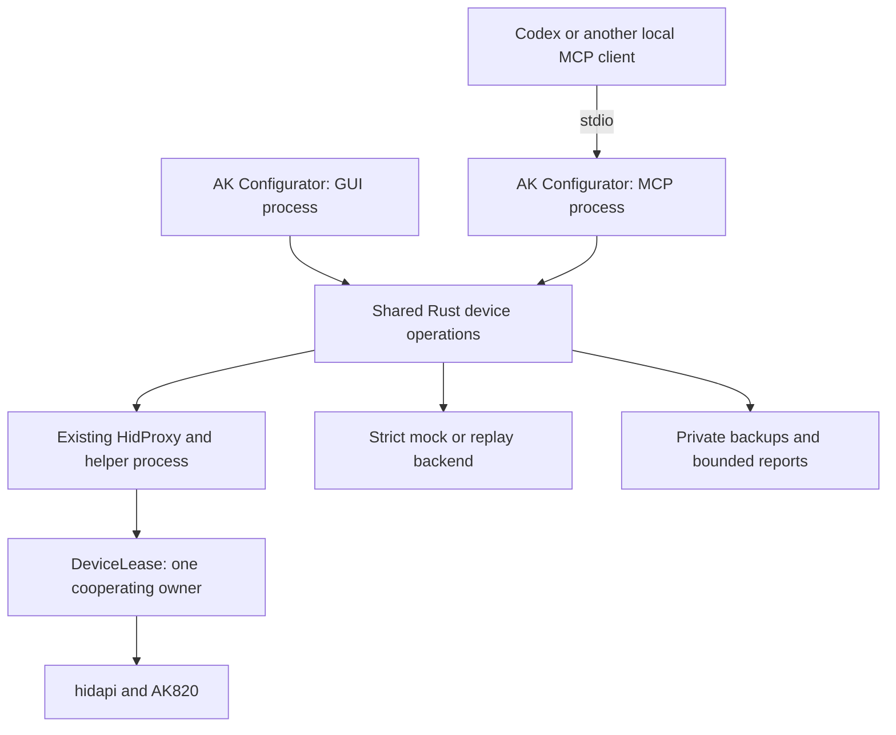
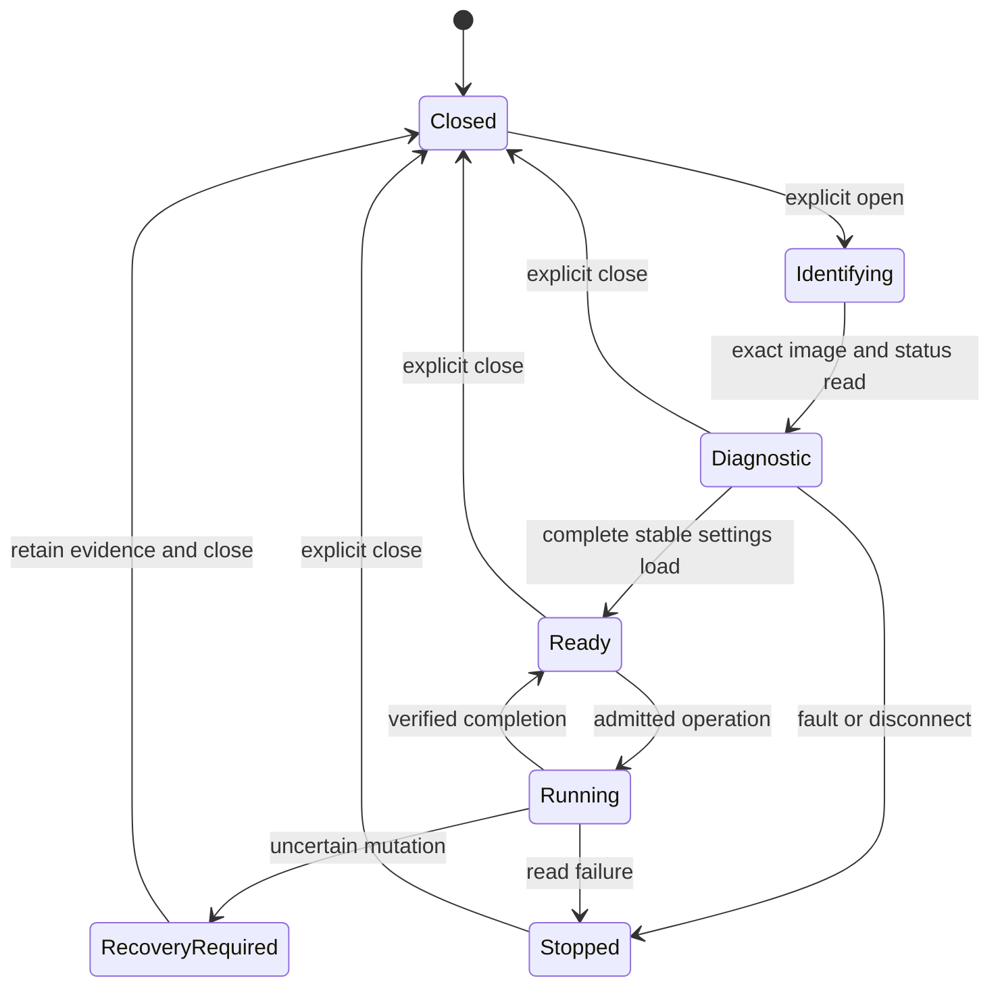

Английский оригинал: [План интеграции MCP](../MCP_IMPLEMENTATION_PLAN.md).

# План интеграции MCP

> Обновление реализации: исходная проверка ниже сохранена как база плана. Теперь есть частичная, отдельно включаемая версия P0 только для чтения; реализованные команды и ограничения описаны в [MCP.md](MCP.md), фактические проверки — в [REVIEW.md](REVIEW.md). Остальные запланированные API пока недоступны.

## 1. Решение, область охвата и проверенные версии

**Статус: предлагаемый план реализации, а не реализованный интерфейс MCP.**
Подготовлено 2026-10-27. Это изменение касается только документации. Исходный код приложения и прошивки, зависимости, конфигурация сборки и профиль выпуска не меняются. В ходе этой проверки команды клавиатуры не выполнялись, сборки и испытания оборудования не проводились.

Для первой реализации рекомендуется **отдельный процесс без графического интерфейса, запускаемый из существующего исполняемого файла** командой `ak-configurator --mcp-stdio` и использующий официальный Rust SDK MCP. Он вызывает существующие службы устройств на Rust и существующий HID-помощник. Он не запускает графический интерфейс, фоновый индикатор, захват звука или мост OpenRGB. Для P0 не требуются ни второй исполняемый файл, ни библиотека общего назначения. Сетевой прослушиватель MCP отсутствует.

| Входные данные | Неизменяемая база проверки |
| --- | --- |
| Configurator | `desktop-dev`, коммит [`f8a31854bae916d1b07f24bdcf5dde1d00fdbdce`](https://github.com/dvino/ak-configurator/tree/f8a31854bae916d1b07f24bdcf5dde1d00fdbdce), версия приложения `0.1.0-alpha.1` |
| Firmware | [`v0.6.0-beta.3`](https://github.com/dvino/ak820/tree/v0.6.0-beta.3), аннотированный объект тега `4cabae9af9bb68492a8cf079c59f8b388c5cf788`, коммит `88d190abb156960915a0f1f8ac7f602bb401eab3` |
| Правила области охвата и поставки | [REQUIREMENTS.md](REQUIREMENTS.md), [PLAN.md](PLAN.md), [STATUS.md](STATUS.md), [AGENTS.md](../../AGENTS.md), [маршрутизация агентов](AGENT-ROUTING.md) |
| Кандидат SDK MCP | Официальный выпуск `rmcp` версии `3.8.0`; манифесты выпуска и тега проверены 2026-10-27. До начала реализации зафиксировать выбранную версию; не использовать изменяемую ветку Git. [S01], [S02] |

Перед проверкой рабочая ветка была сверена с GitHub. Приведённые ниже выводы относятся к этим коммитам, даже если впоследствии `desktop-dev` изменится. Ссылки в конце ведут к неизменяемым исходным файлам и важным функциям.

**Полезный минимально жизнеспособный вариант:** агент может запустить сервер без дисплея, обнаружить AK820, открыть сеанс диагностики только для чтения, отличить точный известный образ от неизвестного, прочитать состояние хранилища и USB, выполнить ограниченный набор диагностик и получить структурированный отчёт и очищенную трассировку обмена. В CI тот же сценарий выполняется на строгом имитаторе. Настройки изменить, снять блокировку, сбросить устройство, перевести его в загрузчик или прошить нельзя. Уже этого достаточно, чтобы ускорить диагностику проблем распознавания, транспорта, некорректных ответов и хранилища.

MCP управляет теми же операциями предметной области, что и приложение. Он не проверяет виджеты, не нажимает элементы интерфейса, не имитирует нажатия клавиш и не становится универсальной оболочкой, файловым сервером или произвольной конечной точкой HID-команд.

## 2. Проверка существующего кода

### 2.1 Повторно используемые компоненты и их фактические границы

| Область | Существующая реализация | Последствие для MCP |
| --- | --- | --- |
| Запуск | `main()` до обычного запуска GUI обрабатывает самопроверку и закрытые режимы HID-помощника. Экспорт без интерфейса и включаемый отдельно фоновый помощник уже существуют. Сейчас в crate один бинарный файл и нет библиотечной цели. [C01], [C02] | Добавить ранний режим MCP, сохранив обработку закрытых режимов помощника. Для MCP не нужен цикл событий eframe. Зависимости GUI в P0 по-прежнему потребуются при сборке и компоновке. |
| Обнаружение | `DeviceManager::scan_usb_devices`, токены экземпляров устройств, `Device::permits_hid_target` и сопоставление физических устройств. [C03] | Повторно использовать обнаружение только USB-устройств. Возвращать непрозрачные идентификаторы кандидатов, привязанные к текущему обнаружению, а не произвольные HID-пути, заданные клиентом. |
| Транспорт | `HidDevice::open_fresh_for` открывает `HidProxy`; прокси запускает тот же исполняемый файл в закрытом режиме и сериализует запросы к реальному дескриптору HID. [C04], [C05] | Использовать этот путь, включая обработку тайм-аутов и завершения процесса. Не открывать из MCP второе необработанное HID-соединение. |
| Владение | `DeviceLease::acquire` вызывается фактическим помощником. В Unix используется защищённый файл блокировки в фиксированном каталоге и `flock`; в Windows — именованный объект ядра. [C06] | GUI и MCP могут работать одновременно, но владеть одной клавиатурой может только один из них. Если устройство занято, об этом сообщается; MCP не принуждает к передаче владения. Сторонние программы не обязательно соблюдают эту кооперативную блокировку. |
| Политика только для чтения | `enforce_read_only_hid` устанавливает необратимый глобальный для процесса `OnceLock`; `ReadOnlyHidSession::send` перед транспортом проверяет `is_read_request`. [C04], [C07] | Подходит для процесса, по умолчанию работающего только на чтение. Не пытаться повышать права этого процесса до записи. Список разрешённых команд ограничивает запись со стороны хоста, но не доказывает, что прошивка не сбросит уже изменённый кэш хранилища. |
| Распознавание образа | `parse_manifest`, `identify_image`, `ImageContract`, `contract_for_hash` и `verify_ak820_firmware` связывают манифест с полным хешем упакованного CODE и каталогом. [C08], [C09] | Повторно использовать проверки точной идентичности. UID, схема, название выпуска и имя профиля недостаточны. Готовность к редактированию — отдельное состояние. |
| Загрузка соединения | `load_ak820` / `load_verified_ak820` проверяют описание, матрицу, счётчики, раскладку, энкодеры, макросы, динамические таблицы и типизированные расширения, сравнивают результаты getter-команд с NVM, повторно считывают NVM, а затем вызывают `ak820_enable_settings`. [C10] | В P1 эту последовательность следует вынести в службу, не зависящую от GUI, сохранив все проверки. Один вызов `verify_ak820_firmware` никогда не должен сам по себе включать запись. |
| Настройки | Типизированные методы в `hid_keymap`, `hid_macros`, `hid_dynamic` и `hid_settings`; `ak820_send_or_passthrough`, `typed_candidate`, `ak820_verify_write` обеспечивают ограничения AK820 и проверку чтением. [C11], [C12], [C13], [C14], [C09] | MCP передаёт типизированные аргументы и вызывает эти методы. Сохранять проверку кодов клавиш с учётом источника, отклонение неподдерживаемых функций и фиксацию ошибки. |
| Каталог и кодеки | `ak820_beta1_profiles.rs`, несмотря на историческое имя файла, теперь содержит контракты beta.3. `ak820_typed_storage` проверяет настройки, CRC и записи таблиц; `ak820_settings_model` интерпретирует NVM. [C15], [C16], [C17] | Совместно использовать именно эти контракты. Не создавать вторую матрицу возможностей и не выводить возможности из объёма хранилища. |
| Direct и RGB | `ak820_rgb/direct.rs` предоставляет согласованные снимки, проверку поколения, атомарную загрузку и чтение для проверки. `HidDevice` оборачивает их проверками образа, сеанса и владельца; `FrameScheduler` ограничивает отправку команд. [C18], [C09], [C19] | Запись Direct выполняется только в RAM. Она отличается от выбора режима и сохранения RGB. Повторно использовать планировщик для сцен, а не вызывать MCP по разу для каждого кадра анимации. |
| Резервные копии | `ak820_capture_backup`, `CapturedBackup`, строгий разбор архивов, проверка, публикация с ограниченным доступом и повторное чтение уже существуют. [C09], [C20], [C21], [C22] | Повторно использовать формат резервной копии и защиты файловой системы. Частичный экспорт `.entlayout` не является полной резервной копией для безопасного восстановления. |
| Восстановление и сброс | `plan_restore`, `plan_factory_reset`, `RestorePlan`, `PreparedRestore::run`, `ak820_restore_backup`. Планы привязаны к точным идентификаторам источника и цели и ожидаемому NVM; для выполнения требуется свежее физическое подтверждение и итоговая сверка. [C23], [C24], [C25] | Перед выполнением предоставлять предварительный просмотр. Не добавлять команду сброса без ограничений. Универсальное полное восстановление не подходит для очистки после автоматизированных тестов. |
| Установка | `PreparedInstallation::prepare/execute`, `InstallIo`, `HidDevice::ak820_prepare_install/ak820_execute_install`, `InstallUsb`, порядок состояний загрузчика и допуск выпуска. [C26], [C27], [C28], [C29] | В P2 обернуть текущую транзакцию с одной попыткой. Не создавать независимый прошивальщик MCP, зависимость от среды выполнения Python или более свободный допуск образов. |
| Диагностика | `DiagnosticsLogger` пишет в stderr и, при необходимости, в локальные журналы; существующая трассировка HID в основном описывает унаследованные команды дисплея. Ротация журнала выполняется при его открытии, а не постоянно. [C30], [C04] | stderr пригоден, но существующие журналы не являются ни полной записью обмена с AK820, ни ограниченным очищенным отчётом. Добавить небольшой структурированный регистратор. |
| Автономные тесты | `TestHidRecorder`, скриптуемые ответы и сбои, конструкторы имитатора AK820, `Fake` для Direct, тесты владения и отмены задач GUI. [C04], [C09], [C18], [C06], [C31] | Повторно использовать фикстуры и производственные парсеры. Текущая имитация включается через `cfg(test)` и иногда подставляет готовые ответы; это пока не строгий сервер-имитатор времени выполнения. |
| CI | `desktop-dev.yml` уже собирает шесть нативных целевых платформ, запускает тесты Linux, платформенные тесты владения и файловой системы, самопроверки пакетов и пробные установки. [C32] | Добавить целевые проверки MCP в эти задания. Не дублировать в CI configurator матрицу сборок прошивки. |

### 2.2 Идентичность прошивки и ограничения протокола

Приложение использует VID/PID `320F:505B` и страницу/код использования Raw HID `FF60:0061`. Заводская прошивка может иметь те же VID/PID; одного их совпадения недостаточно, чтобы разрешить протокол проекта. Длина сырых отчётов — 32 байта без идентификатора отчёта HID. UID Vial на проводе: `04 70 FF 90 01 B9 15 D3`; соответствующее целое Rust в порядке little-endian — `0xD315B90190FF7004`. Версия протокола VIA — 9, Vial — 6. Интерфейсы следует определять по дескрипторам и кодам использования, а не по жёстко заданному номеру интерфейса ОС. [C08], [F01], [F02]

Текущая конфигурация: шесть слоёв, разреженная матрица 16×8 с 83 физическими позициями, один энкодер с двумя направлениями, 16 макросов с логическим буфером на 8192 байта, восемь Combos и 82 светодиода. Имеется 498 физических назначений клавиш и 12 назначений направлений энкодера. Нажатие энкодера относится к физической матрице и не имеет светодиода. Порядок энкодеров в хранилище отличается от порядка направлений в проводном протоколе; следует использовать существующий код сопоставления. Представление макросов размером 8192 байта не даёт права перезаписывать произвольные 8192 байта NVM. [C10], [C11], [F02]

Исходный код поддерживает десять профилей выпуска: `main`, `game`, `mmo`, `typing`, `code`, `pointer`, `onehand`, `creative`, `shortcuts`, `multios`. Direct v1 присутствует в `main`, `game`, `mmo`, `creative`. Необязательные QMK Settings, Tap Dance, Key Overrides и другие действия определяются точным контрактом образа. Например, в Main и Typing beta.3 есть Auto Shift с QSID 4; MCP не должен приписывать эту возможность Main beta.2. Beta.3 допускает Caps Word как результат Combo, а поддерживаемое действие `LT(layer0..5, MC0..15)` — только в разрешённом для него контексте источника. [C15], [C08], [F03]

### 2.3 Режим только для чтения не означает, что все getter-команды не имеют побочных эффектов

Это главный вывод проверки с точки зрения безопасности. В beta.3 функция `ak820_usb_raw_send()` безусловно вызывает `ak820_nvm_flush()`. Обычные запросы VIA/Vial выполняются внутри `ak820_nvm_begin()` / `ak820_nvm_end()`. `raw_request_is_nonpersistent()` управляет допуском ответа после сбоев хранилища, но не устраняет эту запись кэша. Поэтому обычная getter-команда может записать ранее изменённый кэш в NVM. [F04]

Чтение CODE командой `FD00` и состояние `FD01` в проверенной прошивке обходят пакетную обработку NVM и сброс кэша. `FD01` можно вызывать только после точного распознавания, поскольку в исторических версиях прошивки безопасная диспетчеризация реализовывалась по-разному. Текущая `verify_ak820_firmware()` на Rust сначала вызывает обычные getter-команды протокола и UID, а затем распознаёт CODE; адаптер MCP не должен заявлять, что выполняет строгую диагностическую инициализацию, если без изменений вызывает эту функцию. [F04], [F05], [C09]

В P0 логику идентификации следует вынести в одну общую реализацию со следующим порядком действий:

1. Обнаружить кандидата Raw HID проекта и получить блокировку существующего помощника.
2. Прочитать 64-байтовый манифест по адресу `0xEF80` и вычислить хеш упакованного CODE в диапазоне `[0x2800,0xC700)` ограниченными запросами `FD00`; проверить оба результата по `ImageContract`. Универсальный MCP-инструмент для произвольных адресов не предоставляется.
3. Для распознанного образа beta.3 декодировать `FD01` и требовать чистого хранилища без ошибок, нулевой глубины пакета и отсутствия операции разблокировки до обычных getter-команд.
4. Только после этого проверять идентичность VIA/Vial и выполнять запрошенные группы обычных операций чтения. Перед такими группами проверять состояние; прекращать работу при грязном, занятом или неисправном состоянии.
5. Разделять сеансы только для диагностики и полностью загруженные сеансы настроек. Для неизвестных образов возвращать ошибку идентификации и не угадывать поведение `FD01`, сеттеров или разблокировки.

Распознавание считывает около 40 КиБ блоками не более 27 байт, поэтому это явная операция с отображением прогресса и сроком выполнения, а не действие при запуске MCP. Не следует придумывать быструю команду получения версии: выпуск и профиль определяются по совпадению с проверенным каталогом, и в результате указывается источник такого вывода. Один только манифест — непроверенное утверждение.

Политика на стороне хоста не может помешать сторонним физическим нажатиям клавиш или другой несогласованной программе менять состояние прошивки. В отчётах отдельно указываются `setters_sent: 0` и наблюдавшийся неизменный снимок NVM. Нельзя утверждать, что во время наблюдения ни одна инструкция прошивки не могла записать данные во flash.

### 2.4 Уже доступные средства диагностики

| Средство | Что оно подтверждает | Ограничения и необходимые интеграционные работы |
| --- | --- | --- |
| `FD00` | Точные байты CODE/NVM; прямое чтение для проверки, независимое от кэша NVM | Не более 27 байт в запросе; полные байты ROM/OEM должны оставаться закрытыми. Существующий читатель на Rust можно использовать повторно. [C09], [F04] |
| `FD01 v1` | Фиксация сбоя, валидность/грязное состояние кэша, глубина пакета, кэшированная страница, первый этап сбоя, последняя попытка IAP, состояние разблокировки, перечисление/сон/состояние Raw USB | Снимок RAM и последней попытки; без истории, измерения стека или доказательства долговечной записи. Добавить типизированный декодер диагностики по существующей документированной карте байтов, а не копировать строки ошибок интерфейса. [F05] |
| Отчёт функции EP0 `AKBT v1` | Стадия загрузки и увеличивающийся счётчик основного цикла, даже если путь основного цикла Raw завис | Уже есть в средстве запуска прошивки/Python, отсутствует как типизированная обычная операция Rust. В P1 добавить фиксированную операцию GET_FEATURE в существующий помощник; не предоставлять API отчёта функции установки. Правильная длина буфера hidapi — девять байт с учётом идентификатора отчёта 0. [F06], [F02], [C27] |
| Getter матрицы Vial | Считанное состояние строк матрицы | До выборки требуется подтверждённая разблокировка; при её потере опрос прекращается. Заблокированная прошивка может оставить ответ без изменений; похожие на нули байты не доказывают, что все клавиши отпущены. Отсутствие нажатых клавиш не является проверкой переключателей, а опрос может пропускать события. Не разблокировать автоматически. [C14], [F07] |
| Direct v1 | Согласованный снимок 82 цветов в RAM и его поколение, принятый пакет целого кадра, состояние преобразования/публикации | GET может прекратить незаконченную загрузку в RAM по тайм-ауту; успешная фиксация не подтверждает вывод LED, включение подсветки или сохранение цветов. [C18], [F08] |
| Существующие журналы хоста | Сбои приложения и время выполнения в отдельных местах вызова | Могут содержать закрытые пути; не являются автоматически безопасными для стенограммы агента или вложения к обращению. [C30] |

### 2.5 Существующие гарантии нельзя ослаблять

`ak820_editing_ready()` требует полной загрузки и отсутствия зафиксированной ошибки. Шлюз сеанса сериализует сеттер вместе с его ACK, getter-командой и проверками хранилища; сеттеры типизированных расширений также сверяют полное ожидаемое NVM, включая соседние байты. Неизменённые эффективные типизированные значения по умолчанию не приводят к материализации пустого хранилища. Транспорт AK820 выполняет одну попытку; не добавлять вокруг него повторы в MCP. Существующий алгоритм снимка Direct допускает не более трёх полных попыток чтения (два повторных начала) при изменении поколения; ошибка транспорта или некорректный ответ немедленно останавливают работу. Этот ограниченный алгоритм согласованного чтения отличается от повтора неудачных обменов или изменений с неизвестным результатом. [C09], [C04], [C18]

Восстановление из резервной копии и сброс создают и повторно считывают резервную копию безопасности и требуют нового трёхсекундного физического удержания Esc + левого Control. Предварительная разблокировка не засчитывается как подтверждение. Поэтому исполнитель общего восстановления нельзя незаметно вызывать в `finally` после каждого автоматизированного теста. Существующие тесты с реальным устройством используют узкие заранее спланированные обратные сеттеры и прекращают работу до восстановления, если состояние вызывает сомнения. [C25], [F09]

В некоторых комментариях исходного кода сохранились исторические названия вроде “beta1” или “beta2”. Проверка опирается на `ImageContract`, точные хеши и текущие ветви кода, а не на эти обозначения. Отчёты о квалификации прошивки и опубликованные записи каталога не подтверждают поведение подключённой клавиатуры. [C08], [C15], [F03]

## 3. Выбор архитектуры

### 3.1 Альтернативы

| Вариант | Повторное использование и стоимость | Работа без GUI и устойчивость | Решение |
| --- | --- | --- | --- |
| MCP внутри цикла событий запущенного GUI | Прямой доступ к состоянию GUI, но запросы связываются с жизненным циклом eframe, фоновыми задачами и очередями UI | Требуется GUI; отмена и блокирующий HID могут повлиять на него | Отклонить для первой интеграции |
| Тот же исполняемый файл, отдельный процесс `--mcp-stdio` | Те же функции Rust и существующий запускаемый им HID-помощник; небольшой адаптер запуска/службы | Работает без GUI; сбои локальны для процесса. Зависимости GUI всё ещё компилируются и поставляются | **Рекомендуется для P0–P2** |
| Отдельный исполняемый файл `ak-configurator-mcp` с общей библиотекой Rust | Хорошее долгосрочное разделение; потребуется перенос текущего графа модулей бинарного файла, DTO приложения и контрактов запуска помощника | В будущем может сократить зависимости пакета без GUI; сейчас добавит работу по упаковке и рефакторингу | Пересмотреть после P1 при наличии подтверждённой потребности |
| Сопутствующий сервер MCP на Python/TypeScript | Существуют официальные SDK, но для вызовов Rust потребуется новый IPC/FFI или дублирование логики устройств | Дополнительная среда выполнения, распространение и затраты на синхронизацию | Использовать только как внешние тестовые клиенты, не как производственный сервер |
| Постоянно работающий брокер / HTTP-сервис MCP | Может распределять одновременные операции GUI и агентов | Добавляет управление жизненным циклом, аутентификацию и сопровождение сети/службы | Подтверждённой потребности нет; вне области охвата |

Рекомендуется встроенная **точка входа** сервера, а не сервер в процессе GUI. Клиент запускает новый процесс ОС. У двух экземпляров процесса отдельное состояние Rust; блокировка устройства, удерживаемая существующим помощником, регулирует доступ к нему. Если клавиатурой владеет GUI, возвращается `DEVICE_BUSY`. Управление уже запущенным сеансом GUI потребовало бы отдельной архитектуры брокера и не обещается этим планом.

### 3.2 Связи между компонентами



«Общие» означает одну и ту же реализацию, скомпилированную для обеих точек входа, а не общую изменяемую память. Имитатор выбирается до обнаружения устройств и не имеет доступа к реальному бэкенду.

### 3.3 Политика SDK и зависимостей

Использовать официальный `rmcp`, DTO на serde и схемы входных/выходных данных, создаваемые через schemars. В проверенных манифестах `rmcp-v3.8.0` есть функции `server`, `macros`, `transport-io` и `transport-async-rw`. Минимальная поддерживаемая версия Rust — 1.88; существующий CI desktop выбирает Rust 1.97.0. [S08], [C32] Возможная конфигурация, которую следует скомпилировать и зафиксировать в P0:

```toml
# Proposed only; not a change to Cargo.toml in this work package.
rmcp = { version = "=3.8.0", optional = true, default-features = false, features = ["server", "macros", "transport-io"] }
tokio = { version = "1", optional = true, features = ["rt", "io-std", "time", "sync", "macros"] }
schemars = { version = "1", optional = true }
```

Использовать Cargo feature проекта `mcp`, изначально отключённую в обычной alpha-сборке. `serde`, `serde_json`, `sha2`, обработка ошибок и нативные зависимости HID уже присутствуют. В проверенном lockfile нет Tokio и schemars; это будут новые зависимости. Транзитивные зависимости SDK имеют реальную стоимость: фиксировать изменения lockfile, а также время холодной и повторной сборки. Не включать в поставляемый сервер HTTP, OAuth, sampling, elicitation или клиентские функции без конкретной потребности. `transport-io` может включить сетевые возможности Tokio внутри; это не требует открывать сокет. Проверить лицензии зависимостей и сохранить существующие уведомления. [C01], [S01], [S02]

Текущий SDK поддерживает MCP 2026-07-28 и более ранние клиенты. Ему следует поручить согласование версии, инициализацию совместимости со старыми клиентами, метаданные современных запросов, кадрирование, обнаружение инструментов и стандартную отмену. Проверить обе эпохи протокола; не реализовывать локально JSON-RPC или согласование версии MCP. Для `structuredContent` предусмотрена соответствующая выходная схема и резервный вариант в виде сериализованного JSON-текста. Аннотации инструментов помогают клиентам показывать уровень риска, но не обеспечивают авторизацию. [S01], [S03], [S04], [S09]

MCP Tasks теперь имеют отдельное расширение, поэтому сначала требуется установить поддержку со стороны клиентов. P0 от него не зависит. В любом случае нужна небольшая запись доменной операции, чтобы сохранять владение оборудованием после отмены. `ak820_operation` предоставляет эту запись; это не универсальный планировщик долговечных задач. В будущем адаптер Tasks сможет обернуть ту же запись без изменения выполнения операций с устройством. [S05]

### 3.4 Запуск и границы общих служб

Сохранить обработку `--self-check` и закрытых режимов `--entropy-hid-proxy` / `--ak820-install-proxy`. Проверять `--mcp-stdio` после диспетчеризации закрытых помощников, но до чтения настроек GUI, получения блокировки единственного экземпляра GUI, инициализации рендерера или запуска дополнительных интеграций. Строго разбирать аргументы запуска MCP; неизвестные аргументы должны приводить к отказу без обращения к USB. Отклонять взаимоисключающие флаги точек входа, а не выбирать один молча. [C02], [C05]

Предлагаемые файлы, добавляемые постепенно:

| Файл / модуль | Ответственность | Первый этап |
| --- | --- | --- |
| `src/mcp/mod.rs`, `server.rs` | Запуск, обработчики rmcp, фиксированная регистрация инструментов/ресурсов, контроль вывода в stdout | P0 |
| `src/mcp/dto.rs`, `policy.rs` | Типизированные схемы, ограничения, области доступа при запуске, безопасное преобразование ошибок | P0 |
| `src/ak820_service.rs` | Единственный владелец сеанса, диагностическая идентификация, сериализованные операции, поколение и отмена | P0; полная загрузка настроек в P1 |
| `src/ak820_diagnostics.rs` | Разбор FD01, DTO свидетельств; позднее — фиксированная операция AKBT | P0/P1 |
| `src/ak820_trace.rs` | Ограниченная запись обмена и сокрытие конфиденциальных данных | P0 |
| `src/ak820_test_runner.rs` | Именованные сценарии, проверки, отчёты; позднее — условная компенсация | P0/P1 |
| `src/mcp/test_backend.rs` | Строгий адаптер сценариев/повторного воспроизведения с явной функцией разработки | P0 |
| `src/ak820_settings_service.rs` | Извлечённый полный загрузчик и общие типизированные изменения для GUI и MCP | P1 |
| `src/ak820_operation_policy.rs` | Неизменяемые планы изменения, снимки безопасности и одноразовые записи подтверждения | P1/P2 |

Это описание обязанностей, а не требование создавать для каждой строки большой отдельный файл. Небольшие модули следует объединять, пока разделение не станет полезным. Публичный API crate и универсальная система плагинов не нужны.

В P0 можно ссылаться на существующее пространство имён `app::ak820_beta1_profiles`, не создавая экземпляр `EntropyApp`. В P1 следует перенести чистый модуль каталога в корень crate и при необходимости временно сохранить его повторный экспорт, чтобы упростить извлечение загрузчика. Перенести только необходимые DTO данных из модулей `app_state` / UI. Не переносить несвязанный код Entropy и не переписывать автономные форматы проектов. [C15], [C10], [C33]

Синхронные операции с устройством следует выполнять в одном ограниченном рабочем потоке, а не в асинхронном диспетчере MCP. Использовать существующие помощник/прокси; передавать отмену и прогресс посредством существующих атомарных механизмов. Не удерживать мьютекс службы во время `.await` и не запускать неограниченное число задач `spawn_blocking`. В P0 один процесс сервера поддерживает один активный сеанс устройства и одну активную операцию с устройством; независимые запросы метаданных только для чтения и состояния операции остаются отзывчивыми. Параллельные запросы к устройству возвращают `OPERATION_BUSY`, а не накапливаются в очереди.

## 4. Состояние устройства, полномочия и обработка сбоев

### 4.1 Состояние сеанса и операции

`device_session_id` — это дескриптор приложения, независимый от сеансов транспорта MCP и версии протокола. Он связывает nonce процесса, выбранного кандидата, токен экземпляра ОС, определённый USB-порт, точное наблюдение образа и монотонно возрастающее поколение. Переподключение само по себе не сохраняет сеанс или план. Устройства без серийного номера нельзя надёжно идентифицировать только по VID/PID.



Идентичность может быть известна и при сбое хранилища; такое состояние следует сообщать как остановленную диагностику, а не как успешно готовый сеанс. `session.status` и `operation.status` читают кэшированное состояние хоста и не отправляют запросы восстановления. Для новой диагностики устройства требуется явное новое действие. Состояние остановки нельзя снять сеттером, счётчиком повторов или фиктивным успешным чтением.

Операции сохраняют владельца, пока не завершатся их рабочий процесс и вспомогательные средства. Отмена означает «остановиться на следующей безопасной границе», а не «немедленно освободить дескриптор». EOF запрашивает отмену и ограниченную по времени очистку. Принудительное завершение процесса или потеря питания могут оставить изменения; постоянная запись восстановления должна описывать эту возможность, а не помечать состояние как восстановленное. Изменение поколения сеанса устройства делает недействительными все планы и не позволяет устаревшим результатам рабочих процессов обновлять текущее состояние.
[C05], [C31]

### 4.2 Уровни доступа

| Уровень | Разрешение | По умолчанию |
| --- | --- | --- |
| R | Перечисление, известные диагностические чтения, типизированные чтения, офлайн-проверки и тесты | Включено |
| L | Запись ограниченных отчётов/резервных копий в локальный каталог приложения | Включено для запрошенных действий захвата/отчёта; произвольные пути запрещены |
| S | Обычные поддерживаемые изменения настроек и ограниченные изменения RAM RGB | Отключено; требуется явная политика запуска |
| T | Именованный модифицирующий тест и его точные обратные изменения | Отключено; отдельная область и бюджет записи; не следует из S |
| D | Полное восстановление настроек/сброс и обновление прошивки | Отключено; точное одноразовое локальное разрешение, а где применимо — дополнительное существующее физическое подтверждение |

По умолчанию `--mcp-access=read-only` вызывает существующую необратимую защиту хоста от записи до открытия дескриптора. Процесс с разрешённой записью запускается отдельно и явно, с более узкими неизменяемыми областями в политике запуска; ни один инструмент MCP не меняет эту политику. Ни `confirm: true`, ни утверждение на естественном языке, ни аннотации инструмента, ни успешный план не дают права на запись.

Для S/T область, заданная пользователем, определяет разрешённые типы операций, необязательные ограничения по профилю/устройству и максимальное число изменений в тестах. Агент может подготавливать и выполнять операции в рамках этого делегирования. Само включение S/T не позволяет ему менять образ, снимать блокировку, выполнять сброс или восстанавливать полную резервную копию.

Для D в P1/P2 добавляется небольшая локальная точка подтверждения `ak-configurator --mcp-approve-plan <plan-file>`. Она показывает точную сводку в интерактивном терминале или существующем окне подтверждения и требует нового действия человека. Создаётся закрытое, ограниченное по времени одноразовое разрешение, связанное с nonce запущенного сервера, типом операции, дайджестом плана, поколением устройства, идентичностью источника/цели и хешами артефактов. Инструмента подтверждения MCP нет. Сервер использует разрешение до первой изменяющей команды и повторно проверяет все закреплённые параметры. Для истёкшего или изменённого плана требуется новое подтверждение. Следует повторно использовать `PreparedInstallation::confirmation_pin` и существующие проверки восстановления, а не разрабатывать второй алгоритм подтверждения образа. [C24], [C25], [C26]

Этот канал подтверждения предотвращает случайное предоставление полномочий только через MCP. Он **не является границей безопасности от агента или программы с неограниченным выполнением кода от имени того же пользователя ОС**. Права на файлы, stdio и токены такой гарантии не обеспечивают. Для таких развёртываний также требуется политика клиента MCP/песочницы. Для текущих путей восстановления/обновления прошивки проекта по-прежнему требуется свежее физическое удержание клавиш, наблюдаемое прошивкой; MCP не имитирует его.

Начальная версия P2 поддерживает только переходы обновления прошивки проекта beta.3. Первая установка OEM и откат OEM остаются в существующем процессе приложения, пока их отдельные пути идентификации и подтверждения не пройдут самостоятельную квалификацию. Универсальный план `flash` не разрешает их автоматически.

### 4.3 Правила восстановления при изменяющих состояние тестах

До первого сеттера необходимо захватить и приватно опубликовать полную проверенную исходную конфигурацию, перечитать её, сохранить журнал операции и проверить каждое прямое и обратное изменение для точного образа. При сбое публикации резервной копии не отправляется ни одного сеттера. При запуске с несколькими короткими тестами сохраняется одна стабильная полная исходная конфигурация, а для каждого шага также записываются ожидаемое состояние NVM и подтверждённый прогресс.

Компенсация допускается только после успешных ACK/проверочного чтения, при чистом хранилище без признаков сбоя, неизменных идентичности/владельце и точном совпадении с ожидаемым промежуточным состоянием. Она входит в исходно разрешённый план T. Каждый обратный сеттер проверяется так же, как прямой. Для окончательного успеха исходные байты NVM и соответствующие значения времени выполнения должны совпасть; ожидаемые изменения поколения/счётчика сообщаются отдельно.

При тайм-ауте, некорректном ответе, несовпадении, сбое хранилища или отключении следует остановиться, сохранить `restore_pending`, исходную конфигурацию и трассу, отметить `recovery_required` и не отправлять автоматическое восстановление, отмену, снятие блокировки, сброс или повтор. После контролируемой отмены между проверенными шагами компенсация может завершиться только при сохранении тех же условий исправности. Если рабочий процесс не может установить чистую границу, результатом становится необходимость восстановления. Последующее восстановление требует нового наблюдаемого плана и явного разрешения. Это соответствует текущему правилу живых тестов. [F09], [C25]

Не всякая логически обратимая настройка обратима на уровне байтов: пустые/типовые записи могут стать материализованными, а сохранённое состояние RGB отличается от текущего режима. Тест разрешается только если общая модель хранилища доказывает, что обратная операция возвращает исходные байты. Иначе тест пропускается до внесения изменений. Не следует ослаблять физическое подтверждение полного восстановления резервной копии ради прохождения тестов.

## 5. Предлагаемый MCP API

### 5.1 Общий контракт

Девять инструментов охватывают всю запланированную поверхность. P0 регистрирует шесть:
`ak820_devices`, `ak820_session`, `ak820_read`, `ak820_tests`, `ak820_trace`,
`ak820_operation`. P1 добавляет резервное копирование, подготовку и выполнение. Нереализованные действия отсутствуют в скомпилированной схеме. Отсутствие функции устройства указывается в capabilities и как `UNSUPPORTED_FEATURE`; список инструментов не меняется при подключении клавиатуры или изменении сеанса. Политика фиксируется при запуске процесса.

Каждый вход отклоняет неизвестные поля и целые числа вне допустимого диапазона. Цели изменений задаются типизированными перечислениями и ID каталога. Ни один инструмент не принимает необработанные байты HID, адреса памяти, команды оболочки, произвольные имена исполняемых файлов, неограниченные URL или пути файловой системы. Инструмент не запускает автоматически компилятор, задание CI или сценарий установки прошивки.

Каждый объект `structuredContent` соответствует `ak820-mcp-result-1`:

| Поле | Контракт |
| --- | --- |
| `format`, `request_id` | Версия схемы и сгенерированный сервером ID корреляции |
| `status` | `ok`, `accepted`, `blocked`, `failed`, `cancelled`, `recovery_required` |
| `backend`, `evidence` | `hid` / `mock` / `replay`; `device_protocol` / `host_model` / `replay_model` / `offline_validation`. Эти значения никогда не выводятся из успешного имени теста. |
| `device_session_id`, `session_generation` | Присутствуют для выбранного сеанса; неизменяемая привязка результата |
| `image` | Проверенная идентичность и происхождение в каталоге либо null/непроверенный статус; отдельные идентификаторы IHX, связанного CODE, упакованного CODE и полного ROM |
| `data` | Типизированный результат для конкретного инструмента, описанный ниже |
| `verification` | Фактически выполненные проверки, `setters_sent`, `nvm_readback`, `physical_behavior_validated`, исключения и пропущенные проверки |
| `artifacts` | Непрозрачные ID, тип, размер, дайджест и URI ресурса с безопасными для приватности данными, если он доступен для чтения; содержимое OEM/резервных копий автоматически не включается |
| `error` | Null либо `{code, message, stage, retryable:false, recovery_required, details}`; сообщения не содержат необработанных приватных путей и данных |

Все сбои операций устанавливают MCP `isError=true`; принятие асинхронной работы не означает успеха. Стандартные некорректные запросы MCP используют ошибки JSON-RPC SDK; сбои устройства, политики, проверки и тестов возвращаются как структурированные ошибки инструмента. Для совместимости тот же ограниченный JSON возвращается как текстовый блок содержимого. Полные отчёты тестов являются артефактами, а не усечёнными сводками успеха. [S04]

`physical_behavior_validated` по умолчанию равно false, включая тесты с реальным чтением данных. Если в будущем набор тестов с измерительными приборами предоставит доказательства, его физические утверждения должны точно перечислять выполненные измерения.

Общие ошибки используются всеми применимыми инструментами:

| Коды | Значение / действие |
| --- | --- |
| `INVALID_ARGUMENT`, `LIMIT_EXCEEDED` | Нарушение схемы/диапазона/размера; работа с USB не выполняется |
| `DEVICE_NOT_FOUND`, `DEVICE_AMBIGUOUS`, `DEVICE_BUSY`, `ACCESS_DENIED` | Сбой выбора/владения/разрешений ОС; без автоматического повышения прав, установки драйвера или принудительного закрытия |
| `SESSION_STALE`, `SESSION_STOPPED`, `OPERATION_BUSY` | Повторно перечислить устройства или явно открыть новый сеанс; без неявного переподключения |
| `UNKNOWN_IMAGE`, `IMAGE_MISMATCH`, `UNSUPPORTED_FEATURE`, `NOT_READY`, `UNLOCK_REQUIRED` | Не выполнено точное предварительное условие контракта/готовности; без предположительного обходного варианта |
| `TIMEOUT`, `DISCONNECTED`, `MALFORMED_REPLY`, `READBACK_MISMATCH`, `STORAGE_FAULT`, `STORAGE_BUSY` | Остановить текущую работу с устройством; после возможного изменения сохранить свидетельства для восстановления |
| `READ_ONLY`, `AUTHORIZATION_REQUIRED`, `PLAN_STALE`, `PLAN_EXPIRED`, `PLAN_CONSUMED` | Сбой политики/плана; подготовить или явно авторизовать |
| `BACKUP_INVALID`, `BACKUP_INCOMPATIBLE`, `BACKUP_SAVE_FAILED`, `INPUT_CHANGED`, `IMAGE_REVOKED` | Недопустимые или изменённые входные данные; никогда не продолжать с менее строгой проверкой |
| `CANCELLED`, `RECOVERY_REQUIRED`, `TRACE_LIMIT`, `REPLAY_MISMATCH` | Явное конечное или диагностическое состояние; никогда не маскировать под PASS |

### 5.2 Спецификации инструментов

#### `ak820_devices` — кандидаты USB

- **Аргументы:** `{refresh?: bool=false}`. Backend при запуске неизменяем. Режим mock возвращает только настроенные устройства-заглушки.
- **Результат `data`:** `{devices:[{device_id, label, vid, pid, usage_page, usage,
  connection_state, identity_status}], enumeration_generation}`. Метки и
  ID по умолчанию не содержат необработанные серийные номера/пути ОС. Перечисление не распознаёт прошивку и не открывает все кандидаты.
- **Ошибки:** общие ошибки выбора/ОС/лимита. Пустой список — обычный
  результат, а не утверждение о неизвестном устройстве.
- **Лимиты/доступ:** R; максимум 32 кандидата в отчёте с явным указанием переполнения. Автоматический выбор среди нескольких устройств отсутствует. Повторно использовать [C03].

#### `ak820_session` — открыть, проверить или освободить владельца

- **Аргументы:** tagged union: `{"action":"open","device_id":ID,
  "load":"diagnostics"|"settings"}`; `{"action":"status",
  "device_session_id":ID}`; `{"action":"close","device_session_id":ID}`.
  В P0 принимается только загрузка диагностики. Открытие выполняет безопасную последовательность из §2.3.
- **Результат `data`:** open немедленно возвращает ID операции, затем её конечный
  результат содержит ID сеанса, статус образа, разрешённые операции и возможности;
  status возвращает кэшированное состояние/ход выполнения; close возвращает `closed` или
  `closing_pending_operation`.
- **Ошибки:** `DEVICE_BUSY`, `UNKNOWN_IMAGE`, ошибки хранилища/транспорта и устаревшие ID. Сеанс со сбоем может сообщить уже полученные диагностические сведения, оставаясь остановленным; помечать его как готовый нельзя.
- **Лимиты/доступ:** R, один активный сеанс. Закрытие не прерывает активное изменение ради освобождения клавиатуры. Без неявной передачи GUI или обхода глобальной блокировки экземпляра.

#### `ak820_read` — типизированные наблюдения

- **Аргументы:** `{device_session_id, section, selector?, include_values?:false}`.
  В P0 `section` принимает `identity|capabilities|storage|connection`; P1 добавляет
  `keymap|encoders|macros|combos|qmk_settings|tap_dance|key_overrides|rgb|direct|matrix|boot_liveness`.
  `selector` — схема для конкретного раздела: например один слой или ограниченные слоты,
  объявленные ID QSID либо `samples`/`interval_ms` для matrix/liveness. Обобщённый
  JSON-путь к состоянию приложения не допускается.
- **Результат `data`:** точные типизированные значения, размерности/диапазоны, источник, `state_revision`
  и время наблюдения. Для всех значений, определяющих действия (keymap, encoders,
  macros, Combos, Tap Dance и Key Overrides), требуются одновременно
  `include_values:true` и область раскрытия конфиденциальных настроек, заданная при запуске.
  Иначе возвращаются размерности, метаданные занятых слотов/длины и дайджест ревизии.
  Та же политика применяется к различиям и ожидаемым/наблюдаемым значениям в отчёте.
  `capabilities` содержит объявленную и проверенную поддержку, активные
  QSIDs, счётчики, поддерживаемые режимы RGB и доступность запланированных операций.
  По умолчанию для макросов возвращаются длины слотов и хеши; для содержимого
  требуются одновременно `include_values:true` и область раскрытия конфиденциальных настроек при запуске.
  Matrix возвращает отметки времени для выборок и `edges_may_be_missed:true`.
- **Ошибки:** `UNSUPPORTED_FEATURE`, `UNLOCK_REQUIRED`, ошибки готовности, хранилища и
  транспорта. Не подставлять значения по умолчанию при неудачном чтении устройства.
- **Лимиты/доступ:** R; чтение настроек требует проверенной загрузки P1.
  Keymap: максимум один слой из 83 позиций на страницу; macros: максимум один выбранный слот на чтение содержимого. Matrix: максимум 100 выборок, интервал не менее 20 ms, общая длительность не более 5 s;
  частота опроса — ограничение хоста, а не измеренная частота сканирования клавиатуры.
  Boot liveness использует существующую ограниченную пятисекундную проверку эталона.
  Снятие выборок Matrix требует проверенного разблокированного статуса до и во время
  всего процесса; остановиться при утрате разблокированного состояния или недопустимых ответах, не считая нулевые байты доказательством отпущенных клавиш. Автоматическая разблокировка отсутствует. Повторно использовать [C10]–[C18], [F02], [F06], [F07].

#### `ak820_trace` — ограниченная запись обмена с хостом

- **Аргументы:** запуск `{action:"start",device_session_id,
  mode:"metadata"|"payload",max_bytes?:8388608,max_seconds?:60}`;
  остановка/состояние `{action:"stop"|"status",trace_id}`.
- **Результат `data`:** `{trace_id, state, records, bytes, dropped,
  replayable, artifact_id?}`. Метаданные включают opcode/subcommand, направление,
  длину, монотонное прошедшее время, ID операции и очищенный код результата.
- **Ошибки:** недопустимые лимиты, остановленная сессия, ошибка локального
  ввода-вывода; при достижении предела трассировки запись закрывается,
  фиксируется усечение. Если для теста нужна полная трассировка, он останавливается
  на следующей безопасной границе, а не посреди неотменяемого этапа прошивки.
- **Ограничения/доступ:** R+L; для записи полезной нагрузки требуется отдельный
  запрос и явно заданная при запуске область доступа к чувствительной трассировке.
  По умолчанию одна трассировка на сессию, максимум 8 MiB или 60 s; настраиваемый
  жёсткий предел вне MCP — 32 MiB/300 s. Диапазоны OEM/recovery через MCP
  не экспортируются. Трассировки по умолчанию непригодны для повтора.
  Время — наблюдаемая на хосте задержка запроса, а не время на USB-шине. См. §7.

#### `ak820_tests` — список и запуск зарегистрированных сценариев

- **Аргументы:** `{action:"list"}` или `{action:"run",device_session_id?,
  suite_id, parameters?, seed?:0}`. Схема `parameters` задаётся
  зарегистрированным набором тестов. Аппаратным наборам требуется сессия;
  выбор mock/replay фиксируется при запуске. P0 поддерживает `protocol.smoke`
  и фикстуры отказов.
- **Результат `data`:** список возвращает версии определений наборов тестов
  с уровнем доказательности, возможностями, бюджетом записи и требованиями
  к физическому устройству; запуск возвращает `operation_id`, а затем результат
  со статусом PASS/FAIL/SKIP/BLOCKED для каждой проверки, ID отчёта и состоянием
  восстановления. Отчёт с пропущенными обязательными проверками нельзя считать
  полным подтверждением.
- **Ошибки:** неподдерживаемый набор/параметры, отсутствующие возможности
  и типовые ошибки устройства; проваленные утверждения оформляются
  как структурированные ошибки с наблюдениями.
- **Ограничения/доступ:** R+L для прямого запуска. Модифицирующий набор
  возвращает `AUTHORIZATION_REQUIRED` с указанием использовать
  `ak820_prepare(kind:"test")`; аргумент `allow_write:true` отсутствует.
  Пользовательский код, произвольные пакеты, автоматическая прошивка,
  внешний процесс и неограниченный фаззинг запрещены. Исполнитель обеспечивает
  ограничения сценария и первоначально одну итерацию.

#### `ak820_backup` — создание, импорт и проверка

- **Аргументы:** `{"action":"create","device_session_id":ID,
  "include_direct_ram":false|true}` или `{"action":"validate",
  "source_ref":ID,"target_profile"?:ID}`. `source_ref` — зарегистрированный
  входной файл в заданном при запуске каталоге или ранее созданный артефакт,
  а не путь/URL.
- **Результат `data`:** ID резервной копии, хеш манифеста, формат/схема,
  исходный образ, результаты проверки целостности каждого файла, наличие
  Direct-sidecar и причины совместимости. При проверке различаются целостность,
  распознанное происхождение и совместимость источника с целью; один хеш
  не считается достоверным подтверждением происхождения. Восстановление
  не выполняется.
- **Ошибки:** недопустимая/несовместимая резервная копия, ошибка сохранения,
  нестабильный источник, отсутствующие приватные входные данные и типовые
  ошибки транспорта.
- **Ограничения/доступ:** R+L; P1. Повторно использовать строгие ограничения
  на размер архива, число файлов и файловую систему; полные ROM/OEM-данные
  хранить локально, возвращать только метаданные. `direct-ram.json` — отдельно
  наблюдаемый энергозависимый снимок, а не доказательство одновременного
  захвата RAM/NVM. Повторно использовать [C20]–[C23].

#### `ak820_prepare` — проверка неизменяемого набора изменений

- **Аргументы:** `{device_session_id, kind, request, expected_revision}`.
  В P1 `kind` принимает `settings|rgb|test|restore|reset`; в P2 добавляется
  `flash`. `request` — типизированное размеченное объединение, описанное в §5.3.
  `expected_revision` — ранее наблюдавшийся непрозрачный отпечаток NVM/runtime,
  а не текущее значение сервера, предположительно вычисленное вызывающей стороной.
- **Результат `data`:** `{plan_id, plan_sha256, expires_at, change_summary,
  required_scopes, requires_local_approval, physical_confirmation,
  predicted_nvm_effect, write_budget, reversible, blocked_reasons}`,
  а также читаемый ресурс плана. Setter, разблокировка, сброс или переход
  в загрузчик не выполняются. При подготовке можно читать состояние
  и размещать проверенные локальные файлы; при подготовке прошивки до одобрения
  должны быть размещены все необходимые байты.
- **Ошибки:** ошибки проверки, возможностей, идентичности/совместимости
  и локального размещения файлов. Несовместимому плану не присваивается
  исполняемый ID.
- **Ограничения/доступ:** R+L; полномочия на запись не предоставляются.
  Обычный план настроек содержит не более 32 различных типизированных
  изменений, один Direct-кадр, один зарегистрированный тест либо одну
  операцию восстановления/сброса/прошивки. Срок действия планов — пять минут;
  они аннулируются при изменении сессии/состояния. Перед изменением срок
  действия проверяется повторно.

#### `ak820_execute` — выполнение одного допущенного плана

- **Аргументы:** только `{plan_id, plan_sha256}`. Нет заменяемой полезной
  нагрузки, целевого назначения, флага force, встроенного согласия или поля
  для обхода проверок.
- **Результат `data`:** ID принятой операции, затем итоговый результат
  с точным количеством применённых/проверенных изменений, отпечатками
  до/после, ID резервной копии безопасности, состоянием восстановления
  и возможным `restore_pending`. Успех объявляется только после обязательных
  для плана проверочных чтений. Результаты прошивки и настройки остаются
  отдельными полями.
- **Ошибки:** ошибка режима только для чтения/области доступа/одобрения,
  устаревший/истёкший/использованный план, изменившийся источник и все
  относящиеся к делу ошибки устройства. После возможного изменения состояние
  неопределённости возвращает необходимость восстановления, а не обычную
  ошибку с возможностью повтора.
- **Ограничения/доступ:** S, T или D согласно неизменяемому плану.
  Непосредственно перед выполнением повторно проверяются исходные байты,
  целевая система, хранилище и ожидаемое состояние. Перед вызовом setter
  в журнал записывается единственная заявка на выполнение; повторный вызов
  возвращает существующую запись операции или `PLAN_CONSUMED`, но никогда
  не запускает вторую попытку. Для всех клиентов инструмент консервативно
  помечается как не предназначенный только для чтения/разрушающий.

#### `ak820_operation` — состояние и кооперативная отмена

- **Аргументы:** `{action:"status"|"cancel",operation_id}`.
- **Результат `data`:** вид операции, состояние, этап, счётчики прогресса,
  `cancellable_now`, `cancel_requested`, `loader_transition_attempted`,
  наблюдаемый режим устройства, ссылка на итоговый результат/отчёт
  и признак удержания аренды устройства. `cancel` подтверждает получение
  запроса, но не откат или немедленное завершение.
- **Ошибки:** неизвестная операция или недопустимое действие; проверка
  состояния никогда не повторяет HID-запросы.
- **Ограничения/доступ:** для проверки состояния — R; отмена разрешена
  для собственной операции процесса, но может привести к разрешённой
  компенсации. Для интерфейса клиента объединённый инструмент консервативно
  помечается как не предназначенный только для чтения. В памяти хранится
  не более 32 последних сводок операций; необходимые записи для восстановления
  сохраняются. До перехода в загрузчик при отмене сохраняется приложение.
  После перехода, но до стирания, отмена или ошибка идентификации загрузчика
  могут оставить клавиатуру в загрузчике: это состояние сообщается отдельно
  от результата прошивки `NotAttempted`, и требуется новое разрешённое
  решение о восстановлении. Автоматически отправлять Restart нельзя.
  После начала стирания владение сохраняется; применяется ограниченная
  политика одной попытки существующего исполнителя, а не его принудительная
  остановка по тайм-ауту RPC. [C26], [C27]

### 5.3 Типизированные изменения и ограничения

Ниже предложены публичные DTO; проверки остаются в общем коде предметной
области. Каждая ветвь объединения имеет `additionalProperties:false`.

| Вид изменения | Поля и проверки | Существующее выполнение / эталон проверки |
| --- | --- | --- |
| `key` | `layer:0..5,row:0..15,col:0..7,keycode:0..65535`; координата входит в `MATRIX_MASK`, действие допустимо для Matrix | `set_keycode`, getter, ожидаемое отображение NVM |
| `encoder` | `layer:0..5,index:0,direction:"cw"` или `"ccw",keycode`; действуют ограничения источника назначения | `set_encoder`, кодек отображения, getter/NVM |
| `macro` | `slot:0..15,actions:[...]`; схема действий с тегом приведена ниже; существующая кодировка байтов и пределы логического буфера | Существующий кодек макросов и `write_macros`; требуются полный эталон затронутого хранилища и выполненные условия разблокировки. Загрузка сырых байтов макроса через публичный API отсутствует. |
| `combo` | `slot:0..7,triggers:[u16,u16],output:u16` или явно пустая запись; две разные обычные клавиши и поддерживаемый профилем результат | `valid_combo`, `set_combo`, компактный кодек хранения |
| `qmk_setting` | `id` должен быть получен запросом и разрешён точным контрактом; типизированное `value` | `QmkSettings`, `set_qmk_setting_u8/u16`; ID 1,2,4,7,18,19 существуют в хранилище, но доступны только активные ID |
| `tap_dance` | `slot:0..7,on_tap:u16,on_hold:u16,on_double_tap:u16,on_tap_hold:u16,tapping_term_ms:0..32767` | `TapDance::encode`, `set_tap_dance`; результаты проходят существующую проверку с учётом источника, нулевая запись считается пустой; отсутствующий модуль недоступен |
| `key_override` | `slot:0..7,trigger:u16,replacement:u16,layers:u16,mods:u8,negative_mods:u8,suppressed_mods:u8,options:u8` | `KeyOverride::encode`, `set_key_override`; непустая запись требует trigger `0x04..0xA4`, допустимую замену, маску слоёв `1..63`, сброшенный бит 6 options и хотя бы один установленный бит 0–2; полностью нулевая запись считается пустой |
| `rgb_mode` | Режим из каталога, байты speed/hue/saturation, value `0..160`, явно заданный boolean `persist` | `set_vialrgb_mode`; отдельный `save_rgb` только по запросу и при наличии проверки |
| `direct_frame` | Ровно 82 тройки HSV8, V `0..160`, ожидаемое поколение; без неявного изменения режима, включения или сохранения | `direct::commit` / проверяющая обёртка; полное контрольное чтение и статус после commit |
| `os_indicator` | Существующий поддерживаемый режим, ограниченные lease/duration, точная возможность `os-indicators` | Существующий setter FD02; необязательное расширение P1 после появления getter и наблюдения lease |
| `test` | ID зарегистрированного набора, типизированные параметры, разрешённые целевые записи и бюджет записи | Тот же исполнитель сценариев и типизированные setter, что и при непосредственной настройке |
| `restore` / `reset` | Ссылка на зарегистрированную проверенную копию или точные значения профиля по умолчанию | Существующие `RestorePlan`, `PreparedRestore`, новое физическое подтверждение |
| `flash` | Точные ссылки на локальный/встроенный релиз, профиль и образ, согласие на prerelease, явный выбор сохранения настроек или значений по умолчанию | `ReleaseAdmission`, существующий упаковщик, подготовленная установка и исполнитель |

Действия макроса образуют объединение с тегом: `{type:"text",value:string}`,
`{type:"tap",keycode:u16}`, `{type:"down",keycode:u16}`,
`{type:"up",keycode:u16}` или `{type:"delay",milliseconds:0..65024}`.
Существующий кодек AK820 допускает текстовые байты `0x02..0x7F`; NUL, байт
префикса команды и текст вне ASCII отклоняются. Действия с клавишами должны
пройти проверку назначения внутри макроса для точного профиля. Остальные записи
сохраняются, учитываются все шестнадцать терминаторов; закодированный логический
поток размером более 8192 байт отклоняется до записи. Усечение, переполнение
задержек и ветвь `raw` недопустимы. Уже разблокированное состояние — предварительное
условие, а не повод неявно разблокировать устройство через MCP. [C12], [C33]

Диапазоны QSID определяет `QmkSettings`: ID 1 — `0..15`; ID 2, 4 и 7 —
`1..1000`; ID 18 и 19 — `0..100`. Наличие в хранилище не разрешает доступ к
неактивной настройке. Для Tap Dance и Key Override помимо диапазонов целых JSON
применяются точные предикаты кодека и проверки профиля/модуля. В P1.2 требуется
зафиксировать сгенерированные схемы и эталонные запросы для каждой допущенной
ветви объединения; незавершённые ветви не включаются в публичную схему. [C13], [C16]

Публичный API отклоняет V выше 160, не меняя запрошенное значение молча;
ограничение в нижележащем коде сохраняется как дополнительная защита. H/S
допускают весь диапазон байта. Передача HSV через поканальные ограничения
планировщика RGB8 требует существующего преобразования. Шесть слоёв или восемь
записей в хранилище не означают, что включены все действия и модули. [C16], [C18], [C19]

Пакет изменений настроек целиком не атомарен. Все изменения проверяются заранее,
ожидаемое состояние вычисляется общими кодеками; выполнение идёт в определённом
порядке и останавливается на первом сбое. В отчёте указывается подтверждённое
подмножество. Атомарный откат конфигурации на этой прошивке не гарантируется.
Полный кадр Direct в RAM использует отдельный транзакционный протокол с другими
правилами обработки ошибок.

### 5.4 Ресурсы и конфиденциальность артефактов

Используются стандартные ресурсы MCP:

- `ak820://server`: версии приложения/SDK/API, активный backend, неизменяемая
  политика доступа, ограничения, проверенные идентификаторы контрактов и наборы тестов.
- `ak820://catalog/{catalog_hash}`: публичные метаданные профилей, возможностей и схем.
- `ak820://plan/{plan_id}`: неизменяемая очищенная сводка операции и её хеш.
- `ak820://report/{report_id}`: структурированные итоговые доказательства и метаданные страниц.
- `ak820://trace/{trace_id}/page/{page}`: разрешённые ограниченные страницы трассировки.
- `ak820://inputs`: метаданные явно настроенных ссылок на локальные входные файлы.

Чтение ресурсов выполняется локально и только на чтение; оно не обновляет
состояние устройства и не выполняет план. Разрешаются только ID артефактов,
зарегистрированные этим процессом. Размер читаемой страницы — не более 64 KiB.
Публикация ресурса метаданных не открывает агенту пути, серийные номера, полный
ROM, данные восстановления и содержимое полных резервных копий. Все назначения
действий, включая макросы, Combos, Tap Dance и Key Overrides, считаются закрытыми
данными с доступом по явному согласию. Без соответствующего разрешения при
запуске и явного запроса значений сводки, сравнения и отчёты содержат количества
и хеши ревизий. Произвольные файловые URI, символические ссылки за пределы
заданного каталога входных файлов и автоматические точки загрузки отклоняются.

### 5.5 Примеры

Ниже приведены примеры **аргументов инструментов и тел результатов приложения**,
а не результаты работы подключённой клавиатуры. Оболочку MCP, метаданные
согласованной версии и, где применимо, `resultType` предоставляет SDK.
Идентификаторы ниже иллюстративны.

```json
{"name":"ak820_devices","arguments":{"refresh":true}}
```

```json
{"name":"ak820_session","arguments":{"action":"open","device_id":"dev-1","load":"diagnostics"}}
```

```json
{
  "format":"ak820-mcp-result-1",
  "request_id":"req-2",
  "status":"accepted",
  "backend":"hid",
  "evidence":"device_protocol",
  "image":null,
  "data":{"operation_id":"op-1","stage":"reading_code"},
  "verification":{"setters_sent":0,"physical_behavior_validated":false},
  "artifacts":[],
  "error":null
}
```

После завершения используется возвращённый ID сеанса; принятие операции
не означает успешной проверки идентичности.

```json
{"name":"ak820_read","arguments":{"device_session_id":"session-1","section":"storage"}}
```

```json
{
  "format":"ak820-mcp-result-1",
  "request_id":"req-4",
  "status":"ok",
  "backend":"hid",
  "evidence":"device_protocol",
  "device_session_id":"session-1",
  "session_generation":1,
  "image":{"status":"verified","release":"v0.6.0-beta.3","profile":"main","identity_ref":"identity-1"},
  "data":{"protocol":"FD01-v1","storage_failed":false,"page_dirty":false,"batch_depth":0,"failure_stage":0},
  "verification":{"checks":["exact_image","fd01_signature","reserved_bytes"],"setters_sent":0,"nvm_readback":"not_requested","physical_behavior_validated":false},
  "artifacts":[],
  "error":null
}
```

Фактический объект/ресурс идентичности содержит полные хеши. В сокращённом
примере используется ссылка на идентичность без вымышленного хеша устройства.

```json
{"name":"ak820_prepare","arguments":{"device_session_id":"session-2","kind":"settings","expected_revision":"state-17","request":{"changes":[{"kind":"key","layer":0,"row":0,"col":0,"keycode":4}]}}}
```

```json
{
  "plan_id":"plan-3",
  "plan_sha256":"0123456789abcdef0123456789abcdef0123456789abcdef0123456789abcdef",
  "required_scopes":["settings"],
  "requires_local_approval":false,
  "physical_confirmation":"none_for_this_admitted_change",
  "write_budget":{"max_forward_setters":1,"max_inverse_setters":0},
  "change_summary":[{"kind":"key","layer":0,"row":0,"col":0,"to":4}],
  "reversible":true,
  "blocked_reasons":[]
}
```

Последний блок содержит только `data` конкретного инструмента. Его хеш
иллюстративен и не является токеном разрешения. В процессе с настройками
по умолчанию выполнение отклоняется:

```json
{"name":"ak820_execute","arguments":{"plan_id":"plan-3","plan_sha256":"0123456789abcdef0123456789abcdef0123456789abcdef0123456789abcdef"}}
```

```json
{
  "code":"READ_ONLY",
  "message":"This process has no settings write scope",
  "stage":"authorization",
  "retryable":false,
  "recovery_required":false,
  "details":{"setters_sent":0}
}
```

Пример теста только на чтение и последующего запроса статуса:

```json
{"name":"ak820_tests","arguments":{"action":"run","device_session_id":"session-1","suite_id":"protocol.smoke","seed":0}}
```

```json
{"name":"ak820_operation","arguments":{"action":"status","operation_id":"op-5"}}
```

Пример конфигурации Codex **после реализации и упаковки P0** с абсолютным
путём к установленному исполняемому файлу на соответствующей машине:

```toml
[mcp_servers.ak820]
command = "/absolute/path/to/ak-configurator"
args = ["--mcp-stdio", "--mcp-access=read-only"]
startup_timeout_sec = 10
tool_timeout_sec = 120
```

В Windows используется литеральная строка TOML, например
`command = 'C:\Tools\AK-Configurator\ak-configurator.exe'`.
Значение 120 секунд — начальный тайм-аут клиента, а не гарантированная
длительность аппаратной операции; дескрипторы операций позволяют быстро
завершать отдельные управляющие вызовы. Фактический запуск Windows subsystem
со stdio через каналы должен пройти приёмку P0. Официальный MCP Inspector
может запускать ту же команду для интерактивных и CLI-проверок; при автоматизации
его версия фиксируется. Node и Inspector не входят в зависимости приложения
для выполнения. [S06], [S07]

## 6. Архитектура автоматического тестирования

### 6.1 Три независимых уровня доказательств

| Уровень | Входные данные и выполнение | Объективные проверки | Что установить нельзя |
| --- | --- | --- | --- |
| Автономная модель/host | Существующие тесты Rust, строгая stateful-заглушка, записанный replay, публичные фикстуры, тесты production-C и сгенерированного кода в репозитории прошивки | Границы протокола/схемы, разбор, порядок запросов, read-only gates, несовпадения точного образа, моделируемая NVM, генерация/состояние Direct, остановка при ошибке, учёт очистки | Физическое поведение переключателей/энкодера/LED, фактическое поведение HID-драйвера или установленная прошивка |
| Реальный протокол AK820 | Явно выбранный владелец, проверенный образ, контролируемое чтение или разрешённые типизированные изменения | Фактические ответы, дескриптор/идентичность, байты CODE/NVM, согласованность getter, проверочное чтение, статус хранилища, логическая RAM Direct, поведение отключения транспорта | Реальная генерация нажатий только вследствие переназначения, визуальный RGB-вывод, наихудшая задержка IRQ/сканирования, сохранение после потери питания |
| Контролируемое оборудование / приборы | Физическое воздействие, USB-захват, логический анализатор, необязательный диагностический образ с измерениями | Выбранные события переключателей/энкодера, отчёты хоста, физические тайминги, поведение сканирования/питания LED и специально спроектированные эксперименты на сохранение | Непроверенные профили/условия; результат диагностического образа не квалифицирует немодифицированный выпуск |

`PASS` всегда указывает уровень и точные входные данные. Заглушка не может заявлять о совпадении с установленным упакованным образом, даже если её публичные метаданные называют beta.3. Отчёт с реальной клавиатуры не переводит автоматически все физические проверки в состояние passed.

### 6.2 Офлайн-бэкенд и replay

Вынести за `cfg(any(test, feature="mcp-test-backend"))` только необходимые существующие точки подключения фиктивного транспорта; эту feature не включать в выпускные пакеты. Повторно использовать response hooks `TestHidRecorder` и Direct `Fake`, но сделать адаптер runtime-тестов **строгим**: незапрограммированный запрос завершается ошибкой, а не успехом с нулевым заполнением. `--mcp-backend=mock|replay` принимается только в такой сборке для разработки. Она не перечисляет USB, не загружает пути владения устройством и не переключается на оборудование. [C04], [C18]

Использовать небольшой общий интерфейс детерминированных часов там, где проверяется время. Сценарий может внедрить отключение, таймаут, неверный opcode, неправильное эхо, короткий отчёт, недопустимый зарезервированный байт, устаревшую идентичность, грязное хранилище и переполнение generation. Короткие/длинные HID-отчёты проверять ниже границы домена фиксированного `[u8;32]`; заглушка только на массивах не проверяет отклонение неверной длины кадра. Для этого уровня повторно использовать существующие тесты декодера транспорта.

Replay последовательно обрабатывает записи запрос/ответ/ошибка и отклоняет лишние, отсутствующие или несовпадающие запросы. Он воспроизводит данные, а не код и не команды к USB. Метки времени управляют виртуальными часами; для генерируемых случаев записывается seed. Replay проверяет только записанный случай. Stateful-эмулятором устройства он не становится, если такое поведение явно не моделируется в stateful-заглушке.

Обычные трассы с удалёнными конфиденциальными данными не позволяют выполнить точный replay. Фикстуры должны содержать публичные синтетические данные либо локально сохранённые записи приватных payload, одобренные явно. Не коммитить полный ROM, личный макрос или снимок восстановления с работающего устройства в качестве удобной фикстуры. Хранить схему фикстуры, происхождение, хеши прошивки/runner и `synthetic:true`, если применимо. Эталон Python использовать в CI как независимый oracle байтов/ошибок, а не как runtime-сервис и не копировать вслепую его runner устройства. [F02], [F09]

### 6.3 Перечень конкретных наборов

| Набор | Backend / этап | Обязательные проверки и ограничения |
| --- | --- | --- |
| `protocol.smoke` | mock/replay/HID, P0 | Явный выбор, распознанный образ или честный статус unknown, формат и состояние FD01, стандартная идентичность только после безопасной начальной проверки, отсутствие setters; неподдерживаемые/недоступные проверки указаны явно |
| `protocol.errors` | только mock/replay, P0 | Неизвестный образ, неверный отчёт/эхо/длина, таймаут, отключение, грязная/неисправная NVM, устаревшая сессия, сбой helper; никаких следующих мутаций или неявных повторов |
| `mcp.contract` | офлайн, P0 | Обнаружение MCP legacy и modern, схемы, схема вывода/сопоставление ошибок, чистота stdout, ограничения, отмена/EOF, отсутствие открытий USB в mock-режиме |
| `ownership` | офлайн/платформа, P0 | Конфликт двух взаимодействующих процессов, lease сохраняется при отмене до завершения helper, после сбоя освобождается только при завершении владельца; настройка GUI instance env не может обойти lease устройства |
| `settings.readback` | mock/HID, P1 | Все 498 сопоставленных позиций и 12 направлений энкодера сверяются с NVM; логический вид макросов; таблицы, активные QSIDs, стабильность определений и хранилища. Разбиение вывода MCP на страницы не сокращает покрытие тестами. |
| `matrix.observation` | mock/HID, P1 | Проверка unlock до/во время ограниченной выборки; фикстуры заблокированного состояния и утраты разблокировки не проходят как «все клавиши отпущены»; физическое воздействие отделено, автоматическая разблокировка не выполняется |
| `settings.roundtrip` | mock или явный T/HID, P1 | Сначала одна заранее выбранная обратимая клавиша; расширение до шести слоёв/двух направлений энкодера только после побайтно точного восстановления. По умолчанию не выполнять проход с записью по всем ячейкам. Учитывать лимит прямых/обратных setters и записей страниц. |
| `extensions.roundtrip` | mock или T/HID, P1 | Изменение поддерживаемого QSID/Combo/Tap Dance/Key Override с общим codec oracle, соседними байтами и CRC; пустые записи или недоступные оригиналы пропускаются до мутации |
| `macros.integrity` | офлайн + HID только для чтения, P1 | Кодирование/терминаторы, лимиты действий с учётом источника, согласованность getter/хранилища; произвольная запись макросов на устройстве блокируется до готовности полного снимка/обратного преобразования/oracle и выполнения существующих предусловий unlock |
| `rgb.builtin` | mock или T/HID, P1 | Проверочное чтение режима/цвета/скорости/яркости и восстановление исходного режима. Сохранение состояния — отдельная операция с доказанным oracle сохранённой конфигурации; молча не включается. |
| `rgb.direct` | mock или T/HID, P1 | Согласование возможностей, целостное чтение 82 цветов, одна гонка generation с последующим успехом, исчерпание трёх попыток при смене поколения, таймаут без перезапуска, фиксация полного кадра/статуса/проверочного чтения, восстановление исходной палитры и режима, неизменность NVM; флаги видимого состояния указываются отдельно |
| `backup.integrity` | офлайн/HID-захват, P1 | Полный архив, дублирующиеся/неизвестные/отсутствующие поля, границы hash/CRC/размера/пути, несовместимые переходы источника/цели, изменение файла после предварительного просмотра |
| `reproduction` | строгий mock/replay; типизированная подвыборка HID, P1 | Выполнение ограниченных версионированных шагов, одинаковые закреплённые идентификаторы состояния и входных данных, детерминированный seed и явные ожидаемые ошибки; на реальном оборудовании нельзя задавать raw-пакеты или циклы |
| `boot.liveness` | mock/HID, P1 | Выборки AKBT GET_FEATURE с фиксированным интервалом, корректная сигнатура/этап/флаги и продвигающийся heartbeat; при остановке heartbeat сброс не выполняется |
| `firmware.preflight` | офлайн + выбранный HID только для чтения, P2 | Точные release assets, профиль, модель/ревизия, идентичность исходного/целевого/упакованного образа, сохранённые области, переход настроек, входные данные восстановления и сводка одобрения; без перехода в загрузчик |
| `firmware.update` | mock или явный D/HID, P2 | Существующее свежее подтверждение, однократная прошивка с проверочным чтением, отдельные результаты для настроек и режима устройства; отмена mock до перехода, после перехода/до стирания и после стирания; сбой Identity загрузчика; обновление на устройстве никогда не входит в CI по умолчанию или обычную регрессию |
| `hardware.observation` | контролируемая фикстура, необязательный P2 | Именованные физические входы/выходы и свидетельства приборов; автоматические программные вызовы без оператора сообщают SKIP/BLOCKED при отсутствии физического воздействия |

Fuzzing неверных пакетов на реальном устройстве, повторные неудачные записи, принудительное отключение/обрыв питания и автоматический сброс не входят в обычные наборы. Граничные случаи и ошибки выполняются офлайн; на оборудовании используются известные поддерживаемые операции и небольшой явный лимит записей. Существующий Python live-набор сейчас пропускает запись макросов и сохранение постоянного RGB по конкретным причинам готовности/oracle. MCP должен устранить эти причины до заявления о таких тестах, а не переименовать пропущенный эталонный тест в покрытие. [F09]

### 6.4 Формат воспроизведения и отчёты

Использовать небольшой декларативный файл `ak820-scenario-1`: точные требования контракта, разрешённый backend, требуемую область, лимит шагов, seed, список типизированных действий, проверки, ожидаемые ошибки, политику восстановления и лимит записей. Поддерживаемые шаги вызывают те же сервисные методы, что и инструменты. Никаких Python/JavaScript/shell, произвольных ожиданий, бесконечных циклов или инъекции пакетов в пользовательских сценариях для оборудования.

Пример автономного случая, намеренно короткий:

```json
{
  "format":"ak820-scenario-1",
  "backend":"mock",
  "fixture":"beta3-main-clean",
  "seed":0,
  "max_steps":3,
  "steps":[
    {"action":"read","section":"storage","expect":{"page_dirty":false}},
    {"action":"inject_fault","fault":"timeout_on_next_request"},
    {"action":"read","section":"storage","expect_error":"TIMEOUT"}
  ],
  "assertions":{"setters_sent":0,"automatic_retries":0}
}
```

`inject_fault` доступен только в строгом backend для разработки. Парсер сценария оборудования отклоняет это действие до открытия устройства.

Итоговый JSON-отчёт содержит commit/версию приложения, версии API/SDK/фикстуры, тег прошивки и наблюдаемые точные хеши образов, ОС/архитектуру/HID-backend, возможности, хеш сценария/seed, время начала/окончания, проверки с ожидаемыми и наблюдаемыми значениями (с сокрытием значений по той же политике конфиденциальных настроек), счётчики транспорта, таймауты, причины пропуска, дайджесты NVM до/после, generation/status Direct, метаданные защитной копии и `restore_pending`. Календарное время указывается отдельно от монотонных длительностей. Приватные идентификаторы устройства и payload остаются в локальных приватных доказательствах.

JSON — канонический отчёт. При необходимости для CI из него генерируется короткое представление JUnit XML; не следует поддерживать два независимых механизма assertions. Повторный запуск сценария всегда создаёт новую операцию и выполняет preflight; старый отчёт или trace никогда не предоставляет полномочий.

## 7. Ограниченные данные, отмена и поведение платформ

Начальные ограничения — политика продукта, которую предстоит измерить на P0/P1, а не утверждения о прошивке: максимум 64 KiB на страницу запроса/результата MCP, 32 обычных изменения на план, одна активная операция с устройством, один trace/session, 8 MiB/60 s для trace по умолчанию, 32 последних сводки операций, не более 100 шагов сценария. Макросы передаются через отдельную ограниченную типизированную ветвь входных данных; существующие парсеры архивов/проектов сохраняют более строгие лимиты. Сверхразмерные кадры отклоняются до выделения памяти или декодирования содержимого с использованием лимитов транспорта SDK, если они есть; иначе добавляется только ограниченная обёртка I/O вокруг codec SDK, а не вторая реализация JSON-RPC.

При достижении лимита trace сбор останавливается, записывается число потерянных записей. Если поддерживается кольцевая ротация trace, она должна происходить при записи; ротация существующего logger при открытии не задаёт жёсткий лимит сессии. По умолчанию хранилище trace содержит только метаданные. Сырые payload могут включать keymap, макросы или данные ROM. Этап удаления конфиденциальных данных не должен создавать видимость, будто полученный файл остаётся точной трассой для replay. [C30]

Использовать приватные каталоги приложения и существующие помощники безопасной публикации архивов для Unix/Windows. Для новых MCP-отчётов/trace добавить квоты (начальный общий лимит 128 MiB с явно настраиваемым сроком хранения). Если квота заполнена, отказывать в новой работе, требующей защитной записи. Не удалять защитную/OEM-копию или ожидающую запись восстановления ради освобождения места. Обычные завершённые отчёты можно ротировать согласно явно заданной политике хранения. Автоматической выгрузки диагностики нет.

stdout MCP содержит только сообщения протокола SDK. Логи приложения/SDK направляются в stderr. HID-дочерний процесс сохраняет существующий отдельный внутренний канал stdout; смешивать его с кадрированием MCP нельзя. В Windows проверить унаследованные стандартные дескрипторы в текущей сборке `windows_subsystem="windows"`, включая Unicode и пути с пробелами, EOF и очистку дочернего процесса. Если проверка не проходит, добавить небольшой консольный launcher, вызывающий ту же точку входа сервера; HID-стек не переписывать. Это ограниченная мера с чётким P0 go/no-go тестом. [C02], [C05], [S03]

Инструментам MCP запрещено повышать привилегии или устанавливать правила udev. Возвращать существующую ошибку доступа Linux/Windows с практическими инструкциями. Первыми целями квалификации MCP являются Windows/Linux. Поддержка выпусков GUI для шести платформ сохраняется; MCP для macOS явно остаётся неквалифицированным, пока не пройдены тесты инициализации helper в главном потоке и жизненного цикла pipe.

## 8. Изменения прошивки и аппаратная диагностика

### 8.1 Для P0/P1 изменения прошивки не требуются

FD00/FD01, стандартные getters, Direct v1 и AKBT уже обеспечивают полезное наблюдение в beta.3. Основная работа выполняется в конфигураторе: безопасный порядок начальной проверки, типизированное декодирование FD01, поддержка фиксированного AKBT helper, общая загрузка/валидация, MCP-схемы, отчёты и тесты. Более строгий путь getter в прошивке без flush был бы отдельным изменением с отдельной квалификацией образа, а не скрытым требованием MCP.

Существующие host-тесты прошивки выполняют production C; наборы emitted-code/uCsim проверяют реальные скомпонованные пути SDCC с моделируемыми матрицей, временем, MMIO и IRQ-условиями. `tools/test_keyboard.py`, диагностические emitted-тесты и `tools/ak820_runtime_safety.py` уже организуют эти доказательства. Использовать их повторно при исследовании Combos, Mod-Tap, запуска и контрактов прерываний до добавления телеметрии. [F10], [F11], [F12]

### 8.2 Какие доказательства требуют физического оборудования

Запись keycode Combo или Mod-Tap и его чтение подтверждают конфигурацию, но не семантику срабатывания. Инъекция нажатий на стороне хоста не проходит через матрицу переключателей AK820. Считывание матрицы может пропустить переходы. Heartbeat доказывает ход главного цикла, но не ограничивает задержку сканирования. ACK Direct/снимок HSV не доказывает цвет, соответствие LED, тайминг DMA или публикацию на реальной границе сканирования.

Для физических тестов нужны контролируемые нажатия/повороты энкодера или fixture, замыкающая контакты, а также независимое наблюдение за результирующими HID-отчётами хоста. Для утверждений о таймингах нужны логический анализатор/USB-захват или другие подходящие измерения; проверки отключения питания и перезапуска требуют специальной безопасной оснастки и явного разрешения. USBPcap/Wireshark в Windows и usbmon/Wireshark в Linux — возможные внешние инструменты захвата; их локальный доступ/настройку следует проверить отдельно. Они не являются runtime-зависимостями MCP, и ни отметка времени хоста, ни USB-захват сами по себе не измеряют электрические тайминги матрицы.

Наборы автоматических проверок по умолчанию не требуют ручных нажатий, вращения энкодера, переподключения или разблокировки. Проверки, которым нужны эти действия, именуются отдельно и пропускаются с указанием причины при отсутствии fixture. Агент может координировать такую проверку, но не может создать отсутствующие физические доказательства программными средствами.

### 8.3 Необязательный минимальный диагностический интерфейс

Добавлять диагностический образ только после того, как воспроизводимую ошибку не удалось устранить имеющимися средствами проверочного чтения, host/emitted-code тестами и внешним захватом. Все десять определений выпускных профилей и их артефакты должны оставаться неизменными.

Предлагаемый экспериментальный ABI; opcode можно назначить из неиспользуемых только после проверки конфликтов:

- Фиксированное чтение `DIAG_CAPS`: сигнатура/версия, digest сборки/конфигурации, поддерживаемые счётчики/события, размер записи, правила снимка и поведение при переполнении.
- Фиксированное чтение `DIAG_STATUS`: счётчики прогресса главного цикла/сканирования, выбранные счётчики событий и число отброшенных записей. Чтение не сбрасывает счётчики и не выполняет flush NVM.
- Необязательное ограниченное чтение `DIAG_EVENTS` с использованием sequence number, а не деструктивного pop. События содержат только выбранные координаты матрицы/ID действий, компактные метки времени и флаги причины. Не записывать текст, макросы или произвольную RAM.
- Если требуется активация/очистка, добавить отдельное явное управление только RAM со своей областью действия. Счётчики всегда доступны для чтения без записи «ack». Не добавлять инъекцию синтетических нажатий или произвольный доступ к памяти.

Начать со счётчиков, а не кольцевого буфера. Например, восемь 16-битных счётчиков занимают одни 16 байт; восемь событий по 8 байт — ещё 64 байта без индексов, метки времени и scratch протокола. Это нижние арифметические границы, а не оценка скомпилированного размера. Снимки в прерывании требуют измеренного ограниченного критического участка; 16-битное чтение на этом 8051 нельзя считать атомарным. Не добавлять логирование/USB-отправку в ISR. Для любой схемы watermark стека нужно доказать, что она не перезаписывает активный стек и не меняет проверенный путь запуска.

Сохранённые измерения ресурсов beta.3:

| Профиль | CODE bytes | XRAM / 3008 | Граница стека / ёмкость | Запас стека |
| --- | ---: | ---: | ---: | ---: |
| main | 40466 | 2858 | 160 / 182 | 22 |
| game | 40462 | 2932 | 160 / 177 | 17 |
| mmo | 40343 | 2935 | 164 / 180 | 16 |
| typing | 38720 | 2351 | 160 / 184 | 24 |
| code | 38467 | 2342 | 160 / 184 | 24 |
| pointer | 38902 | 2361 | 160 / 184 | 24 |
| onehand | 38806 | 2388 | 164 / 185 | 21 |
| creative | 39903 | 2869 | 164 / 183 | 19 |
| shortcuts | 38796 | 2405 | 164 / 185 | 21 |
| multios | 38415 | 2335 | 160 / 184 | 24 |

Это сохранённые отчёты для точных образов, а не заново выполненные измерения для данного плана. В частности, у Game и Mmo остаётся лишь 76 и 73 байта свободной XRAM. Для CODE заданы фиксированные окна размещения; вычитание его счётчика из 64 KiB не измеряет доступное пространство. По этой таблице нельзя объявить, что дизайн телеметрии помещается. [F03], [F13]

Диагностическая сборка — дополнительная цель только для разработки; она исключена из каталога выпусков и обычного допуска установщика. Сохранять модули, относящиеся к воспроизведённой ошибке; если они не сосуществуют с инструментированием, указать, какие условия изменились. Назначить сборке отличающуюся идентичность и явную диагностическую возможность. До использования на оборудовании квалифицировать точные link/map, границы стека foreground/startup/всех включённых IRQ и регрессионные фикстуры. Сравнить тайминги с внешними измерениями, чтобы количественно определить влияние инструментирования. Результат нельзя переносить на оценку выпускного бинарника. [F12], [F14]

## 9. Интеграция CI и контроль затрат

CI конфигуратора — основное место для проверок протокола MCP, политик, фиктивного устройства и воспроизведения. Квалификация CPU/стека/IRQ остаётся в репозитории прошивки. Текущий CI прошивки находится в исторически названном `windows-installer.yml`: общие проверки хоста, матрица квалификации из десяти профилей и сборка с проверенным повторным использованием. Ручной `firmware-catalog.yml` — отдельный путь-кандидат; это не единственный CI прошивки. [C32], [F15], [F16]

Последовательность реализации:

1. Добавить модульные тесты MCP в существующий вызов тестов Linux с `--locked` и включённой Cargo feature MCP. Оставить стандартную сборку и тесты без MCP регрессионным барьером.
2. В заданиях Linux x86_64 и Windows x86_64 запустить smoke-проверку подпроцесса с функцией dev/test против явно заданного mock-fixture, включая EOF/отмену и чистый stdout. Собрать этот отладочный тестовый артефакт один раз вместе с существующими тестами; это не пакет выпуска. Отдельно проверить обнаружение, каталог и EOF в фактически упакованном бинарном файле без открытия оборудования и подтвердить, что он отклоняет флаги запуска mock/replay. При выпуске MCP включить его production-функцию в существующую сборку релиза; не выполнять ради MCP вторую оптимизированную сборку релиза или CAVA. Добавить проверки arm64/macOS при поставке MCP для этих платформ.
3. Добавить dev-only тест клиента официального SDK и небольшую закреплённую проверку Inspector на одной платформе для независимой совместимости. Ни один тест не должен динамически загружать SDK при каждом запуске. Автономные тестовые запуски используют кэшированные закреплённые входные данные.
4. Закрепить векторы прошивки/метаданные контракта по коммиту и хешам. Задание обновления контракта импортирует общедоступные фикстуры и записывает их происхождение; обычные PR конфигуратора не загружают и не собирают все профили прошивки.
5. При изменениях прошивки/протокола запускать существующие затронутые host/emitted-наборы и обычный safety gate точного образа в том репозитории. Затем изменения контракта конфигурации запускают фикстуры совместимости MCP для всех десяти профилей.
6. Запуски на оборудовании выполняются через явные локальные/self-hosted workflows, без доступа к устройству из недоверенного кода PR. Результаты и чувствительные трассы автоматически не загружаются. Обычный PASS на GitHub-hosted runner не означает доступность клавиатуры.

Начальный бюджет приемки: сначала измерить существующее задание; целевой предел — менее 60 секунд дополнительного выполнения проверок протокола/mock на тёплом кэше и менее 10% дополнительного времени обычного задания конфигуратора с кэшированными зависимостями. Это цели, а не измеренные оценки. Стоимость холодной сборки зависимостей записывать отдельно. При превышении бюджета устранить дублирующие сборки/работу с фикстурами либо изолировать необязательные проверки совместимости; не удалять обязательные проверки идентичности/безопасности. P0/P1 не добавляют задания компиляции прошивки.

## 10. Этапы реализации и приемка

Ниже приведены оценки инженерных трудозатрат для опытного участника, знакомого с кодом, включая тесты и проверку. Это диапазоны для планирования, а не обещание календарных сроков. Доступность оборудования и квалификация Windows могут увеличить фактическую длительность. Каждый этап должен проходить независимую проверку и оставлять обычный путь GUI работоспособным.

### P0 — полезная диагностическая MVP только для чтения

**Зависимости:** текущие контракты beta.3 и helper/lease, закрепление официального SDK; без работ над прошивкой и изменений выпуска RGB в P1.

| Пакет | Конкретные изменения | Тесты и критерии приемки | Сложность |
| --- | --- | --- | --- |
| P0.1 Запуск/проверка SDK | Необязательная Cargo feature, ранняя диспетчеризация `main.rs`, адаптер `src/mcp`, кэшируемые ресурсы сервера/каталога | Фактический исполняемый файл Windows/Linux запускается без дисплея/GUI или обнаружения USB на этапе handshake; корректный stdio для обеих эпох MCP; журналы только в stderr; приватные режимы helper работают | Низкая, 1–2 дня |
| P0.2 Владелец только для чтения | Минимальный `ak820_service`, непрозрачные ID выбора/сеанса, общая факторизация идентификации с приоритетом FD00 в `hid_ak820.rs`, типизированный декодер FD01 | Точные/неизвестные/несовпадающие образы, грязное/аварийное хранилище, конкуренция за lease, тайм-аут/отключение; никакая команда setter/unlock/reset/loader не доходит до транспорта | Средняя, 2–3 дня |
| P0.3 Mock, отчёты и трасса | Строгий dev-only backend с существующими хуками recorder, именованные smoke/error suites, ограниченная трасса метаданных и состояние операций | Полный подпроцессный путь MCP на mock; без перехода на USB; метки replay/model; ограничения/EOF/отмена; lease не теряется, пока активен helper; полезный JSON-отчёт об ошибке | Средняя, 2–3 дня |

**Завершение P0:** шесть инструментов только для чтения и публичные ресурсы работают в реальном клиенте; основной сквозной сценарий mock воспроизводим; при наличии клавиатуры отдельно записан один разрешённый физический запуск только для чтения на точной целевой модели. Если оборудование недоступно, отметить готовность исходного кода/CI P0 и отсутствие квалификации на оборудовании; не заявлять полную приемку устройства. Для этой MVP не требуются полное извлечение loader, записи, восстановление резервной копии или пересборка прошивки.

### P1 — общие настройки и функциональные тесты

**Зависимости:** стабильные контракты идентичности/владения/fail-stop и схемы P0.

| Пакет | Конкретные изменения | Тесты и критерии приемки | Сложность |
| --- | --- | --- | --- |
| P1.1 Общий полный loader | Перенести загрузку данных/проверку из `ui/ak820_connection.rs` в сервис настроек; переместить только необходимые определения каталога/DTO; GUI использует тот же loader | Сохранены существующие connection tests; сравнение наблюдений до/после для каждого профиля; редактирование недоступно до полного стабильного чтения | Средняя/высокая, 3–5 дней |
| P1.2 Типизированные планы и обычные изменения | Общий settings patch/preflight, неизменяемые планы, политика S, безопасный snapshot/journal; вызов существующих типизированных setters; фиксация сгенерированных схем DTO и эталонных запросов | Readback, отклонение по возможностям/источнику/диапазону, устаревшее состояние, частичный пакет, повтор использованного плана, сокрытие конфиденциальных значений в таблицах и отчётах; одинаковое поведение через GUI и MCP | Высокая, 3–5 дней |
| P1.3 Резервные копии и защищённое восстановление/сброс | `ak820_backup`, общая обёртка `PreparedRestore` вне UI, реестр входных данных, одноразовый локальный канал одобрения; исполнитель восстановления используется без изменений семантики безопасности | Эталонные фикстуры архивов, TOCTOU, правила приватных путей, при ошибке безопасного сохранения записи не отправляются, требуется новое удержание кнопок, отдельный sidecar Direct | Средняя/высокая, 2–4 дня |
| P1.4 RGB и диагностика | Существующие функции Direct/RGB, ограниченный scheduler для именованных сцен, фиксированная операция helper AKBT, необязательное наблюдение FD02 | Direct chunk/generation/wrap/timeout, различие RAM/NVM, восстановление предыдущего состояния, отсутствие неразрешённого запуска capture/bridge, кадрирование AKBT pipe в Windows/Linux | Средняя, 2–4 дня |
| P1.5 Обратимые suites и CI | Перенос существующих узких roundtrip-контрактов, публичные векторы прошивки, строгий replay/scenarios, проекция отчёта/JUnit | Все автономные ветви ошибок; репрезентативные реальные чтение/запись/восстановление только с T; точное равенство базовому состоянию; заблокированные сценарии macro/persistent-RGB остаются явно отмеченными; записан бюджет CI | Средняя/высокая, 3–5 дней |

P1 считается завершённым только для операций, прошедших собственные проверки oracle и области действия. Нет требования открывать все унаследованные функции Entropy. Изменение macro или сохранение persistent RGB может оставаться явно неподдерживаемым до устранения конкретного пробела готовности/readback; такие функции нельзя учитывать как протестированные. Независимые от feature работы P1 могут идти параллельно, но изменения loader, identity и транзакций требуют интегрированной проверки.

### P2 — контролируемое обновление и необязательная работа с оборудованием

**Зависимости:** неизменяемые планы P1, локальное одобрение, приватное хранилище резервных копий и стабильный общий сервис; физическая квалификация обновления — отдельный gate.

| Пакет | Конкретные изменения | Тесты и критерии приемки | Сложность |
| --- | --- | --- | --- |
| P2.1 Preflight обновления | Обернуть существующий допуск релиза, packer и подготовленную установку; зарегистрировать точные входные артефакты | Фикстуры совместимости десяти профилей; неверный источник/цель/хеш/восстановление/отзыв/миграция блокируются до перехода; входные данные автономного выполнения полностью подготовлены | Средняя, 2–3 дня |
| P2.2 Защищённое выполнение | Привязать локальное одобрение к `confirmation_pin`, повторно использовать владельца/исполнитель установки, отдельно от результата прошивки/настроек сообщать переход loader | Отмена до перехода, после перехода/до стирания и после стирания; ошибка Identity loader; поведение одной попытки, повторное обнаружение/привязка порта и полное чтение результата; разрешённая квалификация реального обновления для каждой поддерживаемой ОС | Высокая, 3–5 дней плюс оборудование |
| P2.3 Физическое наблюдение | Необязательный адаптер fixture/capture с фиксированным разрешённым манифестом тестов | Точно документировать, что устанавливают приведение устройства в действие/приборы; различать ручные/fixture SKIP и протокольный PASS | Переменная, 2–5 дней для известной fixture |
| P2.4 Диагностический образ, только при обосновании | Отдельная сборка разработки и минимальные согласованные счётчики/события, без изменения профилей релиза | Измеренный бюджет CODE/XRAM/stack/IRQ, допуск диагностической идентичности, влияние на timing и тесты точного образа; отклонить путь, если доказательства неполны | Исследовательская/высокая, изначально 5–10 дней; оценка может остановить этот путь |

P2.4 необязателен и не блокирует полезную интеграцию MCP. Не делать его условием P0/P1, не включать во все профили релиза и не обещать объём в байтах до связанного эксперимента.

## 11. Риски, влияние на выпуск и эксперименты

| Риск | Решение / смягчение | Требуемые доказательства |
| --- | --- | --- |
| Getter вызывает flush | Идентификация FD00 перед FD01; чистое хранилище перед обычными getters; честные заявления о чтении без записи | Регрессионная проверка с моделью прошивки с грязным/аварийным состоянием, проверки порядка пакетов |
| Неизвестный установленный профиль | Манифест и полная привязка упакованного CODE/каталога; не повышать статус только по UID | Фикстуры неизвестного/изменённого образа и реальное чтение |
| Расхождение GUI/сервиса | Извлечь существующий полный loader и общую проверку, не создавать параллельную бизнес-логику | Одинаковые фикстуры и исходы ошибок для обоих способов доступа |
| Отмена освобождает активного владельца | Операция под управлением worker; lease helper удерживается до завершения | Тесты отмены процесса/worker, EOF и устаревшего поколения |
| Невозможно безопасно восстановить | Проверенный обратный ход только при исправном состоянии; постоянная запись незавершённого восстановления | Сбой после каждой границы мутации; при ошибке не отправлять дополнительные setters |
| Износ NVM / изменения пустого хранилища | Небольшой бюджет записи, обнаружение no-op и побайтовый preflight обратного хода | Ожидаемый oracle всего NVM и явные пропущенные сценарии |
| Ответы Vial без корреляции | Существующий транспорт с одной попыткой и fail-stop после тайм-аута | Отклонять задержанные/неверные ответы encoder и QSID; не использовать повторно повреждённый сеанс |
| Stdout/упаковка Windows | Ранний режим, кадрирование SDK, приватные каналы дочернего процесса; консольный launcher только при необходимости | Реальный запуск упакованного Windows/Linux приложения через stdio и очистка ресурсов |
| Утечка данных | Типизированные сводки, чувствительные данные только по запросу, приватный реестр резервных копий/артефактов | Проверки сокрытия макросов, OEM-данных и путей; отсутствие произвольного поиска ресурсов |
| Ограничения авторизации тем же пользователем | Явно ограниченная модель доверия; области действия плюс одноразовое действие и физическое удержание | Нет обхода одобрения MCP; не заявлять изоляцию пользователей ОС |
| Изменения SDK | Точная стабильная версия, lockfile и тесты обеих эпох протокола | Сборка закреплённого манифеста/MSRV и совместимость клиента |
| Инструментирование меняет прошивку | Отдельная диагностическая идентичность и полная квалификация ресурсов/IRQ | Измеренные link/map и внешнее сравнение timing |

Текущий alpha-релиз не становится зависимым от MCP. Пока P0 не квалифицирован, функция остаётся выключенной в существующем стандартном пакете. План публикуется отдельно; не менять образы beta.3, каталоги, состав профилей или завершённую квалификацию прошивки. При выпуске MCP добавить явную пользовательскую точку входа/справку и заявление о поддержке версионированного API. Приложение по-прежнему запускается как обычный GUI без `--mcp-stdio`.

Эксперименты с конкретными критериями pass/fail:

1. **Windows stdio:** запустить упакованный исполняемый файл с подсистемой GUI и подключёнными каналами stdio. Успех требует обнаружения, ответа, отмены и чистого EOF без окна. При неуспехе использовать резервный вариант небольшого console launcher с общей кодовой базой.
2. **Безопасная начальная идентификация:** подтвердить, что известное Raw-использование разрешает FD00 на поддерживаемых образах проекта, а неизвестные/OEM-кандидаты безопасно останавливаются. Сравнить порядок запросов с текущей проверкой GUI. Общие VID/PID не дают оснований для широких заявлений о безопасности неизвестной прошивки.
3. **Задержка распознавания:** измерить полную длительность чтения CODE и NVM в обеих ОС; выбирать сроки по наблюдениям. Не выполнять дорогие чтения при запуске и избегать повторных полных хешей, пока жив тот же действительный владелец.
4. **Диагностика после сбоя:** выяснить, как явно запрошенная новая диагностическая сессия получает FD00/FD01 после завершения обычного helper. Она не должна снимать блокировку ошибки прошивки или незаметно переподключаться для записи.
5. **Поведение драйвера AKBT:** подтвердить поведение GET_FEATURE длиной девять байт через обычный существующий helper в Windows/Linux без изменения владения Raw.
6. **Oracle восстановления NVM:** доказать побайтово точный обратный ход для каждого разрешённого вида настроек, включая значения по умолчанию пустого хранилища, представление macro storage и сохранённую кодировку RGB. Заблокировать вид до появления oracle.
7. **Поведение клиента:** проверить Codex и Inspector с закреплёнными версиями, отмену/прогресс, выходные схемы и обе эпохи протокола MCP. Фиксировать возможности вместо предположения о поддержке расширения Tasks.
8. **Совместный доступ:** проверить GUI, два процесса MCP и завершение helper. Документировать поведение внешнего драйвера Vial/OpenRGB, не утверждая, что локальная блокировка предотвращает весь внешний доступ.
9. **Необходимость телеметрии прошивки:** требовать конкретный неустранённый дефект и вопрос измерения до компоновки инструментированного образа; записать, в чём уступают существующая модель CPU и внешняя съёмка.

## 12. Инвентаризация повторного использования и контрольный список завершения

Повторно использовать native `HidDevice`/proxy/lease, каталог точного образа и профилей, типизированные кодеки настроек/хранилища, захват/публикацию/проверку резервных копий, планировщик/исполнитель восстановления, допуск релиза/packer/installer, транзакцию Direct и scheduler, существующие fake hooks, а также независимые тестовые oracle Python/C/emitted-code. Для MCP использовать официальный rmcp, для совместимости клиента — Inspector. Существующая интеграция CAVA и OpenRGB позднее может предоставить уже поддерживаемые источники именованных RGB-сцен; MCP не нужны новый аудио/эффектный движок или ещё один сервер OpenRGB. Запуск этих источников остаётся явным действием с отдельной областью действия. [C04]–[C32], [F02], [F09]–[F12], [S01], [S07]

Перед началом реализации согласованы следующие конкретные решения:

- Тот же исполняемый файл, отдельный процесс stdio; экземпляр GUI и сеть не требуются.
- Существующий владелец HID и точная логика идентификации; небольшие сервисы извлекаются только там, где этого требуют текущая связанность UI или порядок начальной проверки.
- MVP только для чтения с шестью инструментами, полный план с девятью инструментами, стандартные ресурсы и типизированные неизменяемые планы мутаций; без сырых команд и обхода одобрения.
- Стандартные тесты автономны и только для чтения. Реальные мутации требуют явной области действия, сохраненных исходных состояний, точного чтения результата и условной компенсации.
- Для P0/P1 прошивка не меняется. Контролируемые обновления и любые диагностические образы проходят отдельные gates P2 и требуют физических подтверждений.

## 13. Индекс источников

Все приведённые ниже ссылки на конфигуратор закреплены за `f8a31854`; ссылки на прошивку — за `88d190ab`. Имена символов в аудите указывают на релевантный код в соответствующем файле. Внешние страницы SDK/спецификаций проверены 2026-10-27. В будущей реализации необходимо сохранить точные версии выбранных зависимостей и тестового клиента.

### Конфигуратор

- Запуск и владение: [`Cargo.toml`][C01], [`main.rs`][C02],
  [`device.rs`][C03], [`hid.rs`][C04], [`hid_proxy.rs`][C05],
  [`hid_ownership.rs`][C06], [`hid_protocol.rs`][C07].
- Идентичность и загрузка: [`ak820.rs`][C08], [`hid_ak820.rs`][C09],
  [`ui/ak820_connection.rs`][C10], [`ak820_beta1_profiles.rs`][C15].
- Настройки и RGB: [`hid_keymap.rs`][C11], [`hid_macros.rs`][C12],
  [`hid_dynamic.rs`][C13], [`hid_settings.rs`][C14],
  [`ak820_typed_storage.rs`][C16], [`ak820_settings_model.rs`][C17],
  [`ak820_rgb/direct.rs`][C18], [`ak820_rgb_scheduler.rs`][C19],
  [`ak820_offline_project.rs`][C33].
- Резервное копирование и восстановление: [`ak820_backup_capture.rs`][C20],
  [`ak820_settings_backup.rs`][C21], [`ak820_backup_files.rs`][C22],
  [`ak820_restore_plan.rs`][C23], [`ui/ak820_restore_request.rs`][C24],
  [`ak820_restore_executor.rs`][C25].
- Установка: [`ak820_install_executor.rs`][C26],
  [`hid_ak820_install.rs`][C27], [`ak820_installer.rs`][C28],
  [`ak820_release.rs`][C29].
- Диагностика и CI: [`diagnostics.rs`][C30], [`ui/vial_hid_task.rs`][C31],
  [`desktop-dev.yml`][C32].

[C01]: https://github.com/dvino/ak-configurator/blob/f8a31854bae916d1b07f24bdcf5dde1d00fdbdce/Cargo.toml
[C02]: https://github.com/dvino/ak-configurator/blob/f8a31854bae916d1b07f24bdcf5dde1d00fdbdce/src/main.rs#L339
[C03]: https://github.com/dvino/ak-configurator/blob/f8a31854bae916d1b07f24bdcf5dde1d00fdbdce/src/device.rs#L546
[C04]: https://github.com/dvino/ak-configurator/blob/f8a31854bae916d1b07f24bdcf5dde1d00fdbdce/src/hid.rs#L201
[C05]: https://github.com/dvino/ak-configurator/blob/f8a31854bae916d1b07f24bdcf5dde1d00fdbdce/src/hid_proxy.rs#L130
[C06]: https://github.com/dvino/ak-configurator/blob/f8a31854bae916d1b07f24bdcf5dde1d00fdbdce/src/hid_ownership.rs
[C07]: https://github.com/dvino/ak-configurator/blob/f8a31854bae916d1b07f24bdcf5dde1d00fdbdce/src/hid_protocol.rs#L89
[C08]: https://github.com/dvino/ak-configurator/blob/f8a31854bae916d1b07f24bdcf5dde1d00fdbdce/src/ak820.rs
[C09]: https://github.com/dvino/ak-configurator/blob/f8a31854bae916d1b07f24bdcf5dde1d00fdbdce/src/hid_ak820.rs#L1052
[C10]: https://github.com/dvino/ak-configurator/blob/f8a31854bae916d1b07f24bdcf5dde1d00fdbdce/src/ui/ak820_connection.rs#L59
[C11]: https://github.com/dvino/ak-configurator/blob/f8a31854bae916d1b07f24bdcf5dde1d00fdbdce/src/hid_keymap.rs
[C12]: https://github.com/dvino/ak-configurator/blob/f8a31854bae916d1b07f24bdcf5dde1d00fdbdce/src/hid_macros.rs
[C13]: https://github.com/dvino/ak-configurator/blob/f8a31854bae916d1b07f24bdcf5dde1d00fdbdce/src/hid_dynamic.rs
[C14]: https://github.com/dvino/ak-configurator/blob/f8a31854bae916d1b07f24bdcf5dde1d00fdbdce/src/hid_settings.rs
[C15]: https://github.com/dvino/ak-configurator/blob/f8a31854bae916d1b07f24bdcf5dde1d00fdbdce/src/ak820_beta1_profiles.rs
[C16]: https://github.com/dvino/ak-configurator/blob/f8a31854bae916d1b07f24bdcf5dde1d00fdbdce/src/ak820_typed_storage.rs
[C17]: https://github.com/dvino/ak-configurator/blob/f8a31854bae916d1b07f24bdcf5dde1d00fdbdce/src/ak820_settings_model.rs
[C18]: https://github.com/dvino/ak-configurator/blob/f8a31854bae916d1b07f24bdcf5dde1d00fdbdce/src/ak820_rgb/direct.rs
[C19]: https://github.com/dvino/ak-configurator/blob/f8a31854bae916d1b07f24bdcf5dde1d00fdbdce/src/ak820_rgb_scheduler.rs
[C20]: https://github.com/dvino/ak-configurator/blob/f8a31854bae916d1b07f24bdcf5dde1d00fdbdce/src/ak820_backup_capture.rs
[C21]: https://github.com/dvino/ak-configurator/blob/f8a31854bae916d1b07f24bdcf5dde1d00fdbdce/src/ak820_settings_backup.rs
[C22]: https://github.com/dvino/ak-configurator/blob/f8a31854bae916d1b07f24bdcf5dde1d00fdbdce/src/ak820_backup_files.rs
[C23]: https://github.com/dvino/ak-configurator/blob/f8a31854bae916d1b07f24bdcf5dde1d00fdbdce/src/ak820_restore_plan.rs
[C24]: https://github.com/dvino/ak-configurator/blob/f8a31854bae916d1b07f24bdcf5dde1d00fdbdce/src/ui/ak820_restore_request.rs
[C25]: https://github.com/dvino/ak-configurator/blob/f8a31854bae916d1b07f24bdcf5dde1d00fdbdce/src/ak820_restore_executor.rs#L149
[C26]: https://github.com/dvino/ak-configurator/blob/f8a31854bae916d1b07f24bdcf5dde1d00fdbdce/src/ak820_install_executor.rs
[C27]: https://github.com/dvino/ak-configurator/blob/f8a31854bae916d1b07f24bdcf5dde1d00fdbdce/src/hid_ak820_install.rs
[C28]: https://github.com/dvino/ak-configurator/blob/f8a31854bae916d1b07f24bdcf5dde1d00fdbdce/src/ak820_installer.rs
[C29]: https://github.com/dvino/ak-configurator/blob/f8a31854bae916d1b07f24bdcf5dde1d00fdbdce/src/ak820_release.rs
[C30]: https://github.com/dvino/ak-configurator/blob/f8a31854bae916d1b07f24bdcf5dde1d00fdbdce/src/diagnostics.rs
[C31]: https://github.com/dvino/ak-configurator/blob/f8a31854bae916d1b07f24bdcf5dde1d00fdbdce/src/ui/vial_hid_task.rs
[C32]: https://github.com/dvino/ak-configurator/blob/f8a31854bae916d1b07f24bdcf5dde1d00fdbdce/.github/workflows/desktop-dev.yml
[C33]: https://github.com/dvino/ak-configurator/blob/f8a31854bae916d1b07f24bdcf5dde1d00fdbdce/src/ak820_offline_project.rs

### Прошивка и эталонные тесты

- Контракт и транспорт: [`usb_descriptor.h`][F01],
  [`ak820_device_protocol.py`][F02], [`STATUS.md`][F03],
  [обработка Raw в `usb_ak820.c`][F04], [контракт диагностики FD01][F05],
  [feature report AKBT][F06], [`quantum/via.c`][F07], [`DIRECT.md`][F08].
- Эталоны проверки: [`ak820_device_tests.py`][F09], [`test_keyboard.py`][F10],
  [`diagnostic/emitted.py`][F11], [`ak820_runtime_safety.py`][F12].
- Упаковка и правила: [`pack_ak820.py`][F13], [`AGENTS.md`][F14],
  [`windows-installer.yml`][F15], [`firmware-catalog.yml`][F16].

[F01]: https://github.com/dvino/ak820/blob/88d190abb156960915a0f1f8ac7f602bb401eab3/qmk-8051-ak820/tmk_core/protocol/usb_descriptor.h
[F02]: https://github.com/dvino/ak820/blob/88d190abb156960915a0f1f8ac7f602bb401eab3/tools/ak820_device_protocol.py
[F03]: https://github.com/dvino/ak820/blob/88d190abb156960915a0f1f8ac7f602bb401eab3/docs/STATUS.md
[F04]: https://github.com/dvino/ak820/blob/88d190abb156960915a0f1f8ac7f602bb401eab3/qmk-8051-ak820/tmk_core/protocol/ch555/usb_ak820.c#L571
[F05]: https://github.com/dvino/ak820/blob/88d190abb156960915a0f1f8ac7f602bb401eab3/qmk-8051-ak820/tests/ak820_diagnostic/README.md
[F06]: https://github.com/dvino/ak820/blob/88d190abb156960915a0f1f8ac7f602bb401eab3/qmk-8051-ak820/tmk_core/protocol/ch555/usb_ak820.c#L329
[F07]: https://github.com/dvino/ak820/blob/88d190abb156960915a0f1f8ac7f602bb401eab3/qmk-8051-ak820/quantum/via.c
[F08]: https://github.com/dvino/ak820/blob/88d190abb156960915a0f1f8ac7f602bb401eab3/docs/DIRECT.md
[F09]: https://github.com/dvino/ak820/blob/88d190abb156960915a0f1f8ac7f602bb401eab3/tools/ak820_device_tests.py
[F10]: https://github.com/dvino/ak820/blob/88d190abb156960915a0f1f8ac7f602bb401eab3/tools/test_keyboard.py
[F11]: https://github.com/dvino/ak820/blob/88d190abb156960915a0f1f8ac7f602bb401eab3/qmk-8051-ak820/tests/ak820_diagnostic/emitted.py
[F12]: https://github.com/dvino/ak820/blob/88d190abb156960915a0f1f8ac7f602bb401eab3/tools/ak820_runtime_safety.py
[F13]: https://github.com/dvino/ak820/blob/88d190abb156960915a0f1f8ac7f602bb401eab3/qmk-8051-ak820/util/pack_ak820.py
[F14]: https://github.com/dvino/ak820/blob/88d190abb156960915a0f1f8ac7f602bb401eab3/AGENTS.md
[F15]: https://github.com/dvino/ak820/blob/88d190abb156960915a0f1f8ac7f602bb401eab3/.github/workflows/windows-installer.yml
[F16]: https://github.com/dvino/ak820/blob/88d190abb156960915a0f1f8ac7f602bb401eab3/.github/workflows/firmware-catalog.yml

### Официальные внешние источники

- SDK: [релиз `rmcp-v3.8.0`][S01], [features crate][S02],
  [версия и MSRV workspace][S08], [поддерживаемые версии протокола][S09].
- MCP: [транспорт stdio][S03], [инструменты и структурированные результаты][S04],
  [расширение Tasks][S05].
- Клиенты: [настройка MCP в Codex][S06], [MCP Inspector][S07].

[S01]: https://github.com/modelcontextprotocol/rust-sdk/releases/tag/rmcp-v3.8.0
[S02]: https://github.com/modelcontextprotocol/rust-sdk/blob/rmcp-v3.8.0/crates/rmcp/Cargo.toml
[S03]: https://modelcontextprotocol.io/specification/2026-07-28/basic/transports/stdio
[S04]: https://modelcontextprotocol.io/specification/2026-07-28/server/tools
[S05]: https://modelcontextprotocol.io/extensions/tasks/overview
[S06]: https://developers.openai.com/codex/mcp
[S07]: https://modelcontextprotocol.io/docs/2026-07-28/tools/inspector
[S08]: https://github.com/modelcontextprotocol/rust-sdk/blob/rmcp-v3.8.0/Cargo.toml
[S09]: https://github.com/modelcontextprotocol/rust-sdk/blob/rmcp-v3.8.0/README.md

Дополнительно рассмотрены альтернативные SDK: [официальный Python SDK](https://github.com/modelcontextprotocol/python-sdk)
и [официальный TypeScript SDK](https://github.com/modelcontextprotocol/typescript-sdk).
Они остаются подходящими независимыми тестовыми клиентами; ни один из них
не заменяет общую бизнес-логику Rust в этом плане.
