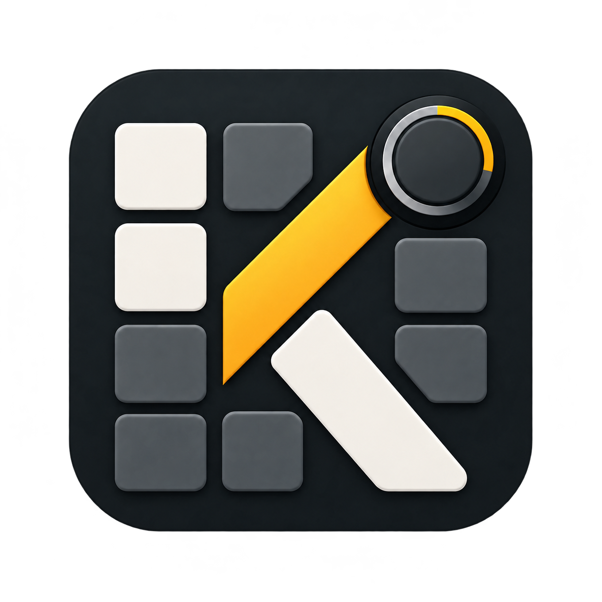

English source of truth: [AK Configurator](../../README.md).

# AK Configurator

AK Configurator адаптирует [Entropy](https://github.com/ergohaven/entropy) для проводной AK820. Сейчас готовится первая альфа для Windows — `0.1.0-alpha.1`; настроены package/CI-пути x86_64 и ARM64. Runtime-проверки выполнены на исполняемом файле x86_64; запуск ARM64 не проверялся. Пока это локальный кандидат: выпуск приложения и ссылка на загрузку не опубликованы. Linux и macOS не входят в этот этап; общее требование к выпуску для шести целей остаётся открытым.

Кандидат использует опубликованную прошивку AK820 `v0.6.0-beta.5` и десять точных профилей: Main, Game, Mmo, Typing, Code, Pointer, Onehand, Creative, Shortcuts и Multios. Проверки совместимости Beta3 сохранены, но установить Beta3 нельзя. Beta5 выбрана по умолчанию; для предварительной версии требуется явное подтверждение в настройках. Проверка оборудования и запись сохранённых настроек отключены.

В нативном приложении есть отдельно включаемый диагностический MCP-интерфейс только для чтения. Он показывает ограниченные метаданные и подготавливает локальный план установки; интерфейса записи настроек, исполнения восстановления или прошивки в нём нет. Исполняемый файл x86_64 прошёл изолированную проверку GUI и metadata-only MCP; интеграционная Windows suite, строгие lint и форматирование также прошли. Неподписанный GUI-установщик прошёл изолированные установку, переустановку той же версии и удаление. Финальный подписанный setup и пакет выпуска ожидаются.

Офлайн-примеры профилей можно просматривать и редактировать без подключения клавиатуры. Это не подтверждает полную настройку клавиатуры или физическую поддержку. Интеграционная регрессия и независимое ревью альфа-кандидата ещё не завершены. Операций с физической клавиатурой не проводили.

## Документация

- [Установка](INSTALL.md): статус кандидата для Windows, локальная сборка и проверки пакета.
- [Руководство по приложению](DESKTOP.md): элементы управления и текущие ограничения платформы и устройства.
- [Руководство MCP](MCP.md): диагностика, синтетические проверки и границы доступа.
- [Состояние проекта](STATUS.md) и [отчёт о ревью](REVIEW.md): evidence и незакрытые этапы.
- [Требования](REQUIREMENTS.md) и [план](PLAN.md): область проекта и условия поставки.
- [Изменения](CHANGELOG.md): пользовательские изменения и ограничения.

Исходный код и релизы прошивки остаются в [dvino/ak820](https://github.com/dvino/ak820). OEM ROM и данные восстановления хранятся локально. В репозитории сохранены история Entropy, уведомления об авторских правах и лицензия GPL-3.0-or-later; см. [LICENSE](../../LICENSE).
